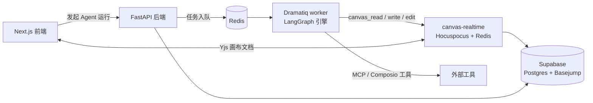

# Zmind

在一张无限画布上和 Agent 一起整理想法：Agent 读你的节点、写新节点、连线，你和 Agent 的改动实时同步；开源，可自部署。

<p align="center">
  
</p>

[线上版（Beta）](https://zmind.site) · [自部署](#自部署) · [文档](#文档) · [Apache-2.0](LICENSE)

## 实际效果

〔待补：证据物，建议内容为：生产站 https://zmind.site 上一张多节点画布加 Agent 侧栏的真实截图，或约 10 秒录屏；画面里应能看到你对 Agent 说的一句话，以及它写到画布上的节点和连线。alt 写明画面内容，放在 `docs/assets/`，每张不超过 1 MB。〕

## 状态与限制

- **状态**：v1.0.0（2026-09-08）是第一个公开版本，团队维护；只有 `main` 分支在[安全支持范围](SECURITY.md)内。移动端（`apps/mobile`）是预览版。
- **来源**：Zmind 基于一个开源 Agent 平台项目分叉并持续修改，不是从零自研。〔待核：上游项目名称、链接，以及按其许可证应保留的署名〕
- **适合谁**：能自己准备 Supabase 项目和几个 API Key 的开发者。不适合想一条命令就跑起来、不想接外部服务的人。
- **依赖**：Docker、Python 3.11+、Node.js 18+；一个 Supabase 项目；至少一个 LLM 的 Key，外加 Tavily 和 Firecrawl 的 Key（后端启动必填，见下）。
- **数据去向**：画布和账号数据存在你自己的 Supabase 项目里。Agent 运行时，对话和画布内容会发给你配置的 LLM 服务，搜索和网页抓取会发给 Tavily、Firecrawl。

## 自部署

三步：准备外部账号与 Key，运行 `python setup.py`，打开页面注册。不想自部署，用[线上版](https://zmind.site)，它目前标注为 Beta。

**1. 先准备好这些**（缺一项后端起不来）

| 项目 | 用途 | 在哪拿 |
|---|---|---|
| Supabase 项目 | 数据库与登录；需要 URL、anon key、service role key、JWT secret | supabase.com 新建项目；在控制台把 `basejump` 加进 Exposed schemas |
| LLM Key（至少一个） | Agent 调模型 | 见下方「模型」 |
| `TAVILY_API_KEY` | 搜索工具 | tavily.com |
| `FIRECRAWL_API_KEY` | 网页抓取工具 | firecrawl.dev |

`MCP_CREDENTIAL_ENCRYPTION_KEY`、`TRIGGER_WEBHOOK_SECRET` 建议设置，向导会帮你生成。其余 Key（Stripe、Composio、Langfuse、R2 等）按需再填，见 [`backend/.env.example`](backend/.env.example)。

**2. 运行向导**

```bash
git clone https://github.com/RZX00/zmind.git && cd zmind
python setup.py
```

向导是交互式的：收集上面的 Key，写出 `backend/.env` 和 `frontend/.env.local`，然后调用 Supabase CLI 推送 [`backend/supabase/migrations/`](backend/supabase/migrations) 里的迁移（需要登录你的 Supabase 账号，可跳过后手动应用）。选择 Docker Compose 方式时，最后一步会自动执行 `docker compose up -d --build`，启动 redis、backend、worker、outbox-relay、projection-worker、canvas-realtime、frontend。

**3. 打开页面**（端口取自根目录 `docker-compose.yaml`）

| 服务 | 地址 |
|---|---|
| Web 前端 | http://localhost:4200 |
| 后端健康检查 | http://localhost:18013/api/health |
| 画布实时服务 | http://localhost:6020/healthz |

在前端页面用 Supabase 认证注册账号。页面能打开、但请求后端失败时，先看下方「已知问题」第 1 条。

**模型**：默认模型是 `habitat/gpt-5.6-sol`（[`registry.py`](backend/core/ai_models/registry.py) 第 7、8 行），经 ewo 网关调用，对应 `EWO_API_KEY`（[`.env.example`](backend/.env.example) 把它列为推荐网关）。改用 Anthropic、OpenAI、Gemini、OpenRouter 等自己的 Key 时，需要同时在 `registry.py` 改默认模型。

## 第一次使用

登录后新建一张画布，放几个文本节点并选中，在侧栏对 Agent 说：

```text
把选中的节点归纳成三类，用思维导图排在它们右边，每一类连到一个主题节点。
```

按设计，Agent 会先用 `canvas_read` 读取选中的节点，再用 `canvas_write`（`layout: mindmap`，`anchor: selection.right`）写入新节点和连线；写入经 `canvas-realtime` 同步给所有打开这张画布的人。三个画布工具的参数见 [`docs/skills/canvas-as-code.md`](docs/skills/canvas-as-code.md)。

本次改写没有实跑这一步，实际画面见上方〔待补〕。

## 和聊天式 AI 助手比，差在哪

下表对比的是一种做法（回答只出现在对话里的助手），不是某个具体产品。

| | 聊天式 AI 助手 | Zmind |
|---|---|---|
| 产出放哪 | 通常是一段文字，自己复制整理 | Agent 直接写成画布上的节点和连线：文本、表格、代码或 Mermaid、待办、媒体、画布链接 |
| 读已有内容 | 通常需要你粘贴 | `canvas_read` 读整张画布、当前选中或视口内的节点，可按类型和内容过滤 |
| 改一处 | 重新生成整段 | `canvas_edit` 按节点 ID 或选择器改、删，其余节点不动 |
| 协作 | 通常各自一份对话 | 人和 Agent 的写入走同一条 Yjs 实时链路（Hocuspocus + Redis），校验 Supabase JWT |

## 能力与工作原理



| 目录 | 内容 |
|---|---|
| `frontend/` | Next.js 16、React 19、Tailwind v4；画布、对话、设置 |
| `backend/` | FastAPI 0.115、Dramatiq、LangGraph；Agent 内核、工具注册、MCP 与 Composio 集成 |
| `services/canvas-realtime/` | Hocuspocus WebSocket 服务，画布 Yjs 文档的同步与快照持久化 |
| `backend/supabase/` | 数据库迁移，含 Basejump 多租户与行级安全策略 |
| `apps/desktop/` | Electron 桌面壳，支持 `zmind://` 深链登录回调 |
| `apps/mobile/` | Expo + React Native 移动端（预览） |
| `apps/cli/`、`apps/openclaw-zmind/` | 命令行，以及 OpenClaw 插件（本次未验证，见各自 README） |

<details>
<summary>分进程本地开发（不用 Docker 跑应用服务）</summary>

Redis 仍用容器；用本机进程跑应用时，把 `backend/.env` 的 `REDIS_HOST` 改成 `localhost`。

```bash
docker compose up -d redis
cd backend && uv run uvicorn api:app --host 0.0.0.0 --port 8013 --reload          # 终端 1：后端 API
cd backend && uv run dramatiq --processes 4 --threads 4 run_agent_background       # 终端 2：worker
cd services/canvas-realtime && npm install && npm run dev                          # 终端 3：画布实时服务
cd frontend && npm install && npm run dev                                          # 终端 4：前端，http://localhost:3000
```

桌面端、移动端：`cd apps/desktop && npm install && npm start`，`cd apps/mobile && npm install && npm start`。

提交前检查：

```bash
cd backend && uv run pytest -q
cd frontend && npm run lint && npm run type-check && npm run build
```

</details>

## 已知问题

1. **Compose 的端口与向导写出的地址不一致。** `docker-compose.yaml` 把后端发布在宿主机 18013、前端发布在 4200，而 `setup.py` 写进 `frontend/.env.local` 的 `NEXT_PUBLIC_BACKEND_URL` 是 `http://localhost:8013/api`。浏览器端请求用的是这个变量，所以按 Compose 部署时需要把它改成 `http://localhost:18013/api`。〔待核：本次没有实际启动，这一条按文件内容推断〕
2. **自部署指南有一处过期。** [`docs/SELF-HOSTING.md`](docs/SELF-HOSTING.md) 把 Daytona 沙箱列为必填，但后端代码里沙箱已移除，配置类也没有 Daytona 字段；该文档的 Supabase 一节也漏了必填的 `SUPABASE_JWT_SECRET`，并把代码里可选的 `RAPID_API_KEY` 写成必填。以本 README 和 `backend/.env.example` 为准。
3. **`frontend/public/banner.png` 不存在**，但 `frontend/src/app/layout.tsx`、`metadata.ts`、`opengraph-image.tsx` 仍引用它，站点的分享卡片图会裂。

## 文档

| 想了解 | 看这里 |
|---|---|
| 自部署的完整环境变量表 | [`docs/SELF-HOSTING.md`](docs/SELF-HOSTING.md)（注意上面的已知问题 2） |
| 用 nginx 对外提供服务 | [`docs/nginx-server-example.md`](docs/nginx-server-example.md) |
| Agent 运行时架构 | [`docs/zmind-agent-architecture.md`](docs/zmind-agent-architecture.md) |
| 画布工具 `canvas_read / write / edit` | [`docs/skills/canvas-as-code.md`](docs/skills/canvas-as-code.md)、[`docs/design/canvas-as-code-spec.md`](docs/design/canvas-as-code-spec.md) |
| 画布实时服务 | [`services/canvas-realtime/README.md`](services/canvas-realtime/README.md) |
| 全局搜索 | [`docs/global-search.md`](docs/global-search.md) |
| 协作约定、Agent 约定 | [`CONTRIBUTING.md`](CONTRIBUTING.md)、[`AGENTS.md`](AGENTS.md) |

## 贡献与许可证

提交 PR 前读 [`CONTRIBUTING.md`](CONTRIBUTING.md)，每个提交用 `git commit -s` 签署 DCO。行为规范见 [`CODE_OF_CONDUCT.md`](CODE_OF_CONDUCT.md)。安全漏洞按 [`SECURITY.md`](SECURITY.md) 私下披露，不要开公开 issue。

Zmind 以 [Apache-2.0](LICENSE) 开源，可使用、修改、分发和商用。Zmind 名称和标识不在该许可之内，见[商标政策](TRADEMARK_POLICY.md)。
