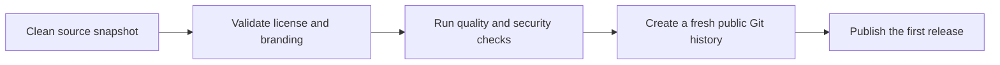

# Open-source release plan

Zmind is released under Apache License 2.0. The public repository is a clean
snapshot and does not retain the private repository's commit history.

```text
Clean snapshot
      |
      +-- Apache-2.0 licensing and contribution rules
      +-- Zmind-only names, identifiers, and database metadata
      +-- Public-safe CI and image publishing
      +-- Reproducible checks
      |
      v
Public Zmind repository
```



## Release gates

1. The source tree contains no legacy product names, private deployment paths,
   cached dependencies, credentials, or internal research artifacts.
2. The default branch is protected and CI runs without deployment credentials.
3. The release commit installs, type-checks, lints, tests, and builds from a
   clean clone.
4. The public repository starts with one signed-off root commit and a `v1.0.0`
   release tag.
