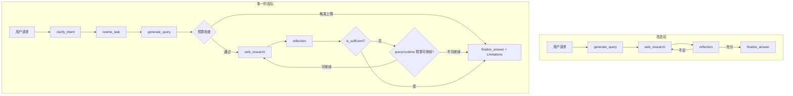
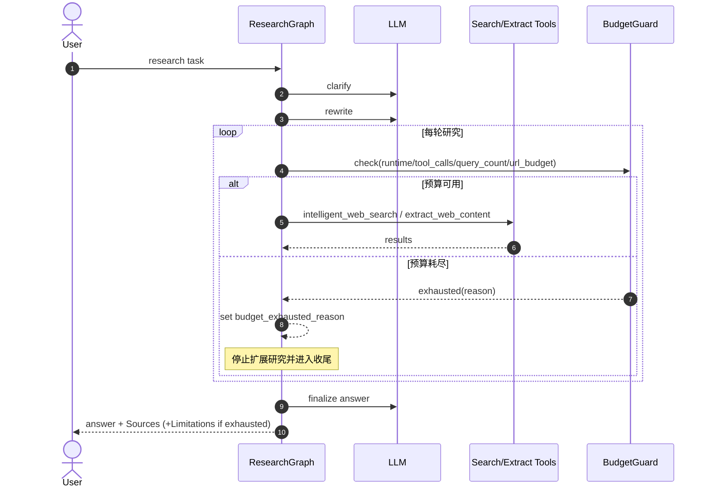
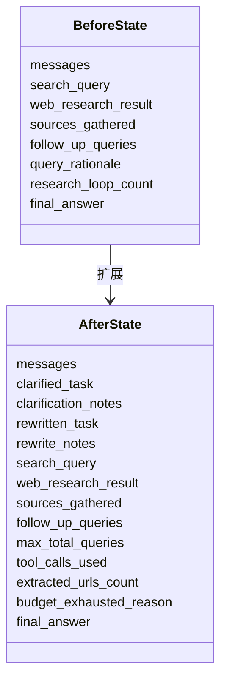
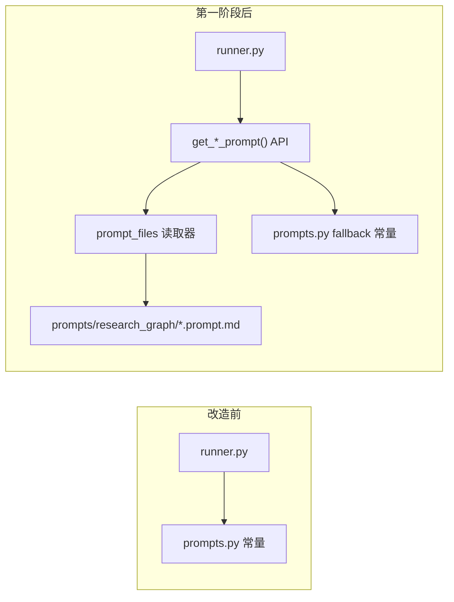
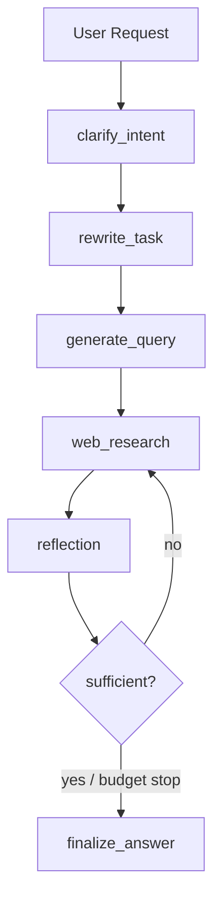
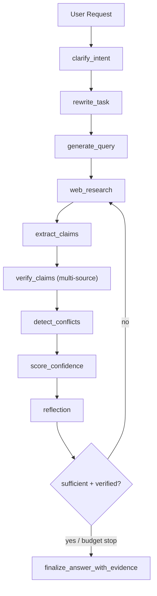
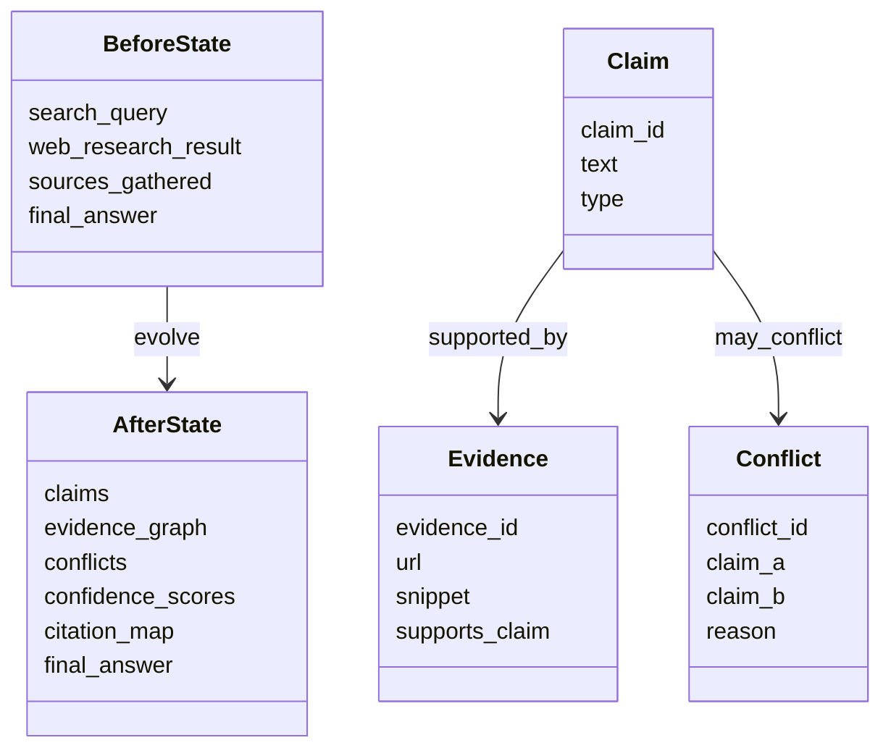
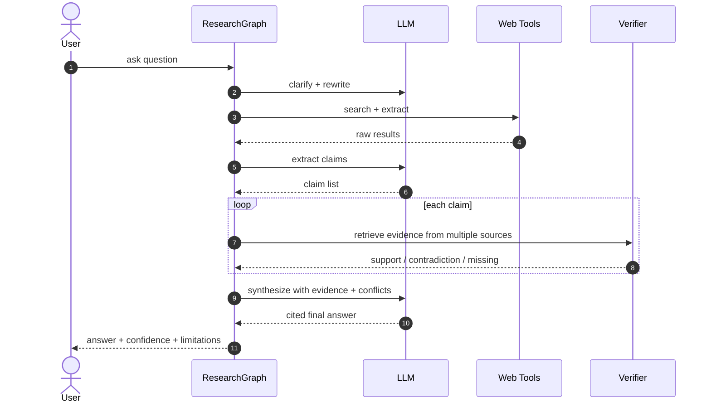
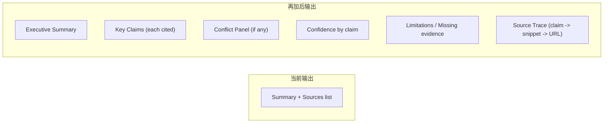

# Deep Research Agent：第一阶段前后差异（Mermaid）

本文档用于展示 Deep Research Agent 在第一阶段改造前后的关键差异，重点覆盖：
- 主流程编排差异
- 预算守卫触发时机
- 状态模型扩展
- Prompt 架构演进

---

## 1) 主流程差异

---

## 2) 执行时序差异（预算守卫）

---

## 3) 状态模型差异

---

## 4) Prompt 架构差异

---

## 5) 再加后的差异图（Phase 2 预案）

> 说明：以下图对比的是“当前第一阶段”与“继续加上第二阶段（Claim-Evidence/冲突检测/置信度）”后的变化。

### 5.1 第一阶段主流程

### 5.2 第二阶段主流程

### 5.3 数据结构差异（扁平 sources -> 证据图）

### 5.4 执行时序差异（新增验证闭环）

### 5.5 输出差异（用户可见层）

