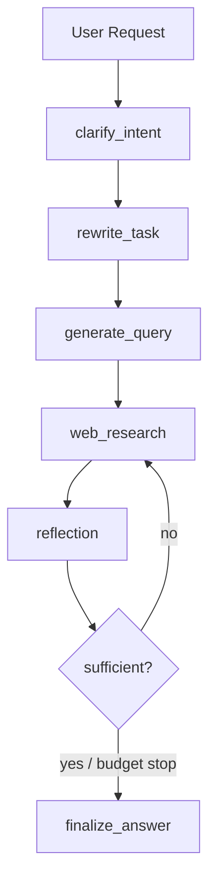
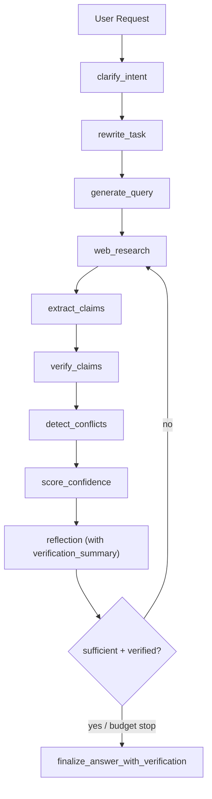

# Deep Research Agent 第二阶段完整改造方案

> 更新时间：2026-02-07  
> 目标：将当前第一阶段（多轮检索 + 预算守卫）升级为“可验证研究系统”，核心增强 `Claim -> Evidence -> Conflict -> Confidence` 闭环。

---

## 1. 目标与验收标准

### 1.1 目标
- 从“摘要驱动回答”升级为“证据驱动回答”。
- 明确每个关键结论的支持/反驳证据与可信度。
- 在预算受限时，优先保证“关键主张的可验证性”而非仅扩展检索条数。

### 1.2 验收标准（Definition of Done）
- 最终输出包含 `verification` 结构（claims/evidence/conflicts/confidence）。
- 反思节点会把“低置信/冲突主张”作为继续检索触发条件。
- Prompt 层、Schema 层、State 层、Runner 编排层全部对齐。
- 回归测试通过（当前针对性 8 项）。

---

## 2. 领域模型（DDD）

| 领域对象 | 核心字段 | 责任 |
|---|---|---|
| Claim | `claim_id`, `text`, `claim_type`, `importance` | 把问题拆成可验证命题 |
| Evidence | `evidence_id`, `claim_id`, `source_id/url`, `snippet`, `verdict` | 记录证据与命题映射 |
| Conflict | `conflict_id`, `claim_id`, `type`, `reason` | 明确证据冲突与分歧来源 |
| Confidence | `claim_id`, `score`, `level`, `rationale` | 给出每条命题置信评估 |

---

## 3. 主流程（第一阶段 vs 第二阶段）

### 3.1 第一阶段主流程

### 3.2 第二阶段主流程

---

## 4. 文件与职责映射

| 文件 | 变更类型 | 责任 |
|---|---|---|
| `backend/core/langgraph_engine/research_graph/state.py` | 扩展 | 增加 claims/evidence/conflicts/confidence 状态域 |
| `backend/core/langgraph_engine/research_graph/schemas.py` | 扩展 | 增加 Claim/Evidence/Verification JSON 结构约束 |
| `backend/core/langgraph_engine/research_graph/verification.py` | 新增 | 纯领域逻辑：归一化、冲突检测、置信度评分、摘要构建 |
| `backend/core/langgraph_engine/research_graph/prompts.py` | 扩展 | 新增 extract/verify prompt API，扩展 reflection/answer 入参 |
| `backend/core/langgraph_engine/research_graph/runner.py` | 扩展 | 新增 4 个节点并接入 phase2 编排与最终输出契约 |
| `prompts/research_graph/extract_claims.prompt.md` | 新增 | 抽取可验证主张 |
| `prompts/research_graph/verify_claims.prompt.md` | 新增 | 证据映射与命题判定 |
| `prompts/research_graph/reflection.prompt.md` | 更新 | 纳入 verification summary |
| `prompts/research_graph/answer.prompt.md` | 更新 | 允许回答阶段使用 verification JSON |
| `backend/tests/test_supervisor_research_phase1.py` | 扩展 | 覆盖 phase2 节点与 prompt 模板存在性 |
| `backend/tests/test_research_verification_phase2.py` | 新增 | 覆盖 verification 领域逻辑单测 |

---

## 5. 数据传递与输出契约

### 5.1 内部状态流
- `web_research` 产出 `web_research_result` + `sources_gathered`
- `extract_claims` 产出 `claims`
- `verify_claims` 产出 `evidence_graph` + `claim_verdicts`
- `detect_conflicts` 产出 `conflicts`
- `score_confidence` 产出 `confidence_scores` + `verification_summary`
- `reflection` 使用 `verification_summary` 决定是否继续检索

### 5.2 对外输出（兼容增强）
- 原有：`content` + `sources`
- 新增：`verification`
  - `claims`
  - `claim_verdicts`
  - `evidence_graph`
  - `conflicts`
  - `confidence_scores`
  - `verification_summary`

---

## 6. 分阶段交付（完整 Phase 2）

### Phase 2A（已落地）
- 领域对象与状态契约落地。
- ResearchGraph 增加验证闭环节点。
- 回答输出补齐 `verification`。

### Phase 2B（已落地）
- 引入“主张重要性驱动后续检索调度”（`prioritize_claims_for_follow_up`）。
- 增加跨主张逻辑冲突检测（cross-claim inconsistency）。
- 增加 citation 一致性守卫（孤儿证据、高重要主张引证不足、弱 snippet）。
- 主流程新增 `validate_citations` 节点，`verification` 输出新增 `citation_issues` 与 `citation_coverage`。

### Phase 2C（下一步）
- 前端可视化验证面板（按 claim 展开证据与置信度）。
- 质量评估基准集（golden set）与自动回归评分。
- 上线策略：灰度开关 + 置信度/冲突率监控看板。

### Phase 2C-1（已落地：发布与呈现主链路）
- Deep Research 结束后自动发布为云端知识库文档（Markdown 文件 + KB entry）。
- 同步在当前线程绑定画布自动创建“研究看板”节点组（总览 + claim 卡片 +来源预览）。
- 输出契约新增 `publication` 字段，向前端透出发布状态（published/partial/failed）。

---

## 7. 风险与防护（反脆弱）

| 风险 | 影响 | 防护策略 |
|---|---|---|
| LLM 输出结构漂移 | 节点失败 | Pydantic 校验 + 归一化兜底 |
| 证据不足 | 误判充分 | reflection 强制纳入低置信 claim 触发继续检索 |
| 冲突处理不稳定 | 结论不一致 | 显式 `conflicts` 域 + 最终回答 limitations 约束 |
| 预算耗尽 | 中途收敛质量下降 | 预算守卫 + 输出中保留验证缺口说明 |

---

## 8. 近期执行建议

1. 先在灰度流量开启 `research_phase2_enabled=true`。  
2. 观察三组指标：`low_confidence_claim_ratio` / `conflict_ratio` / `answer_citation_coverage`。  
3. 若稳定，再推进 Phase 2B（预算按命题重要性调度）。  
