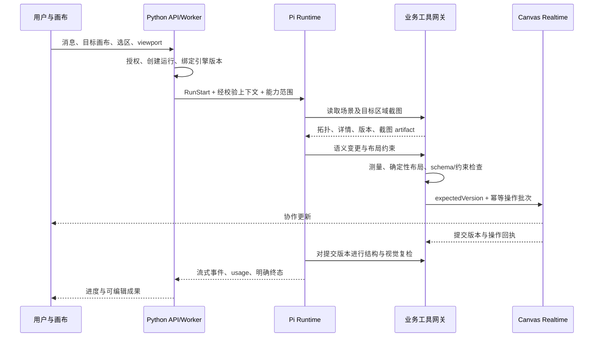

# ZMind 内置 Agent：Pi 重构方案

日期：2026-09-08

状态：Proposed；用户已选择 Pi 并允许重构，本文件提出实施边界，不表示运行时已切换。

代码基线：`2acd5343c`（`codex/remove-prompt-studio`）。本次只读检查源码，未检查生产配置、未运行性能基准。

## 1. 决策与产品目标

补充审计：见 [Agent 全功能依赖审计](2026-09-08-pi-agent-feature-impact-audit.md)。Skills、Fork/Task、Hooks、Trigger/Automation、配置版本和等待恢复都属于必迁范围；该审计修订本文 Skills 执行和阶段验收的简化描述。

普通用户直接在 ZMind 对话、选择画布元素、获得可继续编辑的结果，无需安装 CLI、配置 Agent 或理解工具协议。第一阶段建设内置 Agent；后续外部 Codex 等通过相同业务工具接口接入。

采用 **Pi 的 `pi-agent-core` + `pi-ai`** 作为执行循环与模型适配基础。Python 后端继续负责身份、账户、业务数据、计费、任务调度和工具授权；新增 Node 服务运行 Pi。不在现有 V2 Kernel / LangGraph 内再嵌套 Pi。

明确边界：复用 harness 不等于获得画布理解能力。语义场景、截图、布局约束、原子写入和媒体任务是 ZMind 必须拥有的业务能力。保留现有前端形态，本方案不增加多 Agent 编排器、通用插件平台或用户侧配置流程。

## 2. 当前实现与证据

```text
前端对话
  -> FastAPI agent_runs：鉴权、计费检查、创建 run
  -> Dramatiq run_agent_background
  -> AgentRuntimeKernelV2：上下文、意图、lane、连续性
       +-> canvas lane：规则 planner -> 编译 -> 执行 -> 验证/修复
       +-> general lane：LangGraph -> 模型/工具循环
  -> V2 / legacy 事件转换 -> 持久化、Redis -> SSE -> 前端

画布修改 -> CanvasWriteService -> canvas-realtime -> Y.Doc / 持久化
截图工具 -> 浏览器 DOM capture -> 用户预览/下载（未见 Agent 回传闭环）
```

| 已确认的代码事实 | 影响与判断 |
| --- | --- |
| `backend/core/agent_runs.py` 创建运行并调度；`backend/run_agent_background.py` 组装 V2 Kernel、注册工具、转换事件、推送 Redis | 入口及任务基础设施可保留，运行器和事件职责需要拆开 |
| `backend/core/agent_runtime_v2/lane_selector.py` 根据开关和 pending plan 分流；`backend/core/utils/config.py` 中 `CANVAS_AGENTIC_LANE_ENABLED` 默认关闭 | 同类画布请求可能走不同机制；实际部署启用值未核实 |
| `backend/core/agent_runtime_v2/kernel.py` 的 canvas 分支先 `await execute()` 得到事件集合，再逐条发出 | 这条路径并非执行过程中持续反馈；不能据此断言所有运行都不流式 |
| `backend/core/application/services/canvas_native_planner_service.py` 使用关键词、正则和数量限制做计划 | 可保留确定性工具逻辑，不能继续承担开放式语义理解 |
| `canvas_native_context_resolver_service.py` 无选区时取前 24 个节点作为 focus | 这条路径存在默认关注范围偏差；不代表完整快照只有 24 个节点 |
| `backend/core/canvas/read_projection.py` 已提供完整拓扑、分级详情和 token 预算，full 默认上限 50 | 应统一复用这套读取能力，补齐分页及省略标记；不另造完全独立的场景系统 |
| `frontend/src/canvas/application/screenshot/capture-canvas.usecase.ts` 与基础截图模块已存在 | 目前偏截图产品功能，需增加 Agent 请求、版本关联、回传与复检 |
| `backend/core/tools/canvas_generate_image_tool.py` 等待生成后才加节点；节点采用 `60 * idx` 的对角坐标 | 生成和写入绑定，位置没有基于当前画布规划 |
| `backend/core/media/generation_service.py` 按 quantity 顺序生成和上传 | 多图任务存在明确串行链路；是否是最大耗时需基准测量 |
| `backend/core/langgraph_engine/persistence/event_persister.py` 与 billing guard 相连 | 切换执行器时必须抽出计费链路，不能只让新事件绕过旧持久化 |

这些是源码观察，不是对线上问题完成复现后的性能归因。还需测量排队、bootstrap、首个有效工具结果、模型调用、图片供应商、上传、画布提交和前端可见各阶段耗时。

## 3. 目标架构与数据传递

```text
ZMind Chat / Canvas
  | 请求、选区、viewport               ^ SSE / 画布协作更新
  v                                  |
Python API + 既有 worker（运行控制、账户、计费、租约）
  | RunStart / cancel                 ^ 规范事件、usage、终态
  v                                  |
Node agent-runtime：Pi core + pi-ai
  | 模型调用                           | 有权限边界的业务工具调用
  v                                  v
既有模型策略/供应商适配             Python 工具网关
                                     +-> 场景读取 / 版本快照
                                     +-> 截图服务 / 浏览器捕获
                                     +-> 布局计算 / 校验
                                     +-> CanvasWriteService -> realtime -> Y.Doc
                                     +-> 媒体任务 -> 存储 -> 节点完成更新

未来外部 Agent -> MCP / CLI 适配 -> 同一个工具网关
```



### 3.1 Pi 服务边界

- 新增 `services/agent-runtime/`，使用锁定版本的 Pi 依赖。上游当前为 `earendil-works/pi`；实施时核实正式发行版及 Node 要求，不使用浮动 main 作为生产依赖。
- 使用 core 的执行循环、工具事件、取消和上下文转换。会话以 ZMind 的已提交消息/工具回执为准；不同时维护 V2、LangGraph 和 Pi 三份权威历史。
- core 不自动提供完整产品会话管理、Skills 市场或持久化压缩。由薄适配层重建消息、按预算压缩旧内容、保留用户约束和当前工具状态；复用现有租户 Skills 读取。不默认加载宿主机 `~/.pi`、`~/.claude`、shell 工具或扩展代码。
- Python worker 保留队列、运行租约与停止控制，替换“构造 Kernel”部分为 Pi 客户端。Pi 服务不可公开暴露，也不接收模型自行声明的 account_id 作为授权依据。
- 模型选择仍来自 ZMind 的模型策略。对现有 gateway、凭证、图片输入、usage 和取消进行适配验证；若复用 HTTP 模型网关，它只承担供应商转发，不能再次进入旧 Agent 循环。

### 3.2 内部协议与状态归属

`RunStart` 包含 protocolVersion、runId、threadId、engineVersion、模型策略引用、目标 workspace/canvas、选区、预算、上下文游标和经服务器签发的能力范围。身份由服务凭证及服务端记录确定，不信任模型工具参数。

运行事件至少包含 runId、eventId、单调 sequence、attempt、类型和 payload。类型覆盖 assistant delta、tool start/result、artifact、usage、状态变化及错误。SSE 是交付通道，不是唯一运行记录；消息和工具完成事件必须有持久化回执，文本 delta 可以合并发送，避免逐 token SQL 写入。

每个 run 固定 engineVersion；同一会话的写运行串行，租约带 fencing token 防止旧 worker 继续写。画布写入仍使用版本校验，因为不同会话和真人也能同时编辑。失去租约、取消或预算耗尽后禁止发起新写入。

终态不能由“事件循环结束”推定成功。需区分 completed、waiting_for_jobs、cancelled、failed、partial，并统一映射当前 UI 能表达的状态；只有成果已提交且必要验证通过才报完成。重启时从回执恢复，未知外部调用先查询，禁止盲目重复副作用。

采用至少一次任务投递 + 幂等工具提交、媒体作业和扣费，不宣称跨模型、供应商、数据库实现 exactly once。供应商不支持幂等请求时必须记录不确定状态，不能靠重试隐藏问题。

### 3.3 计费与模型约束

将 `BillingGuard` 中与 LangGraph 无关的结算能力抽成共享服务，保留 `deduct_credits_idempotent` 与账务约束。Pi usage 规范化必须包含模型身份、调用 ID、输入/输出/cache 等可用字段，并按现有定价策略处理。取消、重试、失败和媒体部分成功都要验证实际账单行为。

每次模型调用先记录稳定调用标识；旧事件适配和新事件适配不能各扣一次钱。Pi 内置成本估算不得替代产品账本。未知 usage 的处理遵循现有业务政策，并明确记录，不能默认为零或凭估算宣称已结算。

## 4. 把画布能力做完整

### 4.1 场景读取：完整结构 + 按需细节

统一复用 `read_projection.py`，让内置和外部 Agent 都使用相同视图：

1. 首次获取全局拓扑、节点类型数量、选区、viewport、边界、版本与明确的省略信息。
2. 按选择、区域、分组、节点 ID 读取内容详情和布局关系；大画布分页或区域展开，不能默认为前 24 个节点代表整张画布。
3. 包含真实尺寸/估计尺寸标识、锁定状态、分组、连线、mindmap、表格、资源引用及渲染状态。
4. text、code、column、table、canvas-link、todo、media、group 全部可读。写入能力逐类型列矩阵；不支持的变更返回明确结果，不降级为普通文本节点。

合同以现有 canvas types、CaC 和 realtime 操作格式为基础。共享 schema 只统一边界校验和生成类型，不另建一份画布数据库或平行节点模型。

### 4.2 截图：读取和验证都能用

复用 DOM capture、字体/资源就绪检测与文本测量。Agent 捕获返回：canvasId、snapshotVersion、viewport/camera、worldBounds、pixelScale、节点对应关系、rendererVersion、就绪诊断和有权限的 artifact 引用。

- 有活跃画布时，向浏览器请求目标区域截图；浏览器需先完成协作同步并确认目标画布和版本。导航切换、局部未同步变更或版本漂移时重取，不能把截图和另一份快照强行配对。
- 浏览器不在线或需要完整区域时，用相同画布组件的授权 headless 渲染入口。截图 worker 只接任务绑定资源，不允许模型提供任意抓取 URL；不用 service-role 凭证暴露到页面。
- 使用全局缩略图与区域分块，明确覆盖范围；不把 viewport 截图称为全画布。
- 不沿用面向分享截图的固定 16:9 裁剪。生成后等待目标提交版本渲染完成，再对目标区域截图复检；缺图/字体未就绪需标记降级。
- 视觉模型负责发现遮挡、截断、层级异常等；结构校验仍由代码执行。更换 harness 本身不赋予模型视觉能力，需要选择已验证支持图片输入的模型。

### 4.3 写入与布局：模型表达意图，代码决定合法结果

模型提交节点内容、相对关系、目标区域和布局意图；优先交由现有 layout service 计算坐标。结合前端真实文本测量、图片尺寸和固定节点约束，输出一批可验证操作。

复用 native layout/executor/verifier 与 CaC/write service 的有效部分，移除关键词 planner 对语义决策的控制。需要补齐：尺寸稳定、锁定节点、组内坐标、边连接、mindmap/table 特殊语义、碰撞策略、批量提交以及局部修复范围。

每次写入：schema 校验 -> 业务不变量校验 -> 布局 -> expectedVersion -> 幂等提交 -> 结构复检 -> 必要的截图复检。版本冲突先重新读取及重算，不能覆盖他人编辑。修复有次数与区域边界，不能为了摆正新节点重排无关区域。

延续现有风险预览、确认 token 和版本绑定，不用 prompt 绕过；普通低风险操作按现有授权直接执行。Pi 工具声明将有副作用的画布操作设为串行，独立读取和媒体启动可并行；网关仍需兜底并发约束。

### 4.4 图片：任务化、有限并发、逐个落地

拆开“生成图片并立即编辑画布”的旧工具，改成提交持久化媒体任务与读取结果。复用 `core/media` 的供应商适配、上传和现有队列基础设施，先核实可复用作业设施，再补必要数据结构。

支持 quantity 的有限并发，按供应商限流与账户额度调度；记录 jobId、providerRequestId、运行归属、结果和重试状态。禁止用模型不断轮询耗 token。后台完成回调或恢复运行驱动后续工作。

建议交互：先在合理位置预留结果区域，逐张完成、逐张可用，失败项单独重试。预留位置使用布局服务，不再使用 `60 * idx` 的对角坐标。该交互属于建议，实施前随具体 UI 方案确认。

无论采用预留节点还是结果到达后插入，都必须：避免重试产生重复节点；用户移动/删除后不复原覆盖；使用实际尺寸时只调整允许的局部范围；取消后不继续新增成果。已向供应商提交且无法取消的任务需按真实结果记录成本，不伪装取消成功。

## 5. 文件级调整

以下“新增”是建议路径；实施时遵循附近模块惯例。删除必须以调用引用、灰度和历史运行排空为前提。

| 文件/目录 | 处理 | 职责 |
| --- | --- | --- |
| `backend/core/agent_runs.py` | 保留并收薄 | API、鉴权、额度、创建/停止/订阅运行 |
| `backend/run_agent_background.py` | 重构 | 调度、租约、Pi transport、终态；移出动态多引擎组装 |
| `services/agent-runtime/` | 新增 | Pi loop、模型适配、上下文编排、工具客户端、流式事件 |
| `backend/core/agent_execution/` | 新增薄模块 | 内部协议、Pi 客户端、事件归一、恢复记录；不再建复杂 kernel |
| `backend/core/runtime_tools/` | 新增/抽取 | 经过业务授权的场景、布局、媒体等工具入口；供 Pi 与未来 Bridge 共用；避开现有 `agent_tools.py` 模块同名冲突 |
| `backend/core/canvas/read_projection.py` | 保留扩充 | 唯一的 Agent 场景投影、预算、按需展开 |
| `backend/core/canvas/cac/` | 保留并解耦 | 操作合同与领域执行；移除对旧运行上下文的硬绑定 |
| `backend/core/canvas/write_service.py` | 保留 | 通往 realtime 的唯一受控写入口 |
| `backend/core/application/services/canvas_native_*` | 分拆 | 保留 layout/executor/verifier 等有效能力；退休语义规则 planner；统一读取 |
| `backend/core/tools/canvas_edit_tool.py` | 抽取适配 | 复用编辑领域能力，身份来自已认证调用上下文 |
| `backend/core/tools/canvas_generate_image_tool.py` | 替换组合逻辑 | 改接媒体任务，取消硬编码放置和阻塞等待全部图片 |
| `backend/core/media/generation_service.py` | 重构 | 可恢复媒体执行、限流并发、结果与上传；保留供应商适配 |
| `frontend/src/canvas/application/screenshot/` | 扩充 | Agent 捕获请求、版本/坐标绑定、artifact 回传 |
| `frontend/src/canvas/infrastructure/screenshot/` | 保留扩充 | DOM 捕获、就绪诊断、供 live/headless 共同使用 |
| `frontend/src/canvas/domain/text-layout/` | 保留复用 | 渲染测量与布局反馈 |
| `services/canvas-realtime/` | 保留、补必要合同 | 协作权威写入、版本校验、幂等回执；不在 Pi 中复制 Y.Doc |
| `backend/core/skills/registry.py`、`marketplace_api.py` | 保留业务层、改运行装载 | 租户 Skills 内容、启用状态、来源；区分指令资源与可执行 hooks |
| `backend/core/langgraph_engine/billing/billing_guard.py` | 抽出通用部分 | 引擎无关的 usage 结算与去重 |
| `backend/core/langgraph_engine/persistence/event_persister.py` | 解耦/逐步退休适配 | 业务消息和计费不再依附 LangGraph 事件 |
| `backend/core/agent_runtime_v2/` | 迁移后退休被替代链路 | kernel、lane、重复 context/continuity、legacy projection |
| `backend/core/langgraph_engine/` | 按实际依赖逐步退出 | 内置主路径停止使用；其他专用任务未迁移前不整目录删除 |

前端对话事件消费保持产品行为，迁移期在服务端边缘做一次 legacy 映射。需要沿当前订阅 hook 定位消费者后更新，不制造 Pi -> V2 -> LangGraph -> legacy 的新转换链。

## 6. Skills 与未来外部 Agent

Skills 的内容层是可审计、按租户启用的操作说明与资源，通过摘要发现、按需读取进入上下文。执行层还必须迁移现有 run_skill、隔离 fork、task_run_id 恢复、工具限制、模型覆盖及 Hooks；见补充审计的逐项合同。普通指令型技能优先同会话激活，需要隔离的技能使用统一 Pi 子运行，不隐藏启动旧 LangGraph。不要把所有 Skill 全文塞到 system prompt；不将市场导入内容自动变成服务器 shell hooks 或 Pi 扩展。

外部 Agent 第二阶段通过 MCP/CLI 暴露同一工具网关。Bridge 负责授权、能力发现、目标选择和事件交付；外部 Agent 自己拥有循环。内置 Pi 不成为外部 Codex 的必经中间执行器。本轮不为了未来兼容做完整多 harness 管理平台。

## 7. 迁移步骤与验收

| 阶段 | 交付 | 通过条件 |
| --- | --- | --- |
| A：基线与合同 | 固定场景集、链路计时、节点能力矩阵、事件/工具合同 | 能区分排队、编排、模型、媒体、提交和渲染时间；明确生产 lane 和依赖 |
| B：抽出业务工具 | 场景投影、授权、布局/写入、账务与事件独立接口 | 旧引擎仍可调用；跨账户隔离、版本冲突、重复提交、扣费去重通过 |
| C：Pi 垂直链路 | 对话 -> 读画布 -> 编辑 -> SSE -> 持久化 -> 结算 | 单一循环可取消、断线重连、恢复；与既有任务状态一致；不绕过模型策略 |
| D：视觉与布局 | live/headless 截图、尺寸、语义操作与局部复检 | 全部现有节点类型可读；截图与版本一致；锁定/分组/边等不变量通过 |
| E：媒体与 Skills | 可恢复媒体任务、并发、逐项结果、租户 Skills | 部分失败、重复回调、取消、用户移动/删除、费用记录通过 |
| F：灰度与收敛 | 完整任务覆盖、按 run 绑定引擎、移除旧主路径 | 历史运行及待确认计划排空；监控稳定；无残留调用后删除旧分支 |

阶段 C 只是集成验证，不是最终交付范围。正式切换前覆盖当前支持的会话、文档、媒体、Skills 和专用任务；暂未迁移的专用任务明确保留独立入口，不能悄悄损失能力。

以固定模型/参数、固定画布快照及稳定供应商条件对比。建议场景集至少包括：大画布、八类节点混合、选区编辑、mindmap、table、锁定分组、中文长文本、并发真人编辑、多图部分失败、浏览器离线、截图资源未就绪、取消和恢复。每个开放式任务重复执行，分别记录结构合法率、视觉通过率、用户目标达成率和 p50/p95。

硬验收：零越权、零重复扣费、零重复提交产生的重复节点；不修改明确禁止的节点；不把失败/待处理伪报成功。性能目标在基线建立后设定，不能现在承诺 Pi 会把供应商生图时间缩短多少。

## 8. 灰度、回退与风险

- 创建 run 时固定执行器版本。存量任务与 pending confirmation 按原执行器完成；不能中途换引擎重放写工具。
- 灰度按内部账户/租户放量；可影子比较只读规划，禁止两个执行器同时落图、扣费或调用付费媒体。
- 回退影响新运行；已经产生副作用的 Pi 运行使用其回执恢复或明确结束，不能自动从头交给旧引擎。
- 主要代价是新增 Node 服务、跨服务故障面、core 的会话/压缩适配和 headless 渲染成本。复用现有队列、存储、身份和实时协作，不再引入新的工作流框架。
- 主要未知：生产配置与性能分布、当前模型网关多模态兼容、Pi 版本升级稳定性、既有特殊任务依赖、服务器渲染字体/资源一致性。通过 A/C/D 的原型和基准关闭这些未知。

## 9. 替代方案与决策后果

1. **仅替换 LangGraph 为 Pi**：改动较小，但保留分叉、规则 planner、截图断层和图片布局问题，不满足本次目标。
2. **直接嵌入 Pi coding-agent SDK**：可复用更多会话、压缩、资源装载能力；需要处理默认文件系统会话/资源和 coding 工具与 SaaS 的冲突。当前选 core，以现有业务会话和 Skills 为权威；若核心会话适配显著超出预期，评估 SDK 的受控 ResourceLoader/SessionManager，仍不得双重保存权威状态。
3. **整体重写后端为 TypeScript**：能够同语言嵌入，但鉴权、账务、媒体和数据迁移成本没有必要。本方案保留 Python 业务边界。

该方案替代 `2026-06-26-agent-refactor-architecture.md` 中“保留薄 LangGraph 主循环”的建议；其他有效领域拆分思路可以复用，历史文档不代表当前上线状态。

## 10. 参考

- [Pi Agent Core](https://github.com/earendil-works/pi/blob/main/packages/agent/README.md)：循环、事件、上下文转换及工具执行边界。
- [Pi AI](https://github.com/earendil-works/pi/blob/main/packages/ai/README.md)：模型适配基础；具体网关兼容以接入验证为准。
- [Pi SDK](https://github.com/earendil-works/pi/blob/main/packages/coding-agent/docs/sdk.md)：更高层会话和资源管理的替代方案。
- 历史设计：`docs/design/2026-06-26-agent-refactor-architecture.md`。

本文件是架构提案，不含运行时改动。本次文档校验不能代替上述集成、行为和性能验收。
