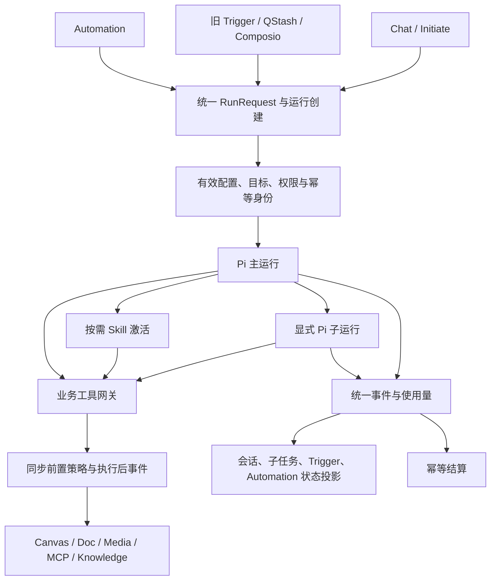

# Pi 迁移：Agent 全功能依赖审计

日期：2026-09-08。状态：源码审计与架构补充，未修改功能、未验证生产运行。基于 `91537c603`，补充同日 Pi 架构方案。

## 1. 审计结论与范围

Pi 迁移不能只覆盖聊天和画布。当前 Agent 包含 Skills 运行、Hooks、子任务、Trigger、Automation、配置版本、外部工具、知识附件、人工确认、恢复、计费和结果发布。多个工具内部会创建旧引擎，多个启动入口自行组装不同上下文。

本次检查相关入口、执行器调用点、配置读取、事件消费者、前端引用及已有测试内容。以下区分：源码已确认、检索未发现接线、需运行验证。没有使用历史审计文档里的“已完成”代替当前证据，也没有将声明字段等同于完整产品能力。

```text
入口
  聊天 start / initiate       Trigger + QStash / Composio       Automation
         \                            |                         /
          +-------------------- worker -----------------------+
                                  |
                         V2 / LangGraph 主执行器
                                  |
           +----------------------+----------------------+
           |                      |                      |
       run_skill               task / transfer       业务工具 / MCP
       新 LangGraph            新 LangGraph          Canvas / Doc / Media
       或 fork                 或 Research Graph
           |                      |
     checkpoint / hooks      task session / 子任务事件 / usage
           +----------------------+----------------------+
                                  |
                  消息持久化 / 计费 / SSE / 成果发布
```

## 2. 功能与文件责任矩阵

| 功能 | 主要实现 | 当前链路与 Pi 影响 |
| --- | --- | --- |
| 技能市场与导入 | `backend/core/skills/marketplace_api.py`、`backend/core/services/skills_import.py`、`skills_compatibility.py`、`skillsmp_client.py`；`frontend/src/components/skills-marketplace/`、`frontend/src/lib/api/skills-marketplace.ts` | 搜索、GitHub/Markdown 导入、安装及启停；保留业务接口，兼容报告需对应 Pi 实际能力 |
| 技能发现与覆盖 | `backend/core/skills/registry.py`、`types.py` | builtin、宿主文件、账户 user_skills；同名 user > file > builtin；运行需固定来源/版本，防止恢复时换内容 |
| 自动选择 Skills | `backend/core/skills/matcher.py`、`orchestrator.py`、`backend/run_agent_background.py` | 启发式匹配和路由提示，orchestrator 依赖 supervisor 的 RouteHint；移出旧引擎，并保持显式选择优先 |
| Skills 执行 | `backend/core/tools/skills_tool.py` | list/install/run；run 创建 LangGraph、检查点、独立 usage；不能作为不透明旧工具直接挂到 Pi |
| Fork | `backend/core/skills/fork_context.py` | 独立 ID、MemoryCheckpointStore、LangGraph、readonly 策略；迁移隔离语义和父子关系 |
| 生命周期 Hooks | `backend/core/skills/hooks.py` | PreToolUse/PostToolUse/Stop，command/prompt 类型及 once；实际支持程度见后文 |
| 通用子任务 | `backend/core/tools/task_tool.py`、`backend/core/langgraph_engine/supervisor/subagent_runner.py` | task_run_id、agent_task_sessions、检查点、子任务事件转发、独立计费；需要统一 Pi 子运行 |
| 专用 Agent | `backend/core/langgraph_engine/supervisor/agent_defs.py`、`research_graph/`、`backend/core/presentation/render_tool.py`、`backend/core/tools/doc_agent_tool.py` | 研究、演示、文档并非普通一条 prompt；保留计划确认、领域执行与成果发布合同 |
| Agent 配置与版本 | `backend/core/agent_crud.py`、`agent_service.py`、`config_helper.py`、`versioning/`、`zmind_config.py`；`frontend/src/components/agents/` | 模型、system prompt、native/MCP 工具、版本及中央默认配置；迁移运行配置快照，不能只记录 agent_id |
| 旧 Trigger | `backend/core/triggers/api.py`、`trigger_service.py`、`provider_service.py`、`execution_service.py`、`scheduling/` | agent_triggers CRUD、QStash 注册/删除、签名、执行、历史；当前触发器页面和 Composio webhook 使用此链路 |
| 新 Automation | `backend/core/automation/api.py`、`background_jobs.py`、`schedule_utils.py`；`application/use_cases/automation/`、`infrastructure/automation/` | automations/provider_events/automation_runs/attempts、去重、重试/死信；存在但不能当作旧链路已被替代 |
| 外部连接与 MCP | `backend/core/mcp_module/`、`core/tools/utils/mcp_*`、`core/credentials*`、`core/composio_integration/`、`core/pipedream/` | HTTP/SSE/stdio、凭证配置、enabled_tools、连接发现；保留授权与工具 schema，Pi 不直接获得全部凭证和工具 |
| 知识库与附件 | `backend/core/tools/knowledge_base_tools.py`、`core/knowledge_base/`、`core/langgraph_engine/nodes/load_context.py`、`core/tools/image_context_manager.py`；`frontend/src/components/thread/chat-input/knowledge-base-picker.tsx` | 文件选择/导入、内容读取、消息附件展开、图片上下文；上下文构造迁移不能遗漏链接与账户授权 |
| 上下文与恢复 | `backend/core/langgraph_engine/checkpoint_store.py`、`context_manager.py`、`core/agent_runtime_v2/continuity.py` | 主会话、子任务检查点、压缩及 pending 状态；不能直接把旧 checkpoint JSON 传给 Pi |
| 人工交互与确认 | `backend/core/tools/message_tool.py`、`core/langgraph_engine/nodes/execute_tools.py`；`frontend/src/hooks/react-query/threads/use-messages.ts`、`frontend/src/lib/api.ts` | ask/CTA/complete、cta_action/payload 与终止规则；迁移为明确等待/完成事件与可恢复确认 |
| 启动、停止与故障回收 | `backend/core/agent_runs.py`、`run_agent_background.py`、`agent_reaper.py` | 两个人工启动入口、队列、STOP、heartbeat、SSE Last-Event-ID；Pi 服务和等待媒体任务须纳入同一租约模型 |
| 账务、消息与业务事件 | `backend/core/langgraph_engine/persistence/`、`billing/`、`backend/core/application/event_bus.py` | 主/子运行扣费、消息、Redis 与 outbox；记录业务事件不等于通知送达，不应宣称现有完成通知已闭环 |
| Playbooks / Workflow | `frontend/src/components/agents/playbooks/agent-playbooks-configuration.tsx`、`config_helper.py`、Automation route_type | UI 组件 return null；Automation 接受 workflow 类型但执行器拒绝非 agent。属于占位/部分能力，不列作已完成 workflow 引擎 |

## 3. Skills：必须修订上一版方案的范围

上一版把 Skills 概括为说明资源不足以覆盖现有行为。应明确两种执行语义：

- 普通指令型 Skill：同一 Pi 会话按需激活，保留身份、目标画布和用户约束，不无条件增加子模型循环。
- 显式隔离型或需要独立模型/可恢复任务的 Skill：由统一子运行服务启动 Pi 子运行，保留 parentRunId、skill snapshot、taskRunId、权限、预算、取消和结果回执。不能把 fork 静默改成同会话，也不能让它继续私下启动 LangGraph。

现有普通 run_skill 也启动子引擎。迁移需逐个盘点实际安装技能及调用方依赖，兼容 task_run_id、output_mode 和结构化返回；是否转同会话由技能执行语义决定，不盲目批量切换。

### 源码已确认的兼容点与缺口

1. `SkillsTool.run_skill` 直接构造 `LangGraphEngine`，非 fork 分支最大迭代数来自 AgentDef，当前设置为 4；默认 prompt 即使未声明 schema 也要求 JSON。fork 则迭代上限 50、内存检查点、独立模型、readonly。两种模式不能简单等同。
2. output_schema 当前只检查必填键和顶层类型；失败会写 validation 信息但仍返回 success。应明确哪些技能需要强结构合同，避免把现状描述为严格 schema 执行器。
3. `allowed_tools` 为空时会使用 native catalog 默认集合，而非“零权限”；普通技能的 MCP wildcard 可扩为 mcp__ 前缀。新策略必须是账户授权 ∩ Agent 配置 ∩ 当前运行能力 ∩ Skill 限制，不能因为迁移丢掉父级限制。
4. `marketplace_api.py` 将 enabled 映射到 user_invocable，registry 也用 user_invocable 筛选默认可用技能。启用、用户可调用、模型可自动调用目前存在语义混用；需要分字段规范及兼容迁移，不单纯复制字段名称。
5. hook command 对 user 来源默认 deny，file/builtin/None 被视为 trusted；执行时使用宿主 shell 环境。保留明确受信任能力的同时，新运行器不能把导入技能自动提升为宿主执行权限。
6. `_execute_prompt_hook` 明确返回 unsupported，按配置 skip 或 deny；不实际调用模型。头部“完整实现”注释不能作为功能证据。
7. `execute_stop` 已定义，但本次在 backend/core 检索仅发现定义，未找到执行路径调用。迁移必须接到实际取消/终止生命周期，并明确不同 Stop 场景。
8. PreToolUse 在 run_skill 外层等待 `event.type == tool_call`；核查旧执行节点发现实际发出 tool_started 状态并执行工具，未找到对应独立 tool_call 事件发射接线。当前阻断能力不能据此认定有效，需阻止真实副作用的行为测试。Pi 接口适配应在工具执行前同步决策，不监听事后 UI 事件实现拦截。
9. once 状态是全局 HookExecutor 的进程内集合，重启/多 worker 不共享。需要按账户、会话、技能版本、hook ID 定义持久幂等作用域。
10. 自动匹配位于 worker 的路由逻辑，并依赖旧 RouteHint。显式用户调用、模型推荐和自动运行应记录 invocationSource，分别校验，而非统一被 disable_model_invocation 拦截后无法区分意图。

以上是源码行为/接线疑点，未运行攻击测试、Hooks 集成或实际租户技能回归。

## 4. Trigger：两条链路不能一起盲迁

```text
当前可见页面
  triggers-page -> useAllTriggers -> /triggers/all -> agent_triggers
                                                      |
  QStash -> /triggers/{id}/webhook ---------------------+
  Composio -> /composio/webhook -> 按远端 trigger ID 匹配 +
                                                      |
                                    ExecutionService -> AgentRun -> worker

另一套设施
  /automations -> automations -> automation_runs/attempts -> worker
  provider_events -> dispatch_provider_event ----------+
  用户范围 schedule/tick -> dispatch_scheduled --------+
```

已确认：两套 API 都在 `backend/api.py` 注册。现有触发器页面消费旧 hooks；本次 frontend/src 引用检索未找到新 use-automations hooks 的业务消费者。Composio webhook 直接遍历 agent_triggers 并调用旧 ExecutionService。新 IngestProviderEventUseCase / dispatch_provider_event.send 在本次生产源码范围未找到入口接线，不能声称新事件链路已投入使用。schedule/tick 是用户 JWT 限定账户的手动 tick；未验证线上是否有外部周期调用者。

关键问题：

- 新 Automation 在 `_start_agent_run_for_automation` 返回 run ID 后，将 attempt 和 automation run 标记 completed；此时 Agent 仅入队。重试也围绕“启动异常”，没有在这段代码中跟踪实际 Agent 执行失败。新系统必须区分 dispatch_status 和 execution_status，并汇总真实终态。
- 新后台明确拒绝 `route_type != agent`；不能因为请求类型允许 workflow 就承诺工作流可运行。
- 两条后台路径都先创建新的 project/thread/message，再进行 AgentRun 去重；重投时前置副作用存在重复创建窗口。应先确立稳定触发执行身份，再原子关联或可恢复创建资源，并返回原始关联 thread ID。
- 两条后台路径都调用 `extract_agent_config(agent_row, None)`；该 helper 在自定义 Agent 无版本数据时会退回默认 prompt/tools/MCP。需统一加载有效版本快照，并对人工与自动启动做配置等价测试。
- 两条后台启动都未传人工画布入口使用的 workspace_target/selection_context；自动任务不会自然继承用户当前页面。必须在自动化定义中明确目标画布/文档，存持久 ID 并重新授权；无需浏览器在线。
- 旧 Trigger 执行历史查询 agent_runs.metadata.trigger_id；新 Automation 查询独立 runs。迁移需保留来源 ID、历史映射、schedule ID、远端绑定和时区，不能删除旧记录后重新注册造成双触发。
- Webhook 验签、provider binding、事件去重、排队投递和结果回写必须一起验收；HTTP 200 或“executed 数量”本身不能证明任务成功。

建议先将旧 Trigger 和 Automation 的启动适配到同一个 RunRequest 服务，维持现有触发器页面与远端注册。之后单独完成数据/调度收敛，明确唯一调度所有者；不得在 Pi 切换时同时全量新注册 QStash 和启用本地 tick。

## 5. 其他必须纳入的迁移合同

### 子任务与专用任务

`task_tool.py`、`skills_tool.py`、`fork_context.py`、`supervisor/subagent_runner.py` 都有旧引擎创建点。保留业务能力不等于保留这些循环。统一父子运行生命周期、能力交集、模型策略、预算和 usage；父任务取消需传播，子任务失败/待确认不能包装成父成功。

Research Graph 还包含确认后的查询流程及知识库/画布发布；Presentation 定义包含大纲确认和 render_presentation；Doc 编辑有独立上下文和冲突处理。逐项抽出领域服务，再替换编排，不能直接删除 langgraph_engine 整个目录。专用模板、渲染和发布不强行改成模型自由生成。

### 配置、MCP 与 Skills 版本

RunRequest 应携带不可变配置引用：Agent/version、Skill 内容 hash、工具 schema/权限版本、模型策略、来源和目标。凭证保存为受控引用，工具网关按账户解析。恢复继续原版本；用户吊销权限则重新授权并停止被吊销能力，不能用旧快照恢复授权。

MCP 名称/schema、enabledTools、返回图片/文件等多模态结果、超时、OAuth 失效和凭证 profile 都属于兼容合同。保留远端工具能力；stdio/command 的执行环境边界单独明确，不能在 Node 服务中默认启用所有外部程序。

### 等待、记忆、停止与结果交付

- ask、CTA、complete 当前依赖旧工具执行节点设置 termination。Pi 不能仅返回同样文字；需要明确 waiting_for_user / waiting_for_jobs / completed，确认回传绑定原任务、版本和待办动作，重复点击去重。
- 无人值守 Trigger 遇到必须确认的动作，应进入持久等待并在产品既有交付渠道提示；不能无限占 worker 或绕过确认。具体通知渠道需另行核实产品和当前实现。
- 当前检查点/压缩用于运行连续性；知识库用于材料检索。此次没有确认独立、完整的用户长期偏好记忆服务，不能将二者称为已经实现的长期记忆体系。
- 附件 file_id、storage_path、知识库关联、图片引用及账户校验随上下文迁移。不能在压缩时只保留短文本，丢掉可再读取的资源标识。
- Reaper 根据 worker 心跳判 stale 并发终止信号。Pi 远程执行、等待用户和媒体任务的状态必须与 reaper 一致，避免 Python 空闲时误杀正在工作的 Node run。
- outbox `record_event` 是事件记录，不是业务通知送达证明。新终态事件需要实际消费者回写 Trigger/Automation 和前端，不能假设既有 outbox 自动完成全部投影。

## 6. 修订后的目标合同



这里只统一运行边界，不为一个产品再建通用多 harness 平台。普通 Skill 默认不额外创建执行器；确有隔离语义的任务仍使用同一 Pi 基础设施。

## 7. 验收矩阵与迁移顺序修订

| 回归面 | 必须验证的用户行为 |
| --- | --- |
| Skills | 安装/更新/禁用/同名覆盖、显式调用/自动选择分别生效、附件输入、schema 输出、模型覆盖 |
| Hooks | 阻断工具时真实副作用为零；Post 对应正确调用；Stop 实际触发；once 跨 worker/重启；不支持类型明确报告 |
| Fork / task | 隔离上下文、权限不提升、子任务恢复、父取消、费用归属、重复恢复无重复成果 |
| Trigger | QStash 时区/DST、暂停/删除/更新、远端绑定、重复事件、过期签名、团队账户、目标画布离线执行 |
| Automation | 启动成功后 Agent 失败/等待不显示完成；重投无重复线程/任务；重试/死信与实际执行阶段一致 |
| 配置/MCP | 人工与自动运行相同配置版本、工具禁用、凭证吊销、OAuth 过期、schema 与多模态结果 |
| 交互与恢复 | ask/CTA/确认、重复按钮、浏览器断线、SSE 游标、worker 重启、媒体等待不被 reaper 误判 |
| 专用成果 | 研究计划确认与引用/知识库发布、PPT 大纲确认与渲染、Doc 冲突重试、画布可编辑成果 |
| 账务与历史 | 主子运行 usage、部分失败和取消、无重复扣费、旧 Trigger 历史继续可见 |

现有测试入口包括 `backend/tests/test_skills_*`、`test_trigger_tool_policy.py`、`backend/tests/automation/`、`test_agent_stream_resume.py`、`test_agent_runtime_v2_*`、`test_doc_agent_*`、`test_presentation_agent_tool_policy.py`。本次仅检查测试文件/覆盖方向，未执行这些测试；单元 mock 也不能证明真实 webhook 或供应商已接线。

修订实施顺序：

1. 在原阶段 A 增加完整功能矩阵、已安装 Skills/Agent 版本/Trigger 数据盘点及运行基线；线上使用量未知，不自动删除“看起来无引用”的持久配置。
2. 原阶段 B 先统一所有人工/自动启动的配置与目标解析，抽出工具权限、Hooks、事件和账务合同。
3. 原阶段 C 的 Pi 垂直链路增加一次 Skill 调用、一次隔离子任务、一次真实 Trigger -> Pi -> 成果状态回写；不能只用聊天演示验收。
4. 原阶段 D/E 并行覆盖画布视觉与上述兼容矩阵；不在本次接入中擅自补建完整 Workflow 产品或长期记忆产品。
5. 原阶段 F 以入口和能力为单位灰度，固定每个运行的执行器版本；旧 pending confirmations/checkpoints 排空或显式转换后，才删除对应旧引擎创建点。

## 8. 本次产出与边界

本审计扩展了上一版规划范围，未重构源码、未改数据库、未注册/删除定时任务，也未调用用户外部集成。需要运行环境证据的接线、实际租户数据和性能均列为实施前核验项，不宣称整套 Agent 功能已通过端到端测试。
