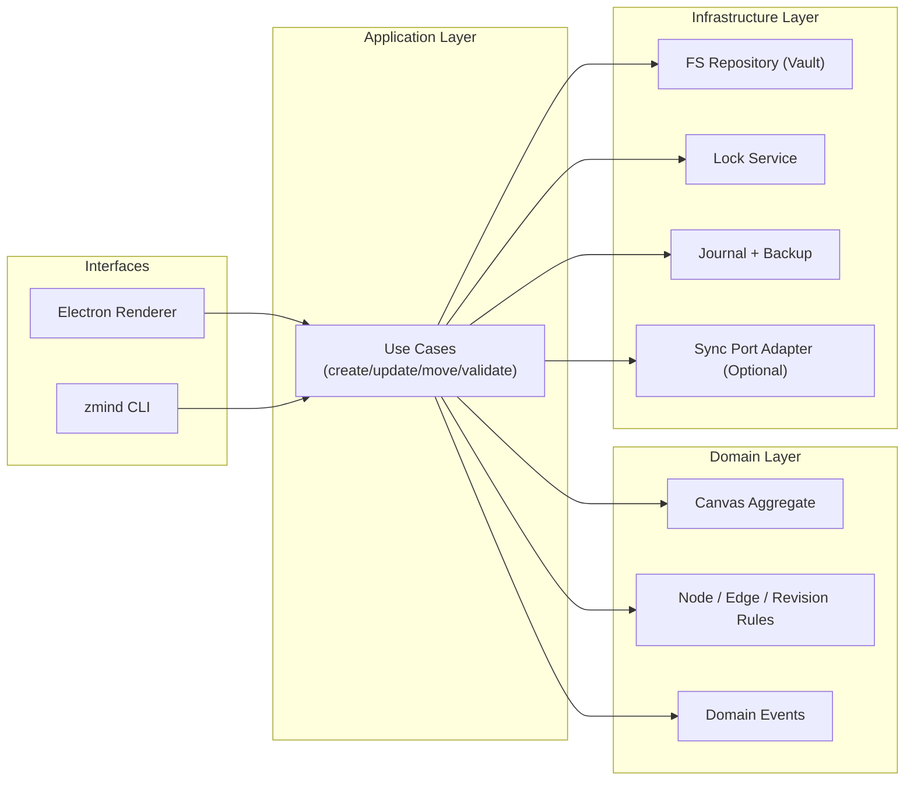
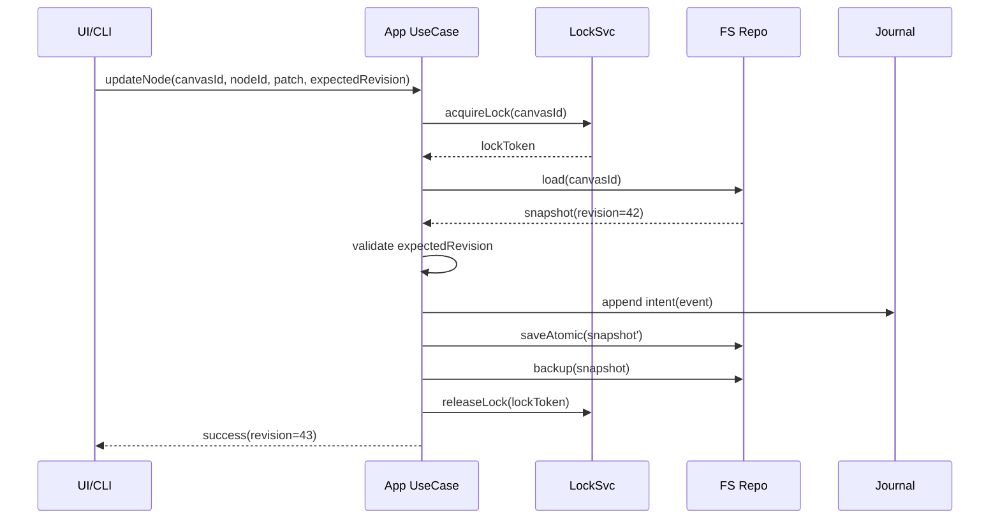

# Zmind Desktop 本地 Vault + CLI 架构设计（DDD + Anti-fragile）

## 1. 背景与目标

当前桌面端 `apps/desktop` 已可作为 Electron 壳加载 Web 应用，但尚未具备 Obsidian 风格的本地优先能力。  
本方案目标是在不破坏现有云端体验的前提下，引入：

1. 本地 Vault（画布 JSON 持久化）
2. `zmind` CLI（命令行读写画布）
3. Desktop 与 CLI 共享核心领域逻辑（DDD）
4. 面向异常场景的反脆弱机制（锁、日志、备份、恢复、迁移）

## 2. 范围定义

### In Scope

1. 新增本地数据域模型与文件存储协议
2. 新增 CLI（Canvas 的读取、创建、修改、校验）
3. Desktop 增加 Vault 管理能力（打开目录、加载本地画布、保存）
4. 定义可选云同步接口（先定义边界，不强制首期实现）

### Out of Scope（首期不做）

1. 多人实时协作冲突自动合并（仅保留扩展点）
2. 云端增量同步完整实现（只做接口和占位策略）
3. 插件市场与第三方扩展生态

## 3. 现状基线

- 桌面主进程入口：`apps/desktop/main.js`
- 目前能力：窗口生命周期、深链、OAuth 弹窗、外链策略、打包
- 缺失能力：本地 Vault 抽象、领域命令、CLI、离线一致性机制

## 4. 目标架构总览



ASCII 视图：

```text
+-----------------------+        +------------------------+
| Electron Desktop UI   |        | zmind CLI              |
+-----------+-----------+        +-----------+------------+
            |                                |
            +--------------+-----------------+
                           |
                   +-------v--------+
                   | Application    |
                   | Use Cases      |
                   +-------+--------+
                           |
                +----------v-----------+
                | Domain Model         |
                | Canvas/Node/Edge     |
                +----------+-----------+
                           |
      +--------------------+--------------------+
      |                    |                    |
+-----v------+     +-------v------+     +-------v------+
| FS Repo    |     | Lock Service |     | Journal/Backup|
+------------+     +--------------+     +--------------+
```

## 5. DDD 分层与模块拆分

建议新增以下目录（Monorepo 内）：

```text
packages/
  canvas-domain/          # 实体、值对象、领域规则、领域错误
  canvas-application/     # 用例编排、事务边界、DTO
  canvas-infra-fs/        # 文件仓储、锁、原子写、备份、迁移
apps/
  desktop/                # Electron（UI + IPC）
  cli/                    # zmind 命令行入口
```

职责矩阵：

```text
+----------------------+----------------------------------------------+
| 模块                 | 责任                                         |
+----------------------+----------------------------------------------+
| canvas-domain        | 画布聚合根、节点边约束、版本规则、领域事件   |
| canvas-application   | create/edit/link/validate 等用例与事务编排    |
| canvas-infra-fs      | Vault IO、文件锁、日志、备份、schema迁移      |
| apps/desktop         | 用户交互、IPC、窗口生命周期、本地目录选择     |
| apps/cli             | 命令解析、参数校验、调用应用层用例            |
+----------------------+----------------------------------------------+
```

## 6. 本地 Vault 数据规范

```text
<vault-root>/
  zmind.vault.json
  canvases/
    <canvasId>.canvas.json
  .zmind/
    locks/
      <canvasId>.lock
    journal/
      <canvasId>.journal.ndjson
    backups/
      <canvasId>.<timestamp>.bak.json
```

`zmind.vault.json`（示例）：

```json
{
  "vaultVersion": 1,
  "name": "My Vault",
  "createdAt": "2026-03-01T12:00:00.000Z",
  "defaultCanvasId": "canvas_01"
}
```

`<canvasId>.canvas.json`（示例）：

```json
{
  "schemaVersion": 1,
  "canvasId": "canvas_01",
  "revision": 42,
  "updatedAt": "2026-03-01T12:30:00.000Z",
  "title": "Roadmap",
  "nodes": [
    { "id": "n1", "type": "text", "x": 120, "y": 80, "data": { "text": "Hello" } }
  ],
  "edges": [
    { "id": "e1", "from": "n1", "to": "n2", "type": "arrow" }
  ],
  "metadata": {
    "tags": ["plan"],
    "author": "local-user"
  }
}
```

## 7. 写入流程与反脆弱机制

### 写入流水线（强约束）

1. 获取文件锁（带 TTL 与 owner）
2. 读取当前快照并校验 `revision`
3. 记录 Journal（意图 + 参数 + 前置 revision）
4. 应用领域命令，生成新快照
5. 原子写入：`tmp file -> fsync -> rename`
6. 写入备份（可配置保留策略）
7. 释放锁



### 冲突策略

```text
if expectedRevision != currentRevision:
  return CONFLICT
  provide:
    - currentSnapshot
    - userIntent
    - autoMergeSuggestion (optional)
```

### 故障恢复

1. 启动时扫描 `.zmind/journal/*.ndjson`
2. 检测未完成事务（有 intent 无 commit）
3. 按 `revision` 回放或丢弃（策略可配置）
4. 优先保证“可打开 + 不丢数据”，其次才是“自动合并”

## 8. CLI 设计（v1）

命令草案：

```bash
zmind vault init <path>
zmind canvas list --vault <path>
zmind canvas create --vault <path> --title "Roadmap"
zmind canvas show --vault <path> --id <canvasId>
zmind node add --vault <path> --canvas <canvasId> --type text --x 100 --y 120 --text "todo"
zmind node update --vault <path> --canvas <canvasId> --node <nodeId> --set data.text="done"
zmind edge add --vault <path> --canvas <canvasId> --from n1 --to n2
zmind validate --vault <path> [--canvas <canvasId>]
zmind migrate --vault <path> --to latest
```

CLI 输出策略：

1. 默认人类可读输出
2. `--json` 输出机器可读结构，便于脚本链路
3. 错误码稳定化（如 `CONFLICT`, `LOCK_TIMEOUT`, `SCHEMA_UNSUPPORTED`）

## 9. Desktop 侧改造点

最小改造路径：

1. `apps/desktop/main.js` 增加 Vault 打开目录与 IPC 通道
2. 新增 `preload.js` 暴露白名单 API（避免 Node 全暴露）
3. Renderer 调用用例层（通过 IPC）执行本地命令
4. 保留现有 Web 模式作为 fallback（双模式共存）

模式切换建议：

```text
Desktop Start
  -> detect last workspace
  -> if vault exists: Local Mode
  -> else: Cloud Mode (existing web shell)
```

## 10. 同步边界（可选二期）

定义 Port，不绑定具体供应商：

```text
SyncPort
  push(canvasDelta)
  pull(canvasId, sinceRevision)
  resolve(local, remote, base)
```

冲突处理优先级：

1. 用户显式选择
2. 规则自动合并（同节点不同字段）
3. 回退为双分支文件并提示人工处理

## 11. 迭代计划（建议）

```text
Phase 0: 设计冻结
  - 锁定 schema v1
  - 锁定错误码与CLI协议

Phase 1: 核心包落地
  - packages/canvas-domain
  - packages/canvas-application
  - packages/canvas-infra-fs

Phase 2: CLI MVP
  - 只读 + create/update + validate
  - 锁 + 原子写 + 备份 + journal

Phase 3: Desktop 本地模式
  - Vault 打开/切换
  - 本地画布读写

Phase 4: 稳定性与同步扩展
  - 故障恢复压测
  - SyncPort 接入
```

## 12. 验收标准（DoD）

1. 断电/进程崩溃后，重启可恢复到一致状态
2. Desktop 与 CLI 并发写同一画布，不会 silent overwrite
3. 1000+ 节点画布在本地读写性能可接受（需压测基线）
4. schema 升级可回滚，迁移失败不破坏原文件
5. Windows/macOS 路径与权限兼容

## 13. 测试矩阵

```text
+-------------------+-----------------------------------+
| 测试类型          | 关注点                            |
+-------------------+-----------------------------------+
| Unit              | 领域规则、revision 计算、校验逻辑 |
| Integration       | Repo 原子写、锁冲突、journal 回放 |
| E2E (CLI)         | 命令链路与错误码稳定性            |
| E2E (Desktop)     | 本地模式开关、IPC、安全边界       |
| Chaos/Failure     | kill -9、磁盘满、权限不足         |
+-------------------+-----------------------------------+
```

## 14. 开放问题

1. 本地画布 JSON 是否采用单文件快照，还是“快照 + patch log”混合？
2. CLI 命令是否优先兼容类 SQL/DSL 语法（如 `--set`）？
3. 本地模式是否默认禁用联网能力以强化隐私预期？
4. 与现有云端画布 ID 的映射策略（UUID 复用 or 本地独立命名）？

---

如果确认该方案，可直接进入 `Phase 1`：先生成三层 package 骨架与 CLI MVP 命令框架，再逐步接入桌面端。
