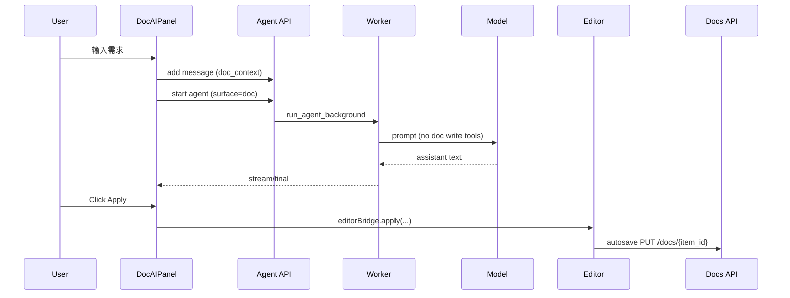
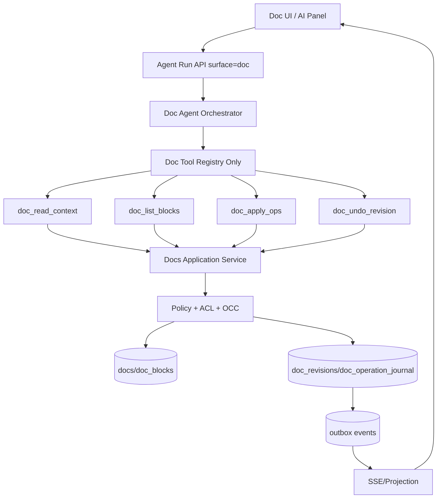
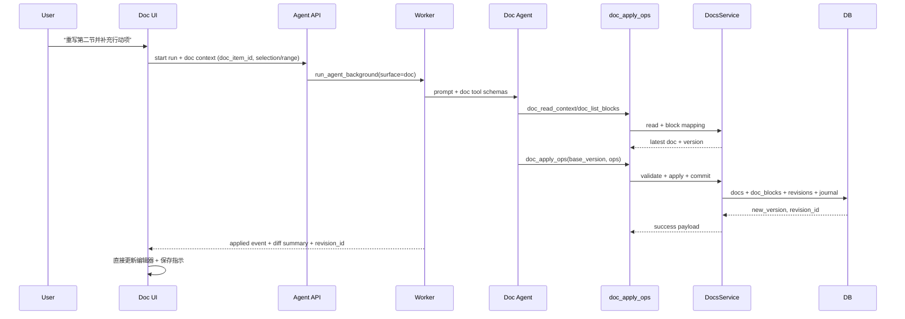
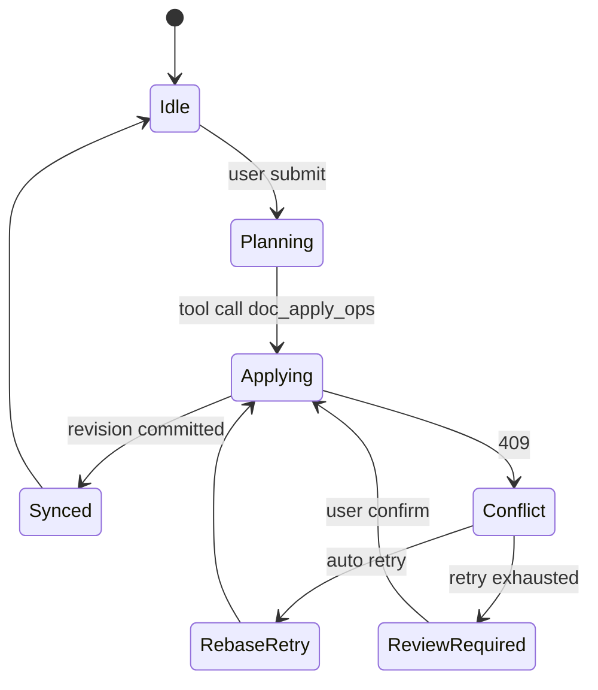

# Doc Agent Native Editing Architecture (Full Plan)

- Status: Proposed (Full-scope blueprint)
- Owner: AI/Docs Platform
- Last Updated: 2026-03-04
- Scope: `frontend/src/components/docs/*`, `backend/core/docs/*`, `backend/core/langgraph_engine/*`, `backend/core/agent_runs.py`, `backend/run_agent_background.py`

---

## 1. Executive Summary

当前文档 Agent 的主路径是“建议式编辑”：LLM 返回文本，前端再由用户点击 Apply 才真正写文档。

目标是升级为“原生可编辑 Agent”：

1. Agent 具备文档读写能力（受严格 ACL 与版本控制约束）。
2. Agent 可执行增删改查（范围、块、章节、整文）并默认自动应用。
3. 所有改动可追溯（revision、journal、审计事件），可撤销与回滚。
4. 与现有文件系统（`items/docs/doc_blocks`）100%兼容，不破坏 canvas 体系。

---

## 2. As-Is (Current Runtime)

### 2.1 当前关键事实

1. Doc 面板通过 `interaction_surface='doc'` 启动 agent run。
2. Doc surface 当前已禁用工具注册（稳定性优先策略）。
3. LLM 返回 Markdown 文本后，前端通过 `editorBridge.apply` 手工应用。
4. 文档持久化由前端编辑器 autosave (`PUT /docs/{item_id}`) 完成。

### 2.2 As-Is Sequence



### 2.3 As-Is 问题

1. 非原生：用户需显式点击 Apply，不符合“AI 直接编辑文档”预期。
2. 无写入原子性：LLM 结果与数据库提交不在同一事务语义内。
3. 无 AI 变更审计：难以对 AI 改动进行回放/比较/问责。
4. 冲突恢复弱：并发下主要依赖前端 `If-Match` 兜底，不是 agent 级 rebase。

---

## 3. To-Be Target (Industry Best Practice)

### 3.1 目标设计原则

1. **Command-first edits**: AI 写入必须走结构化命令，不接受“黑盒整文覆盖”作为默认。
2. **OCC + Rebase**: 必须基于版本写入，冲突自动重读并重放补丁。
3. **Evented visibility**: 每次 AI 修改实时可见（SSE patch events + revision IDs）。
4. **Least privilege**: Doc surface 仅暴露 doc 工具，不可调用 canvas/task/handoff。
5. **Audit by default**: 全量记录变更来源、操作、diff、时延、失败原因。

### 3.2 To-Be High-level Architecture



### 3.3 Target Sequence (Native Edit)



---

## 4. Domain-Driven Design (DDD) Blueprint

### 4.1 Bounded Contexts

1. **Doc Editing Context**
   - 负责文档模型、补丁、版本控制、冲突处理。
2. **Agent Interaction Context**
   - 负责会话、模型调用、工具调度、运行状态。
3. **Workspace/File System Context**
   - 负责 items/folders/tree、一致性与跨模块引用。
4. **Audit & Governance Context**
   - 负责 revision 审计、事件发布、可观测与风控策略。

### 4.2 Context Map (ASCII)

```text
+-------------------------+        +-------------------------+
| Agent Interaction       |        | Audit & Governance      |
| - run orchestration     |------->| - revision journal      |
| - tool call lifecycle   | events | - event audit/outbox    |
+-----------+-------------+        +-------------+-----------+
            |                                      ^
            | tool commands                        |
            v                                      |
+-----------+-------------+        +-------------+-----------+
| Doc Editing             |<------>| Workspace/File System   |
| - doc aggregate         | refs   | - items/folders/docs    |
| - patch apply + OCC     |        | - ownership boundaries  |
+-------------------------+        +-------------------------+
```

### 4.3 Ubiquitous Language

1. `DocAggregate`: 文档聚合根。
2. `DocRevision`: 一次完整提交。
3. `DocOperation`: 原子编辑动作（insert/replace/delete/move...）。
4. `BaseVersion`: 执行操作前文档版本。
5. `Rebase`: 冲突后基于最新版重放操作。

---

## 5. Capability & Permission Model

### 5.1 Surface Capability Matrix

| Surface | Allowed Tools | Write Scope | Forbidden |
|---|---|---|---|
| `doc` | `doc_*` only | bound `doc_item_id` only | `canvas_*`, `task`, `transfer_to_*`, supervisor handoff |
| `canvas` | `canvas_*` + allowed supervisor tools | bound canvas / explicit target | `doc_write_*` (unless explicit future feature) |
| `chat` | no write tools (read/suggest only) | none | all mutating tools |

### 5.2 Authorization Rules (PEP/PDP)

1. thread 必须绑定 `doc_item_id`。
2. `doc_item_id` 必须属于当前 `workspace/account_id`。
3. tool context 的 doc 与线程绑定不一致时直接拒绝（403）。
4. 所有写入必须携带 `base_version`。

---

## 6. Tool Contract Design (Doc Native Tools)

### 6.1 Tool Set

1. `doc_read_context`
2. `doc_list_blocks`
3. `doc_apply_ops`
4. `doc_undo_revision`
5. `doc_get_revision_diff`

### 6.2 `doc_apply_ops` Command Schema (proposed)

```json
{
  "doc_item_id": "string",
  "base_version": 42,
  "idempotency_key": "uuid-or-stable-hash",
  "ops": [
    {
      "op": "replace_range",
      "range": { "from": 120, "to": 260 },
      "content_md": "..."
    },
    {
      "op": "insert_after_block",
      "block_id": "item:b:4:abcd1234",
      "content_md": "### Action Items\n- ..."
    }
  ],
  "intent": "rewrite_section",
  "safety": {
    "max_replace_ratio": 0.35,
    "allow_full_document_replace": false
  }
}
```

### 6.3 Response Schema

```json
{
  "ok": true,
  "doc_item_id": "...",
  "previous_version": 42,
  "new_version": 43,
  "revision_id": "rev_xxx",
  "applied_ops": 2,
  "summary": "Rewrote section 2 and added action items",
  "conflict": null
}
```

### 6.4 Error Contract

1. `409 doc_version_conflict`: 返回 `current_version` + `conflict_spans`。
2. `403 doc_acl_denied`: 线程/工作区绑定不一致。
3. `422 doc_invalid_ops`: 操作不可解析/越界。
4. `429 doc_write_rate_limited`: 防止 AI 高频抖动写。

---

## 7. Data Model & Storage Evolution

### 7.1 Reuse Existing Tables

1. `items`
2. `docs`
3. `doc_blocks`
4. `references`

### 7.2 New Tables

1. `doc_revisions`
   - `id`, `doc_item_id`, `base_version`, `new_version`, `actor_type(user|agent)`, `actor_id`, `agent_run_id`, `summary`, `ops_json`, `diff_json`, `created_at`
2. `doc_operation_journal`
   - `id`, `revision_id`, `op_index`, `op_type`, `payload_json`, `status`, `latency_ms`, `error_code`, `created_at`
3. `doc_idempotency`
   - `idempotency_key`, `doc_item_id`, `result_revision_id`, `expires_at`

### 7.3 Migration Plan

新增迁移（建议命名）：

1. `backend/supabase/migrations/20260305xxxx00_doc_agent_revisions.sql`
2. `backend/supabase/migrations/20260305xxxx10_doc_agent_operation_journal.sql`
3. `backend/supabase/migrations/20260305xxxx20_doc_agent_idempotency.sql`
4. `backend/supabase/migrations/20260305xxxx30_doc_agent_rls_policies.sql`

---

## 8. Write Consistency & Conflict Strategy

### 8.1 OCC (Optimistic Concurrency Control)

1. 每次写入要求 `base_version`。
2. 当前版本 != `base_version` => `409 conflict`。
3. Agent 自动执行：`read latest -> rebase ops -> retry`（最多 2~3 次）。

### 8.2 Idempotency

1. `idempotency_key` 对同一 doc 唯一。
2. 重放请求返回同一 `revision_id`，不重复写库。

### 8.3 Partial Failure Handling

1. `doc_apply_ops` 在服务层做事务边界。
2. `docs/doc_blocks/doc_revisions/journal` 必须同事务提交。
3. 事件通过 outbox 异步发布，失败可重试，不影响主事务。

---

## 9. Frontend UX/Interaction Upgrade

### 9.1 Interaction Modes

1. `Auto-Apply` (default): Agent 结果直接写入编辑器。
2. `Review-Apply` (optional): 用户确认后再提交（高风险变更）。

### 9.2 UI State Machine



### 9.3 Real-time Feedback

1. 顶部栏显示 `AI editing...` / `Saved v43`。
2. 文档内高亮刚改动范围（3~5 秒淡出）。
3. AI 面板消息显示 `Applied revision: rev_xxx`。
4. 历史面板支持按 revision 浏览与回滚。

---

## 10. API & Event Contract Changes

### 10.1 Backend APIs (new)

1. `POST /api/docs/{item_id}/agent/apply-ops`
2. `GET /api/docs/{item_id}/revisions`
3. `GET /api/docs/{item_id}/revisions/{revision_id}`
4. `POST /api/docs/{item_id}/revisions/{revision_id}/undo`

### 10.2 SSE Event Types (new)

1. `doc_tool_started`
2. `doc_ops_applied`
3. `doc_conflict_detected`
4. `doc_rebase_retry`
5. `doc_revision_committed`

Event payload should include:

- `doc_item_id`
- `revision_id`
- `base_version`
- `new_version`
- `changed_ranges`
- `agent_run_id`

---

## 11. Safety, Compliance, and Guardrails

### 11.1 Mutation Safety

1. 大改动阈值：替换比例 > 35% 进入 `Review-Apply`。
2. 敏感块保护：frontmatter、受保护 section 默认不可改。
3. 空响应禁止静默完成：必须返回用户可见消息（已实现兜底）。

### 11.2 Security

1. Doc surface 工具白名单严格化（拒绝隐式扩展）。
2. query/token 日志脱敏（已完成）。
3. revision/journal 保留最小必要信息，敏感文本可配置脱敏/采样。

---

## 12. Observability & SLO

### 12.1 Core Metrics

1. `doc_agent.apply.success_rate`
2. `doc_agent.apply.p95_latency_ms`
3. `doc_agent.conflict_rate`
4. `doc_agent.rebase_success_rate`
5. `doc_agent.empty_response_rate`
6. `doc_agent.rollback_rate`

### 12.2 SLO Targets

1. Apply success rate >= 99.5%
2. P95 apply latency <= 1.2s（不含模型生成）
3. Conflict auto-recovery success >= 95%
4. Empty completion silent-failure = 0

---

## 13. Testing & Verification Matrix

### 13.1 Unit

1. `doc_apply_ops` schema validation。
2. ACL gate: wrong thread/doc/workspace denied。
3. OCC conflict and rebase behavior。
4. idempotency replay。

### 13.2 Integration

1. end-to-end: prompt -> tool ops -> revision commit -> SSE event。
2. concurrent edits: user + agent race。
3. rollback correctness。

### 13.3 E2E (Frontend)

1. Auto-apply path without manual Apply button。
2. Review mode confirm/cancel。
3. history + undo + version indicator。

### 13.4 Chaos/Resilience

1. outbox relay delay/failure。
2. SSE interrupted and resume。
3. tool timeout/LLM partial output。

---

## 14. Rollout Strategy (Full but Safe)

### 14.1 Feature Flags

1. `DOC_AGENT_NATIVE_EDITING_ON`
2. `DOC_AGENT_AUTO_APPLY_ON`
3. `DOC_AGENT_REBASE_RETRY_ON`
4. `DOC_AGENT_REVIEW_GATE_ON`

### 14.2 Progressive Delivery

1. Stage 0: internal workspace canary。
2. Stage 1: 5% workspaces。
3. Stage 2: 25% workspaces + SLO monitor。
4. Stage 3: 100% after 7-day stable window。

### 14.3 Rollback Plan

1. 一键关闭 `DOC_AGENT_NATIVE_EDITING_ON` 回退建议式编辑。
2. 保留 revision 数据，不回滚 schema。
3. 运行态切换无需停机。

---

## 15. Implementation Work Breakdown (WBS)

### Wave A: Backend Domain & Contracts

1. 新增 doc tool specs + handlers (`doc_*`)。
2. 新增 `DocCommandService`（校验、apply、事务提交）。
3. 新增 revisions/journal repository。
4. 新增 API routes + DTO。

### Wave B: Agent Runtime Integration

1. doc surface 专属 tool registry 装载 `doc_*`。
2. execute_tools 增加 doc ACL 与 error mapping。
3. call_model 增加 tool failure recovery policy（doc-specific）。

### Wave C: Frontend Native Experience

1. DocAIPanel 默认 Auto-Apply。
2. 编辑器增量 patch 高亮。
3. revision 历史与回滚 UI。

### Wave D: Governance & Operations

1. metrics + alert + dashboards。
2. runbook（冲突激增、延迟异常、回滚流程）。
3. 灰度放量策略执行。

---

## 16. Compatibility with Existing File System

1. 不修改 `items/docs/doc_blocks` 现有读写协议语义。
2. 新增能力以“旁路增强”方式引入（revision/journal/idempotency）。
3. 现有 canvas 与 doc 引用系统（`references`）不受破坏。
4. 老客户端仍可使用 `PUT /docs/{item_id}` 正常更新。

---

## 17. Risks & Mitigations

| Risk | Impact | Mitigation |
|---|---|---|
| 模型输出不稳定导致错误操作 | 高 | 结构化 ops + schema 校验 + review gate |
| 并发编辑冲突频繁 | 中 | OCC + 自动 rebase + 限次重试 |
| 高频写入导致成本/压力增大 | 中 | debounce + batching + rate limit |
| 误改整篇文档 | 高 | replace ratio gate + protected sections |
| SSE 断连导致前端状态错乱 | 中 | revision 拉齐 + reconnect replay |

---

## 18. Definition of Done (DoD)

1. Doc mode 可直接读写文档，无需手动 Apply。
2. 所有 AI 变更产生 revision/journal 并可回滚。
3. 并发冲突可自动恢复，失败可见且可重试。
4. SLO 达标并支持灰度与一键回退。
5. 与现有文件系统/画布系统兼容通过回归测试。

---

## 19. Immediate Next Step (Execution Order)

1. 先落地 Wave A（domain + contracts + migrations）。
2. 然后 Wave B（doc runtime tool registry integration）。
3. 再做 Wave C（UI auto-apply + revision UX）。
4. 最后 Wave D（observability + rollout）。

---

## Appendix A: Minimal Tool Payload Examples

### A.1 读取文档上下文

```json
{
  "tool": "doc_read_context",
  "arguments": {
    "doc_item_id": "doc_123",
    "mode": "selection_first",
    "selection": { "from": 120, "to": 260 }
  }
}
```

### A.2 应用增量编辑

```json
{
  "tool": "doc_apply_ops",
  "arguments": {
    "doc_item_id": "doc_123",
    "base_version": 42,
    "idempotency_key": "8f7f3a4e-...",
    "ops": [
      {
        "op": "replace_range",
        "range": { "from": 120, "to": 260 },
        "content_md": "重写后的段落..."
      }
    ],
    "intent": "rewrite_selection"
  }
}
```

---

## 20. Industry Best Practice Alignment Matrix

| Best Practice Pattern | Why It Matters | This Plan |
|---|---|---|
| Server-authoritative edits | 避免前端多副本漂移 | 所有 AI 写入必须经 `doc_apply_ops -> DocsService` |
| Structured command writes | 降低模型幻觉直接写坏数据风险 | 强制 `ops[]` schema，不接受自由写库 |
| OCC + rebase | 解决多人并发冲突 | `base_version` + `409 conflict` + auto-retry |
| Idempotent mutation | 防止重试重复提交 | `idempotency_key -> revision_id` 映射 |
| Event-driven auditability | 可追溯与合规 | `doc_revisions` + `doc_operation_journal` + outbox |
| Progressive rollout | 控风险上线 | feature flag + 分阶段灰度 |
| Explicit capability boundaries | 避免越权与跨域写入 | doc surface 仅 `doc_*`，禁止 canvas/task/handoff |

---

## 21. Threat Model (STRIDE-lite)

| Threat | Example | Control |
|---|---|---|
| Spoofing | 伪造 doc_item_id 写他人文档 | thread-doc 绑定校验 + workspace ACL |
| Tampering | 直接构造非法 ops 篡改结构 | schema 校验 + range/anchor 合法性检查 |
| Repudiation | 无法证明谁改了文档 | revision 记录 actor/run/tool_call |
| Information Disclosure | 日志泄露 token 或敏感内容 | query 脱敏 + revision 内容可配置采样脱敏 |
| Denial of Service | 高频 AI 写入压垮存储 | rate limit + debounce + batch apply |
| Elevation of Privilege | doc 模式调用 canvas/task | surface capability gate + tool whitelist |

---

## 22. Delivery Governance (RACI)

| Workstream | R | A | C | I |
|---|---|---|---|---|
| Doc tools & command service | Backend AI Infra | Tech Lead | Product, Security | Frontend |
| Revision/journal schema | Backend Platform | Tech Lead | Data/DBA | Product |
| UI auto-apply + history UX | Frontend Editor | Product Eng Lead | Backend | QA |
| Observability + SLO alerts | SRE/Platform | Tech Lead | Backend | Product |
| Canary and rollout | Platform + Product | Product Owner | QA, SRE | All teams |

---

## 23. Milestone Plan (Recommended)

| Milestone | Duration | Exit Criteria |
|---|---|---|
| M1 Domain Foundation | 5-7 days | `doc_*` tools + command service + migrations merged |
| M2 Runtime Integration | 3-4 days | doc surface tool path E2E pass, no silent completion |
| M3 Native UX | 4-6 days | auto-apply + revision history + undo working |
| M4 Hardening & Rollout | 5-7 days | SLO dashboard green, canary stable 7 days |

---

## 24. Implementation Status (2026-03-04)

### 24.1 Completed

1. **M1 Domain Foundation**
   - 已完成文档操作域能力：`doc_read_context`, `doc_list_blocks`, `doc_apply_ops`, `doc_get_revision`, `doc_undo_revision`。
   - 已完成 revision/undo API 与服务层接入。
2. **M2 Runtime Integration**
   - `interaction_surface=doc` 改为正向 allowlist，仅暴露 doc-native 工具链。
   - `run_agent_background` 在 doc surface 注入 `doc_item_id/doc_context` 并启用 doc registry。
   - 执行层对非 doc 工具在 doc surface 严格阻断。
3. **M3 Native UX (核心路径)**
   - Doc AI 面板移除手动 “Apply Latest Response”。
   - 前端改为监听 `doc_apply_ops/doc_undo_revision` tool 结果后自动刷新文档。
   - 增加提交前落盘（标题+正文）以降低版本漂移。
   - 新增“无 thread 也可用”的 `History` / `New session` 流程（点击自动 ensure thread）。
   - 前端补齐 doc revisions typed API 封装。

### 24.2 Validation Snapshot

1. Backend targeted tests:
   - `tests/test_doc_tool_policy.py`
   - `tests/test_ws_a_load_context.py`
   - 结果：`9 passed`
2. Frontend checks:
   - `npm run type-check` 通过
   - lint 无新增 error（仅现有项目 warning）

### 24.3 Remaining Hardening (for M4)

1. 增加 doc revision 时间线 UI（可视化 diff / 一键回滚入口）。
2. 增加 doc tool telemetry dashboard（成功率、冲突率、平均重试次数、每次 run 写入次数）。
3. 增加 doc surface chaos/regression 套件（并发冲突、断流恢复、幂等重放）。
