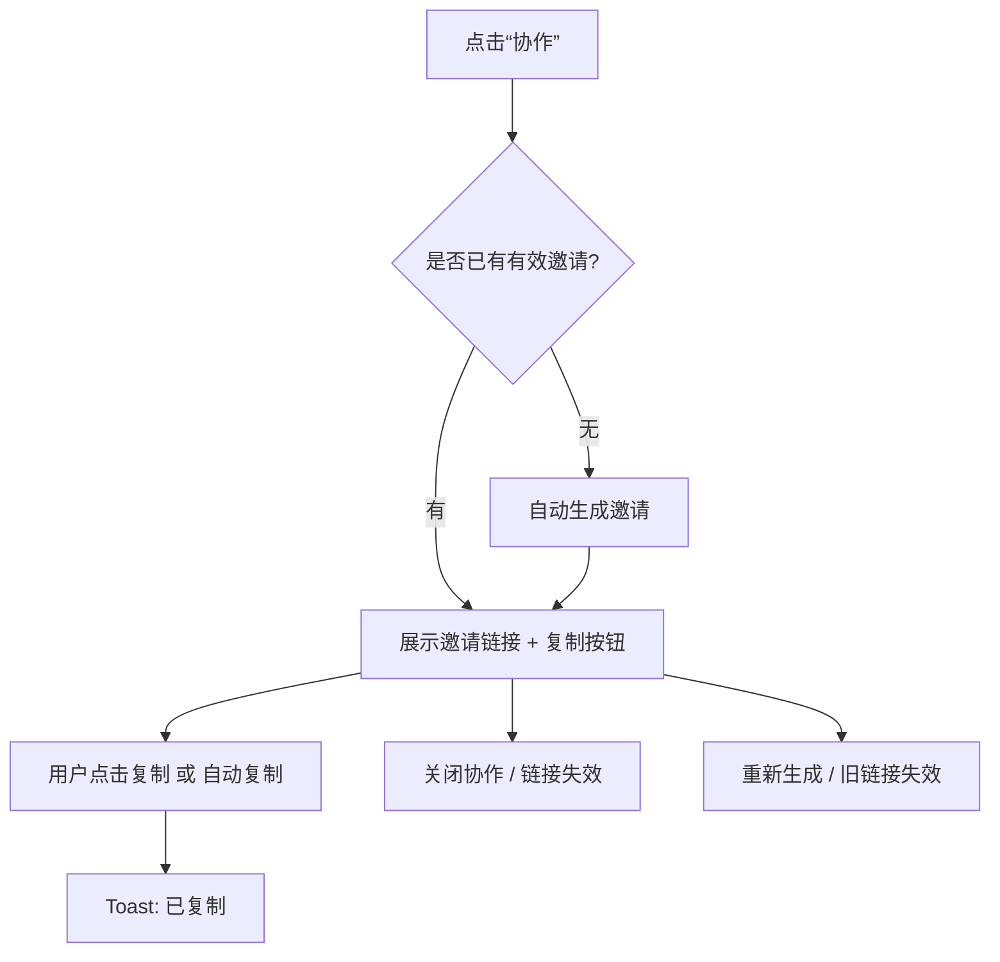
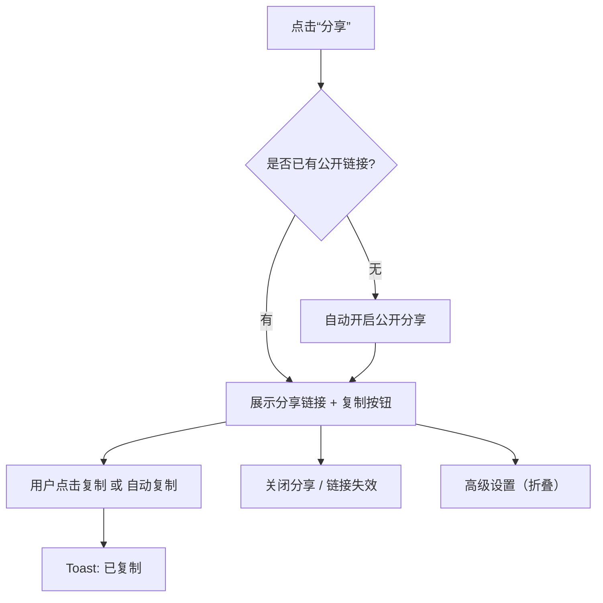

# 协作邀请 & 公开分享 UX 流程与文案（V1）

日期: 2026-02-01
负责人: C-Side Experience Architect
范围: 画布协作邀请（可编辑）/ 公开分享（只读）
目标: 一键完成、结果优先、隐藏复杂度

---

## 核心原则
- 结果优先: 用户打开即看到“可用链接”，而不是“生成按钮”。
- 一键策略: 从打开弹窗到可发送，只需要一次“复制”。
- 隐藏复杂度: 邀请码、权限字段、迁移错误等技术细节不出现。

---

## 一、协作邀请（Collaborate）

### 目标用户旅程
1) 点击“协作” → 直接出现可用邀请链接（已生成/已复用）。
2) 一键复制邀请链接 → 直接发送给对方。
3) 需要停止协作 → 一键关闭（旧链接失效）。
4) 需要重新发给新的人 → 一键重新生成（旧链接失效）。

### 新流程图（Mermaid）

### 关键交互说明
- 弹窗打开时自动调用“获取活跃邀请”。无则自动创建。
- 仅展示单一“邀请链接”（链接已包含邀请码/权限参数）。
- 不显示“邀请码”字段，不提示“记住邀请码”。
- “关闭协作”是唯一破坏性操作，需二次确认或软确认（Undo 3 秒）。
- “重新生成”明确提示“旧链接将失效”。
- 可选：自动复制开关（默认开），只在首次进入弹窗时触发。

### UI 文案稿（中文）
#### 弹窗结构
- 标题: 协作邀请
- 副标题: 生成一个链接，邀请他人一起编辑这个画布
- 主按钮: 复制邀请链接
- 次按钮: 重新生成链接（旧链接失效）
- 破坏性按钮: 关闭协作

#### 说明/提示
- 链接说明: 任何拿到链接的人都可以编辑
- 限制说明: 链接有效期 7 天 / 最多 5 人（如有）
- 关闭提示: 关闭后当前链接失效，需要重新生成

#### Toast
- 成功: 邀请链接已复制
- 关闭成功: 协作已关闭，链接失效
- 生成失败: 暂时无法生成邀请链接，请稍后再试
- 复制失败: 复制失败，请手动复制

#### 错误态（弹窗内）
- 文案: 暂时无法创建邀请链接，请稍后再试
- 操作: 重试

### i18n 文案建议（示例）
| Key | 文案 | 用途 |
| --- | --- | --- |
| canvas.collab.title | 协作邀请 | 弹窗标题 |
| canvas.collab.subtitle | 生成一个链接，邀请他人一起编辑这个画布 | 弹窗副标题 |
| canvas.collab.linkLabel | 邀请链接 | 链接标签 |
| canvas.collab.copy | 复制邀请链接 | 主按钮 |
| canvas.collab.regen | 重新生成链接（旧链接失效） | 次按钮 |
| canvas.collab.disable | 关闭协作 | 破坏性按钮 |
| canvas.collab.note | 任何拿到链接的人都可以编辑 | 说明 |
| canvas.collab.limitNote | 链接有效期 7 天 / 最多 5 人 | 限制说明 |
| canvas.collab.disableTip | 关闭后当前链接失效，需要重新生成 | 关闭提示 |
| canvas.collab.toast.copied | 邀请链接已复制 | 成功 Toast |
| canvas.collab.toast.disabled | 协作已关闭，链接失效 | 关闭成功 Toast |
| canvas.collab.toast.failed | 暂时无法生成邀请链接，请稍后再试 | 失败 Toast |
| canvas.collab.retry | 重试 | 错误态按钮 |

---

## 二、公开分享（Read-only Share）

### 目标用户旅程
1) 点击“分享” → 立即出现可用分享链接。
2) 一键复制分享链接 → 直接发送。
3) 需要关闭分享 → 一键关闭（链接失效）。
4) 高级项（时间线/模板）收起，不打扰。

### 新流程图（Mermaid）

### 关键交互说明
- 弹窗打开自动拉取分享状态；无则自动开启并返回链接。
- 主动作仅保留“复制链接”。不出现“创建链接”按钮。
- 高级设置折叠：时间线可见/发布到模板。
- 禁止显示任何工程术语（如 SQL、is_public 字段）。

### UI 文案稿（中文）
#### 弹窗结构
- 标题: 分享画布
- 副标题: 生成一个只读链接，方便他人查看
- 主按钮: 复制分享链接
- 破坏性按钮: 关闭分享
- 高级设置入口: 高级设置

#### 说明/提示
- 链接说明: 任何拿到链接的人都可以查看（只读）
- 高级项说明: 可选显示 AI 时间线 / 发布到模板

#### Toast
- 成功: 分享链接已复制
- 开启成功: 分享已开启
- 关闭成功: 分享已关闭，链接失效
- 开启失败: 暂时无法开启分享，请稍后再试
- 复制失败: 复制失败，请手动复制

#### 错误态（弹窗内）
- 文案: 暂时无法创建分享链接，请稍后再试
- 操作: 重试

### i18n 文案建议（示例）
| Key | 文案 | 用途 |
| --- | --- | --- |
| canvas.share.title | 分享画布 | 弹窗标题 |
| canvas.share.subtitle | 生成一个只读链接，方便他人查看 | 弹窗副标题 |
| canvas.share.linkLabel | 分享链接 | 链接标签 |
| canvas.share.copy | 复制分享链接 | 主按钮 |
| canvas.share.disable | 关闭分享 | 破坏性按钮 |
| canvas.share.note | 任何拿到链接的人都可以查看（只读） | 说明 |
| canvas.share.advanced | 高级设置 | 折叠入口 |
| canvas.share.timeline | 显示 AI 时间线 | 高级项 |
| canvas.share.publish | 发布到模板 | 高级项 |
| canvas.share.toast.copied | 分享链接已复制 | 成功 Toast |
| canvas.share.toast.enabled | 分享已开启 | 开启成功 Toast |
| canvas.share.toast.disabled | 分享已关闭，链接失效 | 关闭成功 Toast |
| canvas.share.toast.failed | 暂时无法开启分享，请稍后再试 | 失败 Toast |
| canvas.share.retry | 重试 | 错误态按钮 |

---

## 交付边界与依赖
- 后端需要提供“获取当前有效邀请/分享链接”与“自动生成”的接口。
- 前端不展示邀请码/数据库字段/迁移提示。
- 若无法创建链接，需可重试，不阻塞弹窗关闭。

---

## 成功指标
- 打开弹窗到复制成功的中位时长 < 3 秒
- 协作邀请生成后复制率 > 70%
- 分享弹窗打开后复制率 > 60%
- 关闭分享/协作后的重复生成率下降