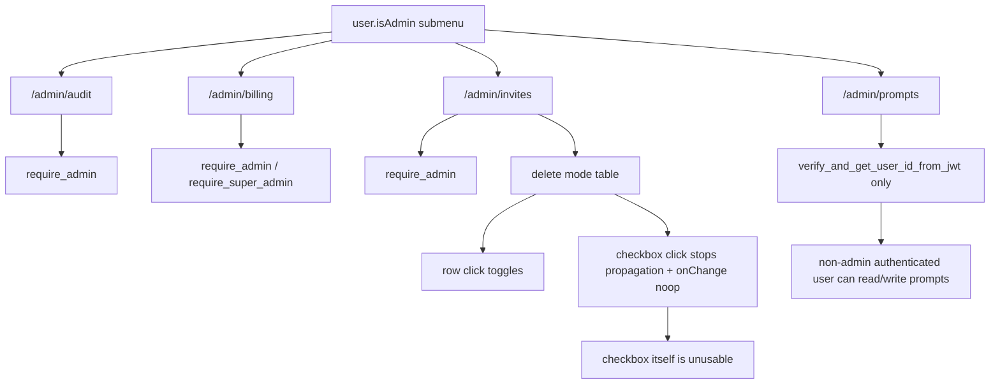

# Admin Audit Surface Audit

> Phase window: 2026-05-22 to 2026-06-11
> Frozen on: 2026-03-13
> Scope: `BND-08`, `BND-09`, `BND-10`, `BND-11`
> Evidence basis: static code audit

---

## 1. Surface Summary

| Audit ID | Surface slice | Critical path | Primary risk | Verdict |
|---|---|---|---|---|
| `BND-08` | Admin audit | filter, page, payload detail | missing admin backend gate | Pass |
| `BND-09` | Admin billing | user list, adjustments, refund ceiling | missing admin/super-admin gate | Pass |
| `BND-10` | Admin invites | QR upload, create code, batch delete | broken delete-mode interaction | Fail |
| `BND-11` | Prompt Studio | prompt read, preview, apply, rollback | admin RBAC missing on backend | Fail |

## 2. Flow Decomposition

```text
Admin surface boundary flow
===========================

Sidebar / user menu
  -> admin submenu visible only when user.isAdmin

Admin audit + billing + invites
  -> frontend uses backendApi
  -> backend routes require_admin or require_super_admin

Prompt Studio
  -> frontend also lives under admin submenu
  -> backend /prompts routes only verify JWT
  -> any authenticated user can read tree, read files, preview, apply, view history, and rollback

Admin invites delete mode
  -> row click toggles selection
  -> checkbox cell stops row click
  -> checkbox onChange is a no-op
  -> direct checkbox click does nothing
```



## 3. Evidence Map

- `frontend/src/components/sidebar/nav-user-with-teams.tsx:479-509`
  - admin submenu is hidden in the UI unless `user.isAdmin`
- `backend/core/admin/audit_admin.py:63-74`
  - audit events endpoint requires `require_admin`
- `backend/core/admin/audit_admin.py:108-118`
  - projection failures endpoint requires `require_admin`
- `backend/core/billing/admin.py:74-80`
  - billing credit adjustment requires `require_admin`, with super-admin escalation for higher risk amounts
- `backend/core/billing/admin.py:192-223`
  - refund and invite endpoints remain admin or super-admin guarded
- `backend/core/auth.py:18-46`
  - `require_admin` and `require_super_admin` are the role-enforcement primitives used by the real admin APIs
- `backend/core/prompts/api.py:100-226`
  - prompt tree, file, preview, apply, history, rollback, and tool-matrix all depend only on `verify_and_get_user_id_from_jwt`
- `frontend/src/components/admin/prompt-studio-client.tsx:150-215`
  - prompt studio client reads tree, tool matrix, catalog, scenarios, and prompt files from `/prompts/*`
- `frontend/src/components/admin/prompt-studio-client.tsx:570-607`
  - prompt studio client applies changes and rollbacks through `/prompts/apply` and `/prompts/rollback`
- `frontend/src/components/admin/invites-admin-client.tsx:505-516`
  - invite rows toggle via row click, but the checkbox cell blocks row propagation and the checkbox onChange is empty

## 4. Findings

## BUG-0013 - Prompt Studio backend is missing admin-role enforcement

- Surface: Admin prompt studio
- Audit ID: `BND-11`
- Severity: `P0`
- Status: `Triaged`
- Owner: Backend platform owner
- Phase target: `Phase 5`
- Environment:
  - app version / commit: repository state on 2026-03-13
  - role: any authenticated user
  - device: web
  - browser / platform: all
  - locale: all

### Reproduction Steps
1. Sign in as any authenticated non-admin user.
2. Call any `/prompts/*` endpoint directly, for example `/prompts/tree`, `/prompts/file`, `/prompts/apply`, or `/prompts/rollback`.
3. Compare those dependencies with the real admin APIs in `/admin/audit` and `/admin/billing`.

### Expected Result

Prompt Studio should enforce the same admin-role boundary as the rest of the admin surface, ideally with `require_admin` and stricter controls around write / rollback endpoints.

### Actual Result

Every prompt endpoint only verifies that the caller has a valid JWT. That means any authenticated user can enumerate prompt files, read their contents, preview rendered system prompts, write prompt changes, create git commits, inspect prompt history, and trigger rollbacks.

### User Harm

This is a platform-level control-plane exposure. A normal authenticated user can tamper with system prompts and rollback history that affect other users, which makes the entire agent behavior surface mutable outside admin governance.

### Workaround

No safe user workaround exists. This requires backend authorization hardening.

### Evidence

- `frontend/src/components/sidebar/nav-user-with-teams.tsx:479-509`
- `backend/core/auth.py:18-46`
- `backend/core/prompts/api.py:100-226`
- `frontend/src/components/admin/prompt-studio-client.tsx:150-215`
- `frontend/src/components/admin/prompt-studio-client.tsx:570-607`

### Severity Justification

`P0` because this is an admin-only control surface in product intent, yet the backend exposes read/write/rollback power to any authenticated user.

### Regression Target

- Must automate?: yes
- Candidate regression pack: `REG-04`

## BUG-0014 - Admin invite delete-mode checkbox is non-functional

- Surface: Admin invites / batch delete selection
- Audit ID: `BND-10`
- Severity: `P2`
- Status: `Triaged`
- Owner: Admin invites owner
- Phase target: `Phase 5`
- Environment:
  - app version / commit: repository state on 2026-03-13
  - role: admin, super admin
  - device: web
  - browser / platform: all
  - locale: all

### Reproduction Steps
1. Open admin invites.
2. Enter delete mode.
3. Click a row checkbox directly instead of clicking the whole row.

### Expected Result

The checkbox itself should toggle invite selection.

### Actual Result

The checkbox cell stops row-click propagation, and the checkbox `onChange` handler is empty. As a result, clicking the checkbox does nothing; selection only changes when the user clicks the row outside the checkbox.

### User Harm

The delete-mode interaction violates a standard table-selection affordance on an admin surface that controls destructive actions. That increases operator error risk and makes the selection UI look broken.

### Workaround

Click the row background instead of the checkbox itself.

### Evidence

- `frontend/src/components/admin/invites-admin-client.tsx:505-516`

### Severity Justification

`P2` because the batch-delete flow still exists, but one of its primary affordances is visibly broken.

### Regression Target

- Must automate?: yes
- Candidate regression pack: `REG-04`

## 5. Non-Bug Notes

- Static review did not confirm an authorization gap in the audit or billing backends. Those routes consistently use `require_admin` or `require_super_admin`.
- The admin prompt defect is not a mere missing page guard. The backend endpoints themselves are under-protected, which is why it is registered separately and at higher severity.

## 6. Verdict

- Result: `Fail`
- Open bug IDs:
  - `BUG-0013`
  - `BUG-0014`
- Regression follow-up:
  - add non-admin denial coverage for every `/prompts/*` endpoint and batch-delete checkbox interaction coverage to `REG-04`
