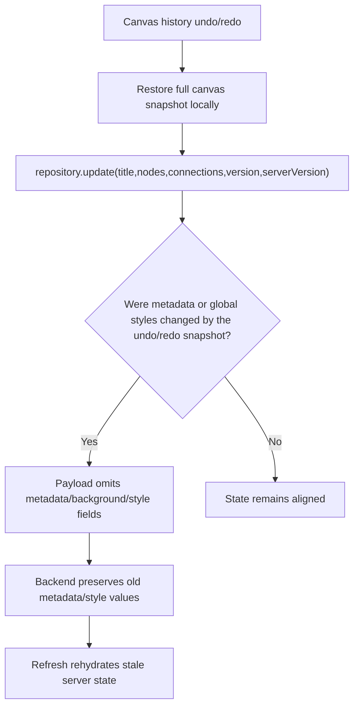

# Canvas Deep Audit

> Phase window: 2026-04-10 to 2026-04-30
> Frozen on: 2026-03-13
> Scope: `CORE-03`, `CORE-04`, `CORE-05`, `CORE-06`, `CORE-07`, `CORE-08`, `CORE-09`
> Evidence basis: static code audit

---

## 1. Surface Summary

| Audit ID | Surface | Critical path | Primary risk | Verdict |
|---|---|---|---|---|
| `CORE-03` | Canvas editor shell | load, hydrate, switch guard | editor unavailable, wrong snapshot | Pass |
| `CORE-04` | Canvas top bar | title, share, playback, screenshot, global style controls | wrong persistence of edited state | Fail |
| `CORE-05` | Canvas creation/editing tools | node create/edit/connect/group | state corruption | Watch |
| `CORE-06` | Canvas AI panel | prompt handoff, session bootstrap, streaming | AI workflow dead or desynced | Watch |
| `CORE-07` | Canvas outline | derived hierarchy and navigation | hidden state drift | Watch |
| `CORE-08` | Playback / screenshot | presentation mode and capture | export inconsistency | Watch |
| `CORE-09` | Draft recovery | reload and unsaved-state recovery | data durability | Fail |

## 2. Flow Decomposition

```text
Canvas save model
=================

Normal edit
  -> canvas state mutates
  -> repository save builder collects
     - title
     - nodes
     - connections
     - background styles
     - text presets
     - metadata
  -> backend merges into existing doc

Undo / redo
  -> history snapshot restores full canvas locally
  -> immediate repository.update() persists only
     - title
     - nodes
     - connections
     - version
     - serverVersion
  -> metadata-backed state and global styles are omitted
  -> refresh can revive pre-undo server state
```



## 3. Evidence Map

- `frontend/src/canvas/stores/canvas.store.ts:1841-1899`
  - undo and redo restore the full history snapshot into local state
  - persistence after undo/redo only sends `title`, `nodes`, `connections`, `version`, and `serverVersion`
- `frontend/src/canvas/stores/canvas.store.ts:1997-2043`
  - the normal save path explicitly persists `backgroundColor`, `backgroundStyleId`, `patternColor`, `cornerStyle`, `fontStyle`, `textOpacityPreset`, `textLayoutPreset`, and synthesized `metadata`
- `frontend/src/canvas/stores/canvas.store.ts:2110-2140`
  - canvas create path also persists metadata-backed connection anchors, styles, and group attachments
- `frontend/src/canvas/stores/canvas.store.ts:2256-2274`
  - load path rehydrates connections and group state from `metadata`
- `frontend/src/canvas/utils/canvasNormalization.ts:80-120`
  - metadata is not cosmetic only; it rebuilds connection anchors, anchor params, appearance, and group attachments into runtime canvas state
- `frontend/src/canvas/types/canvas.ts:286-345`
  - canvas model includes persisted connection anchors, appearance, global styles, and metadata
- `frontend/src/canvas/services/canvas-file-repository.service.ts:359-395`
  - repository update supports sending metadata and global style fields, but only if the caller includes them
- `backend/core/application/services/canvas_command_application_service.py:380-412`
  - backend update logic replaces only fields present in payload and preserves existing doc state otherwise

## 4. Findings

## BUG-0004 - Canvas undo/redo does not durably persist metadata-backed state or global styles

- Surface: Canvas editor / save-recovery path
- Audit ID: `CORE-04`
- Severity: `P0`
- Status: `Triaged`
- Owner: Canvas editor owner
- Phase target: `Phase 3`
- Environment:
  - app version / commit: repository state on 2026-03-13
  - role: personal free, personal paid, team owner, team member
  - device: web
  - browser / platform: all
  - locale: all

### Reproduction Steps
1. Open a canvas and change a metadata-backed or global-style field, such as connection anchor geometry, connection appearance, group attachments, background style, or global text preset.
2. Let the normal save path persist that edit.
3. Use undo or redo so the local canvas snapshot moves back to a prior state.
4. Observe the immediate persistence call made by the undo/redo handler.
5. Refresh the page or reopen the canvas from workspace.

### Expected Result

Undo and redo should durably persist the same full canvas shape that history restores locally, including metadata-backed connection state and global style fields.

### Actual Result

Undo and redo write only `title`, `nodes`, `connections`, `version`, and `serverVersion`. The repository and backend both support richer fields, but the undo/redo caller omits them. The server therefore keeps stale metadata and style values, and refresh can resurrect the pre-undo state.

### User Harm

This is a core-editor durability defect. Users can believe they successfully reverted a canvas state, only to have refresh restore stale anchors, styling, or attached-connection relationships. That is functionally a data-loss class issue on the main editing surface.

### Workaround

No reliable user-level workaround exists other than reapplying the style or metadata edit manually after undo/redo and forcing a normal save path.

### Evidence

- `frontend/src/canvas/stores/canvas.store.ts:1841-1899`
- `frontend/src/canvas/stores/canvas.store.ts:1997-2043`
- `frontend/src/canvas/stores/canvas.store.ts:2256-2274`
- `frontend/src/canvas/utils/canvasNormalization.ts:80-120`
- `frontend/src/canvas/services/canvas-file-repository.service.ts:359-395`
- `backend/core/application/services/canvas_command_application_service.py:380-412`

### Severity Justification

`P0` because this is a save/recovery integrity failure on the main canvas editor. The defect does not merely misrender; it can silently restore stale persisted state after the user performed a core editing action that should have been durable.

### Regression Target

- Must automate?: yes
- Candidate regression pack: `REG-02`

## 5. Non-Bug Notes

- The ordinary save path is materially better than the undo/redo save path. When edits flow through the main repository-save scheduler, metadata and global styles are intentionally collected and persisted.
- Draft recovery infrastructure exists and is deeper than a trivial dirty flag. The main remaining durability flaw confirmed in this slice is the mismatch between history restore and persisted payload shape.

## 6. Verdict

- Result: `Fail`
- Open bug IDs:
  - `BUG-0004`
- Regression follow-up:
  - add refresh-persistence regression cases for undo/redo on background styles, connection anchors, and group attachments
