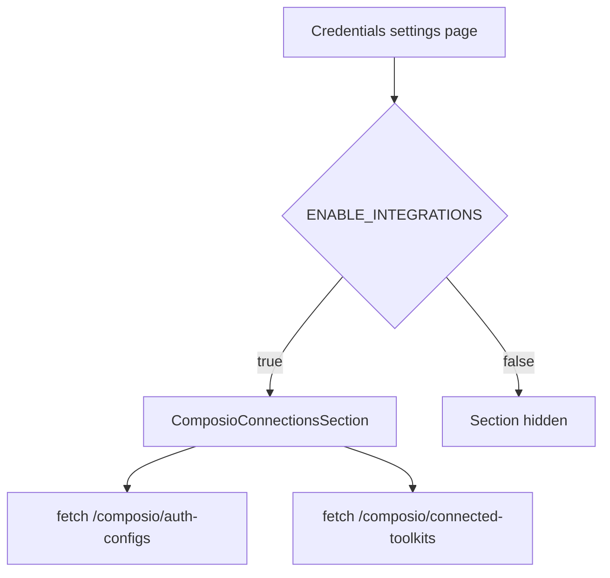

# Credentials Audit

> Phase window: 2026-05-01 to 2026-05-21
> Frozen on: 2026-03-13
> Scope: `SET-05`
> Evidence basis: static code audit

---

## 1. Surface Summary

| Audit ID | Surface slice | Critical path | Primary risk | Verdict |
|---|---|---|---|---|
| `SET-05` | App credentials settings page | load credential/integration state, refresh configs, refresh toolkits | third-party auth visibility gap | Pass |

## 2. Flow Decomposition

```text
Credentials support flow
========================

Settings route
  -> App credentials page
  -> feature flag gate
  -> ComposioConnectionsSection
  -> fetch auth configs
  -> fetch connected toolkits
  -> manual refresh buttons
```



## 3. Evidence Map

- `frontend/src/app/(dashboard)/settings/credentials/page.tsx:11-21`
  - credentials route is a thin shell around `ComposioConnectionsSection` and a feature-flag gate
- `frontend/src/app/[locale]/(dashboard)/settings/credentials/page.tsx:1-1`
  - locale wrapper reuses the canonical page without new logic
- `frontend/src/components/integrations/composio-connections-section.tsx:26-160`
  - surface is currently diagnostic/read-refresh oriented: it lists auth configs and connected toolkits, with independent refresh triggers but no destructive write path on this page

## 4. Findings

No confirmed code-level defect met bug-register threshold in this slice.

## 5. Non-Bug Notes

- The page is narrower than the audit matrix label "Credentials" suggests; most credential-profile CRUD logic lives in other hooks and tool surfaces, not in this settings page itself.
- The section still deserves smoke coverage because it is a user-facing trust surface for external auth state, but static review did not show a broken permission or route path.

## 6. Verdict

- Result: `Pass`
- Open bug IDs:
  - none confirmed in static review
- Regression follow-up:
  - keep a lightweight refresh-state smoke case in `REG-03`
