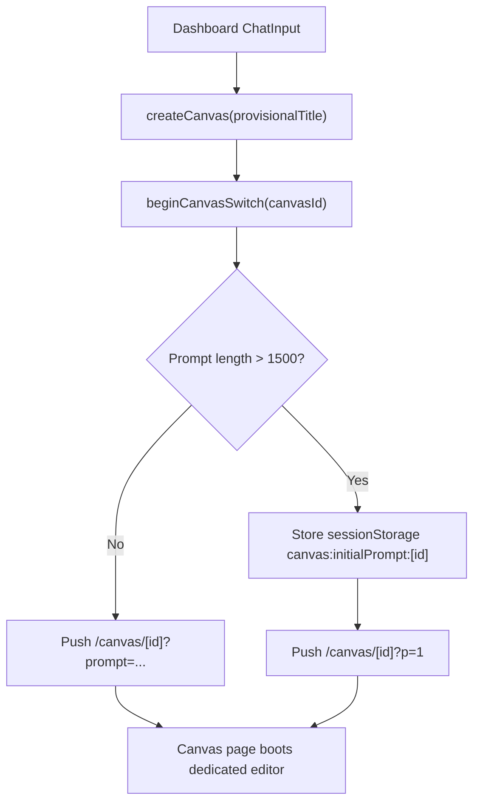

# Dashboard Audit

> Phase window: 2026-04-10 to 2026-04-30
> Frozen on: 2026-03-13
> Scope: `CORE-01`
> Evidence basis: static code audit

---

## 1. Surface Summary

| Audit ID | Surface | Critical path | Primary risk | Verdict |
|---|---|---|---|---|
| `CORE-01` | Dashboard | prompt handoff, canvas bootstrap, invite-success refresh, embedded workspace and knowledge sections | broken entry into core workflow | Pass |

## 2. Flow Decomposition

```text
Dashboard prompt handoff
========================

User enters prompt or attachments
  -> dashboard submit handler
  -> create canvas
  -> mark canvas switch state
  -> persist initial prompt/attachments in session storage
  -> push to dedicated canvas route
  -> canvas page auto-consumes handoff payload

Invite redemption return
  -> /dashboard?invite=redeemed
  -> refresh subscription context
  -> open success dialog
  -> clean URL state
```



## 3. Evidence Map

- `frontend/src/components/dashboard/dashboard-content.tsx:218-275`
  - submit path trims message, blocks duplicate submissions, creates canvas, stages initial prompt and attachments, then routes to dedicated canvas
- `frontend/src/components/dashboard/dashboard-content.tsx:286-295`
  - invite-redeem return refreshes subscription state before cleaning URL state
- `frontend/src/app/(dashboard)/dashboard/page.tsx:2-29`
  - `DashboardContent` is mounted only on the personal dashboard route, not reused across team dashboard mirrors

## 4. Findings

No confirmed dashboard-specific bug was promoted into the register in this phase.

## 5. Non-Bug Notes

- The prompt-to-canvas entry path is intentionally thin. It creates the canvas first, then hands off prompt and attachments to the canvas page, which reduces the amount of core AI orchestration the dashboard itself must own.
- The invite-success cleanup hard-codes `/dashboard`, but static route ownership shows this component is mounted on the personal dashboard page only, so this is not a confirmed scope bug in the current routing model.
- `pendingAgentPrompt` is read on mount (`frontend/src/components/dashboard/dashboard-content.tsx:308-322`), but this Phase 3 slice did not find an active write path under `frontend/src`. That looks more like legacy residue than a confirmed defect.

## 6. Verdict

- Result: `Pass`
- Open bug IDs:
  - none confirmed for `CORE-01`
- Regression follow-up:
  - cover prompt handoff and invite-success refresh inside `REG-02`
