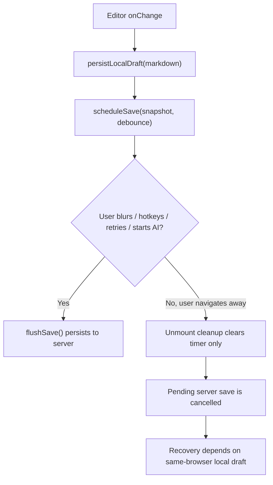

# Doc Deep Audit

> Phase window: 2026-04-10 to 2026-04-30
> Frozen on: 2026-03-13
> Scope: `CORE-10`
> Evidence basis: static code audit

---

## 1. Surface Summary

| Audit ID | Surface | Critical path | Primary risk | Verdict |
|---|---|---|---|---|
| `CORE-10` | Doc editor | autosave, title save, image upload, AI mutation preflight, reload recovery | server durability gap during navigation or unmount | Fail |

## 2. Flow Decomposition

```text
Doc autosave model
==================

Editor change
  -> persist local draft
  -> schedule debounced save to server

Flush points that do exist
  -> blur
  -> save hotkey
  -> retry button
  -> before AI mutation

Navigation / tab close
  -> component unmount cleanup clears timer only
  -> no docs-specific beforeunload / pagehide / visibilitychange flush
  -> latest snapshot may never reach server
```



## 3. Evidence Map

- `frontend/src/components/docs/hooks/useDocEditor.ts:209-228`
  - doc changes are persisted to server only through a debounced timer unless an explicit flush path runs
- `frontend/src/components/docs/hooks/useDocEditor.ts:287-294`
  - unmount cleanup clears the timer but does not flush the latest snapshot
- `frontend/src/components/docs/hooks/useDocEditor.ts:296-320`
  - local draft persists on every change and blur, but server persistence still depends on scheduled or explicit flush
- `frontend/src/components/docs/DocEditorShell.tsx:209-212`
  - manual retry path flushes title and content saves
- `frontend/src/components/docs/DocEditorShell.tsx:248-251`
  - AI mutation preflight flushes title and content saves
- `frontend/src/components/docs/DocEditorShell.tsx:463-468`
  - blur and save-hotkey wiring flush content save
- repository-wide search under `frontend/src/components/docs`
  - no docs-specific `beforeunload`, `pagehide`, or `visibilitychange` flush handler was found
- `frontend/src/canvas/components/core/InfiniteCanvas.tsx:561-570`
  - canvas editor does install unload/visibility flush hooks, which makes the absence on docs more concrete rather than speculative

## 4. Findings

## BUG-0005 - Doc autosave can drop pending server persistence on unmount or navigation

- Surface: Doc editor autosave durability
- Audit ID: `CORE-10`
- Severity: `P1`
- Status: `Triaged`
- Owner: Doc editor owner
- Phase target: `Phase 3`
- Environment:
  - app version / commit: repository state on 2026-03-13
  - role: personal free, personal paid, team owner, team member
  - device: web
  - browser / platform: all
  - locale: all

### Reproduction Steps
1. Open a doc and type within the editor.
2. Stop before the debounce window elapses.
3. Navigate away, close the tab, hard refresh, or switch routes fast enough to unmount the editor before a blur or manual flush occurs.
4. Observe hook cleanup behavior.
5. Reopen the doc from another browser session or after local draft loss.

### Expected Result

The latest doc snapshot should flush to the server when the editor is being torn down, or the product should guarantee an equivalent recovery path across sessions and devices.

### Actual Result

Unmount cleanup cancels the pending timer and does not flush the latest snapshot. Same-browser local draft may still exist, but the server copy can lag behind the user's last edits.

### User Harm

Users can leave a doc believing recent text is safely saved while the authoritative server copy is stale. This is especially damaging for cross-device usage, hard closes, or any local-storage loss scenario.

### Workaround

Users can blur the editor, use the save hotkey, or trigger an action that forces `flushSave()`, but that is not durable enough to count as a product-level guarantee.

### Evidence

- `frontend/src/components/docs/hooks/useDocEditor.ts:209-228`
- `frontend/src/components/docs/hooks/useDocEditor.ts:287-294`
- `frontend/src/components/docs/hooks/useDocEditor.ts:296-320`
- `frontend/src/components/docs/DocEditorShell.tsx:209-212`
- `frontend/src/components/docs/DocEditorShell.tsx:248-251`
- `frontend/src/components/docs/DocEditorShell.tsx:463-468`

### Severity Justification

`P1` because the defect weakens durability on a core editor and can lose recent server persistence, but same-browser local draft recovery still exists and softens immediate total-loss impact.

### Regression Target

- Must automate?: yes
- Candidate regression pack: `REG-02`

## 5. Non-Bug Notes

- The doc surface is not completely unprotected. Local draft persistence exists, and blur/save-hotkey/AI-preflight flush paths are implemented.
- The confirmed issue is specifically the teardown path, not the entire autosave mechanism.

## 6. Verdict

- Result: `Fail`
- Open bug IDs:
  - `BUG-0005`
- Regression follow-up:
  - add navigation-close durability cases to `REG-02`
