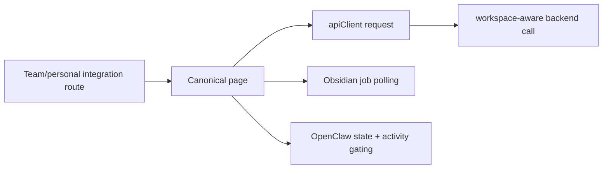

# Integrations Audit

> Phase window: 2026-05-01 to 2026-05-21
> Frozen on: 2026-03-13
> Scope: `SET-06`, `SET-07`
> Evidence basis: static code audit

---

## 1. Surface Summary

| Audit ID | Surface slice | Critical path | Primary risk | Verdict |
|---|---|---|---|---|
| `SET-06` | Obsidian integration | import wizard, export job creation, polling, zip download | import/export job dead end | Pass |
| `SET-07` | OpenClaw integration | state load, owner-only settings, capability gate, rollback action | bridge permission misconfig | Pass |

## 2. Flow Decomposition

```text
Integration support flow
========================

Obsidian
  -> integration page
  -> import wizard or export job creation
  -> query job status
  -> download exported zip when completed

OpenClaw
  -> integration page
  -> load state + activity list
  -> owner can edit enabled/roles/capabilities
  -> rollback button appears only when state and activity gates allow it

Shared routing model
  -> personal pages exist
  -> team wrapper routes re-export the same pages
  -> hooks use apiClient, which carries workspace context
```



## 3. Evidence Map

- `frontend/src/app/(dashboard)/integrations/obsidian/page.tsx:6-17`
  - canonical Obsidian page is a thin route shell around `ObsidianHub`
- `frontend/src/app/(dashboard)/(teamAccount)/team/[accountSlug]/integrations/obsidian/page.tsx:1-1`
  - team wrapper reuses the canonical Obsidian page
- `frontend/src/components/integrations/obsidian/ObsidianHub.tsx:18-91`
  - export state is driven by job creation, status polling, and a proxy download route
- `frontend/src/hooks/react-query/integrations/use-obsidian-import.ts:101-140`
  - export hooks use `apiClient` rather than raw unscoped fetches
- `frontend/src/app/(dashboard)/integrations/openclaw/page.tsx:6-17`
  - canonical OpenClaw page is a thin route shell around `OpenClawHub`
- `frontend/src/app/(dashboard)/(teamAccount)/team/[accountSlug]/integrations/openclaw/page.tsx:1-1`
  - team wrapper reuses the canonical OpenClaw page
- `frontend/src/components/integrations/openclaw/OpenClawHub.tsx:87-150`
  - save and rollback actions are gated by loaded workspace role and allowed capabilities
- `frontend/src/hooks/react-query/integrations/use-openclaw-integration.ts:91-141`
  - state, activity, settings update, and rollback all flow through `apiClient`

## 4. Findings

No confirmed code-level defect met bug-register threshold in this slice.

## 5. Non-Bug Notes

- Team wrappers for Obsidian and OpenClaw are safer than the trigger and dashboard-knowledge support slices because they simply re-export canonical pages while leaving workspace transport to `apiClient`.
- This audit did not prove runtime third-party service health. It only confirmed that the client-side route, workspace, and owner-gating logic are structurally coherent in static review.

## 6. Verdict

- Result: `Pass`
- Open bug IDs:
  - none confirmed in static review
- Regression follow-up:
  - keep explicit owner/member role-gate smoke coverage for OpenClaw and end-to-end import/export coverage for Obsidian in `REG-03`
