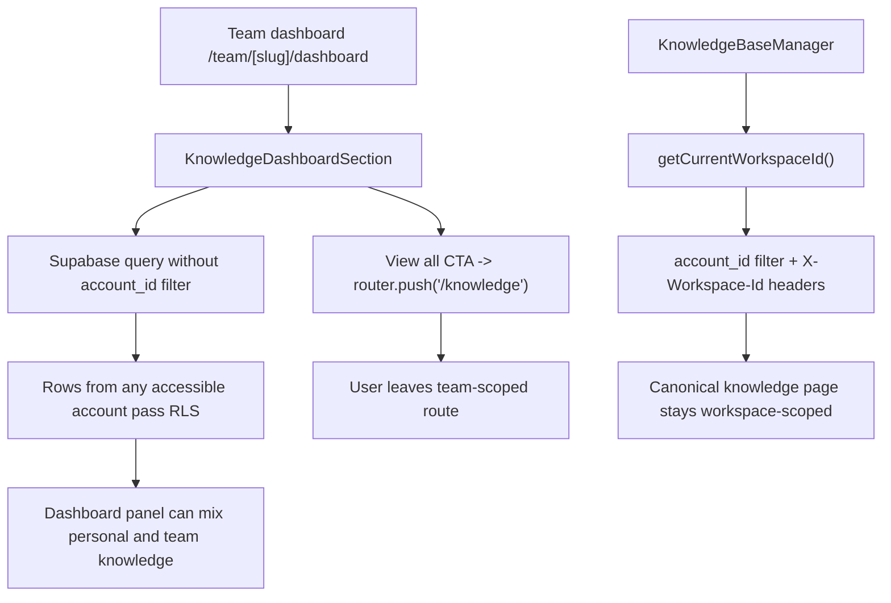

# Knowledge Audit

> Phase window: 2026-05-01 to 2026-05-21
> Frozen on: 2026-03-13
> Scope: `CORE-13`
> Evidence basis: static code audit

---

## 1. Surface Summary

| Audit ID | Surface slice | Critical path | Primary risk | Verdict |
|---|---|---|---|---|
| `CORE-13` | Dashboard knowledge entry | recent files, quick upload, view-all handoff | wrong workspace scope, wrong destination route | Fail |
| `CORE-13` | Full knowledge manager | folder load, upload, preview, summary edit, move, delete | knowledge CRUD and retrieval | Pass |

## 2. Flow Decomposition

```text
Knowledge support flow
======================

Team or personal dashboard
  -> KnowledgeDashboardSection
  -> direct Supabase query for folders and recent files
  -> quick upload / text entry actions reuse fetched folders
  -> "View all" CTA opens knowledge page

Canonical knowledge page
  -> WorkspaceProvider derives active workspace from path
  -> setCurrentWorkspaceId(workspaceId)
  -> KnowledgeBaseManager filters folders/files by account_id
  -> write and download requests include X-Workspace-Id

Current mismatch
  -> dashboard slice ignores currentWorkspaceId entirely
  -> dashboard CTA pushes hard-coded /knowledge
  -> team dashboard can show mixed-account knowledge and then jump to personal route
```



## 3. Evidence Map

- `frontend/src/contexts/workspace-context.tsx:20-73`
  - active workspace is derived from route path and stored via `setCurrentWorkspaceId(workspaceId)`
- `frontend/src/components/knowledge-base/knowledge-dashboard-section.tsx:62-82`
  - dashboard knowledge slice queries `knowledge_base_folders` and `knowledge_base_entries` with no `account_id` filter
- `frontend/src/components/knowledge-base/knowledge-dashboard-section.tsx:108-110`
  - view-all CTA always pushes `/knowledge`
- `backend/supabase/migrations/20250916000000_new_knowledge_base.sql:74-90`
  - RLS allows any row where `basejump.has_role_on_account(account_id) = true`, so omitting `account_id` does not constrain results to the active workspace
- `frontend/src/components/knowledge-base/knowledge-base-manager.tsx:167-195`
  - canonical knowledge page filters folders and entries by `account_id = workspaceId`
- `frontend/src/components/knowledge-base/knowledge-base-manager.tsx:269-275`
  - write requests include `X-Workspace-Id`
- `frontend/src/components/sidebar/sidebar-left.tsx:118-126`
  - canonical sidebar navigation already computes workspace-safe knowledge paths with `buildTeamScopedPath('/knowledge', teamSlug)`
- `frontend/src/components/knowledge-base/knowledge-overview.tsx:27-32`
  - an additional overview component repeats the same unscoped direct-query pattern, which reinforces that this is a structural support-surface risk even though this audit did not prove that component is currently mounted

## 4. Findings

## BUG-0008 - Knowledge dashboard shortcuts ignore active workspace scope for queries and destination route

- Surface: Knowledge base / dashboard entry slice
- Audit ID: `CORE-13`
- Severity: `P1`
- Status: `Triaged`
- Owner: Knowledge surface owner
- Phase target: `Phase 4`
- Environment:
  - app version / commit: repository state on 2026-03-13
  - role: team owner, team member, any user with more than one accessible workspace
  - device: web
  - browser / platform: all
  - locale: all

### Reproduction Steps
1. Use an account that has at least a personal workspace plus one team workspace, or multiple team memberships.
2. Open a team dashboard route such as `/team/[accountSlug]/dashboard`.
3. Inspect the knowledge panel data source and compare it with the canonical knowledge page implementation.
4. Observe that dashboard folder and recent-file queries do not constrain by `account_id = currentWorkspaceId`.
5. Click the knowledge panel's "View all" CTA.

### Expected Result

The dashboard knowledge slice should only show entries from the active workspace and should open the matching scoped route, for example `/team/[slug]/knowledge`.

### Actual Result

The dashboard slice queries all knowledge rows that pass RLS for the current user, not just the active workspace. Its view-all CTA then pushes the hard-coded personal route `/knowledge`, which drops team scope even when the user started on a team dashboard.

### User Harm

This is a trust-breaking multi-workspace defect. Team users can see the wrong workspace's recent knowledge, quick-upload into the wrong folder universe, and then get ejected to a personal route when trying to continue into full knowledge management.

### Workaround

Users can avoid the dashboard shortcuts and open knowledge from the scoped sidebar route instead, but that does not repair the dashboard panel itself.

### Evidence

- `frontend/src/contexts/workspace-context.tsx:20-73`
- `frontend/src/components/knowledge-base/knowledge-dashboard-section.tsx:62-82`
- `frontend/src/components/knowledge-base/knowledge-dashboard-section.tsx:108-110`
- `backend/supabase/migrations/20250916000000_new_knowledge_base.sql:74-90`
- `frontend/src/components/knowledge-base/knowledge-base-manager.tsx:167-195`
- `frontend/src/components/sidebar/sidebar-left.tsx:118-126`

### Severity Justification

`P1` because the defect does not create public data exposure, but it does break tenant/workspace truth on a high-visibility support surface and can mislead users about which account they are managing.

### Regression Target

- Must automate?: yes
- Candidate regression pack: `REG-03`

## 5. Non-Bug Notes

- The canonical knowledge manager is materially safer than the dashboard slice. It consistently uses `getCurrentWorkspaceId()`, `account_id` filtering, and `X-Workspace-Id` headers for write/download flows.
- File preview and upload paths appear to honor active workspace context once the user is inside the full knowledge manager.

## 6. Verdict

- Result: `Fail`
- Open bug IDs:
  - `BUG-0008`
- Regression follow-up:
  - add a team-dashboard knowledge smoke case that asserts data source scope and CTA route scope together
