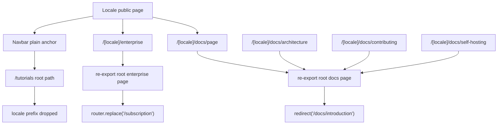

# Locale Consistency Audit

> Phase window: 2026-06-12 to 2026-07-02
> Frozen on: 2026-03-13
> Scope: locale wrappers vs canonical public pages
> Evidence basis: static code audit

---

## 1. Surface Summary

| Audit ID | Surface slice | Critical path | Primary risk | Verdict |
|---|---|---|---|---|
| `PUB-01` | Localized home navigation | locale home -> public nav -> tutorials/docs/legal | locale dropped on public exits | Fail |
| `PUB-06` | Localized docs wrappers | locale docs entry -> docs page -> deeper docs paths | wrapper routes collapse to root docs behavior | Fail |
| `PUB-05` | Localized legal | locale legal wrapper -> legal page | static wrapper itself is consistent | Pass |

## 2. Flow Decomposition

```text
Locale consistency flow
=======================

Locale wrappers
  -> many pages simply re-export root implementations
  -> root implementations often contain hard-coded root paths or redirects

Navigation layer
  -> siteConfig exposes /tutorials as a raw path
  -> desktop and mobile navbar use plain <a href> for non-anchor items
  -> localized users leave the locale-prefixed shell on click

Docs wrappers
  -> /[locale]/docs/page re-exports root docs redirect
  -> architecture/contributing/self-hosting wrappers also re-export root docs redirect
  -> localized docs detail routes collapse into /docs/introduction behavior

Result
  -> locale-prefixed public routes are incomplete
  -> several locale exits silently fall back to root-language pages
  -> some locale docs paths are present in routing but do not represent real unique content
```



## 3. Evidence Map

- locale route inventory on 2026-03-13
  - `[locale]/(home)` only mirrors `page`, `changelog`, and `enterprise`; there is no localized `pricing` or `tutorials` route file
- `frontend/src/lib/home.tsx:72-79`
  - public nav config includes raw `/tutorials`
- `frontend/src/components/home/nav-menu.tsx:111-118`
  - desktop nav deliberately lets non-anchor links navigate through plain `<a href>`
- `frontend/src/components/home/nav-menu.tsx:198-200`
  - rendered public desktop nav uses plain anchor tags instead of locale-aware `Link`
- `frontend/src/components/home/sections/navbar.tsx:339-345`
  - mobile drawer also lets non-anchor public links fall through to raw href navigation
- `frontend/src/app/[locale]/(home)/enterprise/page.tsx:1`
  - locale enterprise route re-exports the root enterprise implementation
- `frontend/src/app/(home)/enterprise/page.tsx:12-21`
  - root enterprise page hard-redirects and buttons to `/subscription`
- `frontend/src/app/[locale]/docs/page.tsx:1`
  - locale docs root re-exports root docs page
- `frontend/src/app/docs/page.tsx:5-6`
  - root docs page hard-redirects to `/docs/introduction`
- `frontend/src/app/[locale]/docs/architecture/page.tsx:1`
  - architecture wrapper collapses into root docs redirect instead of unique content
- `frontend/src/app/[locale]/docs/contributing/page.tsx:1`
  - contributing wrapper collapses into root docs redirect instead of unique content
- `frontend/src/app/[locale]/docs/self-hosting/page.tsx:1`
  - self-hosting wrapper collapses into root docs redirect instead of unique content
- `frontend/src/app/docs/introduction/page.tsx:16-20`
  - docs breadcrumbs hardcode `/docs`
- `frontend/src/app/docs/introduction/page.tsx:109-121`
  - docs CTA card hardcodes `/`
- `frontend/src/components/app-sidebar.tsx:47-58`
  - docs sidebar nav is hardcoded to root docs paths, not a source-of-truth locale route map

## 4. Findings

## BUG-0015 - Localized public mirrors are incomplete and drop users onto root-language routes

- Surface: Localized public navigation and docs wrappers
- Audit ID: `PUB-01`, `PUB-06`
- Severity: `P1`
- Status: `Triaged`
- Owner: Frontend platform owner
- Phase target: `Phase 6`
- Environment:
  - app version / commit: repository state on 2026-03-13
  - role: anonymous, authenticated
  - device: web
  - browser / platform: all
  - locale: non-default locale, especially `zh`

### Reproduction Steps
1. Open locale-prefixed public pages such as `/zh`, `/zh/enterprise`, or `/zh/docs`.
2. Use public navigation or locale-specific docs routes.
3. Compare wrapper behavior and link targets with the canonical public route tree.

### Expected Result

Locale-prefixed public pages should keep users inside the same locale scope, and any locale route that exists in routing should represent the same truth as its canonical source page.

### Actual Result

The locale mirror set is incomplete, desktop and mobile public nav use raw anchors for non-anchor routes, `/[locale]/enterprise` reuses a root page that redirects to `/subscription`, `/[locale]/docs` reuses a root page that redirects to `/docs/introduction`, and several locale docs detail routes (`architecture`, `contributing`, `self-hosting`) collapse into the root docs redirect instead of real content.

### User Harm

Users on localized public surfaces can be silently dropped into root-language pages or route shells that do not match the locale route they entered. That breaks route truth on acquisition, docs, and onboarding surfaces.

### Workaround

Users can manually re-add the locale prefix to target URLs, but many wrapper routes themselves are still incomplete or non-truthful.

### Evidence

- locale route inventory on 2026-03-13
- `frontend/src/lib/home.tsx:72-79`
- `frontend/src/components/home/nav-menu.tsx:111-118`
- `frontend/src/components/home/nav-menu.tsx:198-200`
- `frontend/src/components/home/sections/navbar.tsx:339-345`
- `frontend/src/app/[locale]/(home)/enterprise/page.tsx:1`
- `frontend/src/app/(home)/enterprise/page.tsx:12-21`
- `frontend/src/app/[locale]/docs/page.tsx:1`
- `frontend/src/app/docs/page.tsx:5-6`
- `frontend/src/app/[locale]/docs/architecture/page.tsx:1`
- `frontend/src/app/[locale]/docs/contributing/page.tsx:1`
- `frontend/src/app/[locale]/docs/self-hosting/page.tsx:1`
- `frontend/src/app/docs/introduction/page.tsx:16-20`
- `frontend/src/app/docs/introduction/page.tsx:109-121`
- `frontend/src/components/app-sidebar.tsx:47-58`

### Severity Justification

`P1` because the defect breaks locale truth on public onboarding and documentation surfaces. It does not corrupt protected data, but it makes a supported locale materially unreliable.

### Regression Target

- Must automate?: yes
- Candidate regression pack: `REG-05`

## 5. Non-Bug Notes

- The localized legal wrapper itself is a clean re-export because the legal page derives locale-sensitive content at runtime and does not hardcode a root redirect.
- This audit is about route and wrapper truth. Copy corruption is tracked separately as `BUG-0016`.

## 6. Verdict

- Result: `Fail`
- Open bug IDs:
  - `BUG-0015`
- Regression follow-up:
  - add locale-preserving navigation and localized docs-route truth cases to `REG-05`
