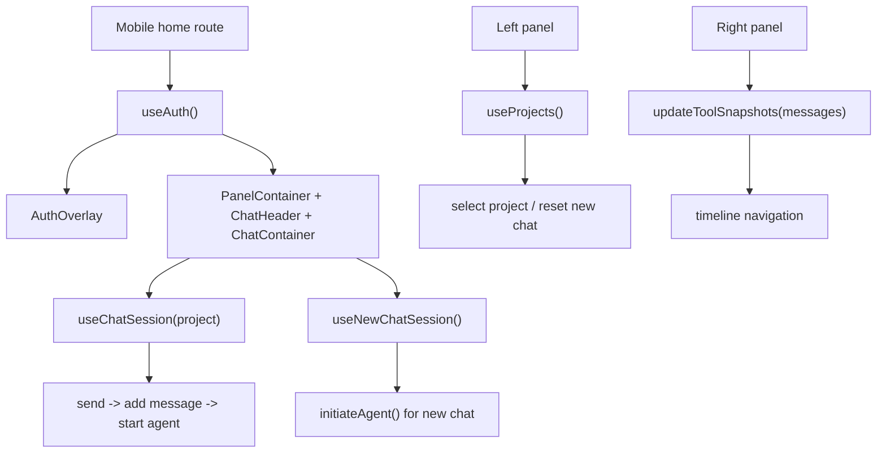

# Mobile Core Audit

> Phase window: 2026-06-12 to 2026-07-02
> Frozen on: 2026-03-13
> Scope: `MOB-01`, `MOB-02`, `MOB-03`, `MOB-04`
> Evidence basis: static code audit

---

## 1. Surface Summary

| Audit ID | Surface slice | Critical path | Primary risk | Verdict |
|---|---|---|---|---|
| `MOB-01` | Mobile home route | auth gate -> header -> panel container | blocked app entry | Pass |
| `MOB-02` | Mobile chat container | send -> stream -> cancel -> empty state | unusable mobile chat loop | Pass |
| `MOB-03` | Mobile left panel core navigation | load chats -> select chat -> new chat reset | project switch and chat continuity | Pass |
| `MOB-04` | Mobile right panel | tool snapshots -> timeline -> latest jump | broken tool review shell | Pass |

## 2. Flow Decomposition

```text
Mobile core flow
================

Home route
  -> useAuth() gates loading vs signed-out overlay vs authenticated shell
  -> selectedProject and isNewChatMode choose active chat session

Chat container
  -> selects project session or new-chat session
  -> optimistic send
  -> initiate or start agent
  -> stop path calls stream stop plus backend stop mutation

Left panel
  -> useProjects() fetches chat list
  -> selecting a real project exits new-chat mode
  -> pen button resets new-chat session

Right panel
  -> tool snapshots derived from message history
  -> latest/manual navigation modes preserved in store

Result
  -> static review did not justify a confirmed bug on the mobile auth gate, chat core loop, project switching, or tool timeline shell
```



## 3. Evidence Map

- `apps/mobile/app/index.tsx`
  - home route correctly branches between loading skeleton, auth overlay, and authenticated shell
- `apps/mobile/components/ChatContainer.tsx`
  - chat container selects the correct session and keeps send/cancel paths wired
- `apps/mobile/hooks/useChatHooks.tsx`
  - send, stream, stop, optimistic update, and new-chat initialization paths are all explicitly implemented
- `apps/mobile/components/LeftPanel.tsx`
  - left panel resets new-chat state and switches between stored projects
- `apps/mobile/components/RightPanel.tsx`
  - right panel derives tool snapshots from message history and preserves latest/manual timeline navigation

## 4. Findings

No bug-register-level defect was confirmed on the mobile auth gate, chat loop, project selection core, or right-panel timeline during static review.

## 5. Non-Bug Notes

- The mobile core files contain substantial debug logging, but that is treated as a non-functional concern for Phase 7 rather than a user-facing functional bug in this phase.
- Team-account and multi-workspace semantics are still less mature on mobile than on web, but this slice did not prove a bug without runtime evidence.

## 6. Verdict

- Result: `Pass`
- Open bug IDs:
  - none confirmed in this slice
- Regression follow-up:
  - keep mobile auth gate, new-chat initialization, project switch, send, and cancel flows in `REG-05`
