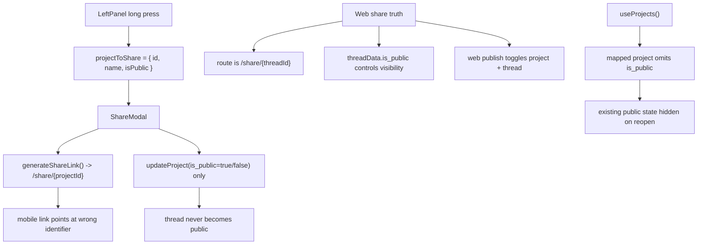

# Mobile Panel and Modal Audit

> Phase window: 2026-06-12 to 2026-07-02
> Frozen on: 2026-03-13
> Scope: `MOB-05`, `MOB-06`, `MOB-07`
> Evidence basis: static code audit

---

## 1. Surface Summary

| Audit ID | Surface slice | Critical path | Primary risk | Verdict |
|---|---|---|---|---|
| `MOB-05` | Settings drawer | open -> sign out -> close | account-management dead end | Pass |
| `MOB-06` | Share modal | show status -> create/remove link -> copy/open social | invalid public-link state on mobile | Fail |
| `MOB-07` | Chat and message action modals | long press -> share/delete/copy -> dismiss | broken modal action affordance | Pass |

## 2. Flow Decomposition

```text
Mobile panel and modal flow
===========================

Left panel long-press
  -> capture project layout
  -> store projectToDelete and projectToShare
  -> open ChatActionModal

Share modal
  -> receives projectId, projectName, isPublic
  -> if isPublic, synthesizes share URL locally
  -> create/remove only mutate project.is_public

Web share truth
  -> public route shape is /share/[threadId]
  -> web share modal reads threadData.is_public
  -> web share publish toggles both project.is_public and thread.is_public

Current mobile mismatch
  -> mobile share URL uses projectId, not threadId
  -> production host is hard-coded as https://yourdomain.com
  -> mobile never flips thread.is_public
  -> project list strips is_public, so existing public chats look private
```



## 3. Evidence Map

- `apps/mobile/components/LeftPanel.tsx:318-325`
  - share modal receives `project.id` and `project.is_public` from long-press state
- `apps/mobile/api/project-api.ts:47-84`
  - project list query joins threads but strips `is_public` when mapping project rows
- `apps/mobile/components/ShareModal.tsx:226-275`
  - mobile share modal derives visibility from `isPublic`, generates `/share/${projectId}`, and only mutates `project.is_public`
- `frontend/src/app/share/[threadId]/layout.tsx:4-45`
  - public web canonical route shape is `/share/${threadId}`
- `frontend/src/components/sidebar/share-modal.tsx:64-67`
  - web share link generation uses `threadId`
- `frontend/src/components/sidebar/share-modal.tsx:80-87`
  - web modal reads `threadData.is_public`
- `frontend/src/components/sidebar/share-modal.tsx:126-136`
  - web publish flow mutates both `project.is_public` and `thread.is_public`

## 4. Findings

## BUG-0019 - Mobile share modal generates an invalid public link and never publishes the thread

- Surface: Mobile share modal
- Audit ID: `MOB-06`
- Severity: `P1`
- Status: `Triaged`
- Owner: Mobile surface owner
- Phase target: `Phase 6`
- Environment:
  - app version / commit: repository state on 2026-03-13
  - role: authenticated mobile user
  - device: mobile
  - browser / platform: iOS, Android
  - locale: all

### Reproduction Steps
1. Open a mobile chat from the left panel.
2. Long-press the chat and open `Share`.
3. Create a share link.
4. Compare the generated link and mutation logic with the real web share route and publish flow.

### Expected Result

Mobile should publish the same public thread surface as web: generate `/share/{threadId}` on the real product host and toggle the thread's public flag together with any project-level metadata.

### Actual Result

The mobile modal generates `http://localhost:3000/share/{projectId}` in dev and `https://yourdomain.com/share/{projectId}` in production, while only mutating `project.is_public`. The actual public route in this repo is `/share/{threadId}`, and the web implementation also toggles `thread.is_public`.

### User Harm

The mobile share primary action is effectively false. It can show and copy a link that does not match the real public route, and it does not fully publish the shareable thread state.

### Workaround

Users must recreate the share operation from the web app, where the correct thread-based share flow exists.

### Evidence

- `apps/mobile/components/ShareModal.tsx:235-249`
- `apps/mobile/components/ShareModal.tsx:269-275`
- `frontend/src/app/share/[threadId]/layout.tsx:4-45`
- `frontend/src/components/sidebar/share-modal.tsx:64-67`
- `frontend/src/components/sidebar/share-modal.tsx:126-136`

### Severity Justification

`P1` because the mobile share action looks first-party and complete, but it produces an invalid public artifact and misses the thread-level publish contract that web relies on.

### Regression Target

- Must automate?: yes
- Candidate regression pack: `REG-05`

## BUG-0020 - Mobile share modal hides existing public state because project list strips is_public

- Surface: Mobile share modal / existing share state
- Audit ID: `MOB-06`
- Severity: `P2`
- Status: `Triaged`
- Owner: Mobile surface owner
- Phase target: `Phase 6`
- Environment:
  - app version / commit: repository state on 2026-03-13
  - role: authenticated mobile user
  - device: mobile
  - browser / platform: iOS, Android
  - locale: all

### Reproduction Steps
1. Load the mobile project list.
2. Long-press any previously shared chat and open `Share`.
3. Trace how `project.is_public` is populated from the list query.

### Expected Result

If a mobile chat is already public, the share modal should reopen in the public-state shell and show the existing share link / remove action.

### Actual Result

`LeftPanel` forwards `project.is_public`, but `useProjects()` never maps `is_public` onto returned project objects. That means the modal often receives `undefined`, treats the chat as private, and hides the existing public state.

### User Harm

The user cannot trust whether a mobile chat is already public. Existing shared conversations can look private, which makes revoke/share follow-up actions ambiguous.

### Workaround

Users must verify share state from the web app instead of trusting the mobile modal.

### Evidence

- `apps/mobile/api/project-api.ts:70-84`
- `apps/mobile/components/LeftPanel.tsx:323-325`
- `apps/mobile/components/ShareModal.tsx:226-233`

### Severity Justification

`P2` because the modal still opens and the chat remains usable, but the share-state shell is misleading and blocks reliable follow-up management.

### Regression Target

- Must automate?: yes
- Candidate regression pack: `REG-05`

## 5. Non-Bug Notes

- Static review did not prove a functional defect in the settings drawer sign-out flow.
- Chat action and message action modals appear structurally wired for dismiss/share/delete/copy interactions, even though animation and polish still need runtime validation.

## 6. Verdict

- Result: `Fail`
- Open bug IDs:
  - `BUG-0019`
  - `BUG-0020`
- Regression follow-up:
  - add mobile share create/reopen/remove coverage to `REG-05`
