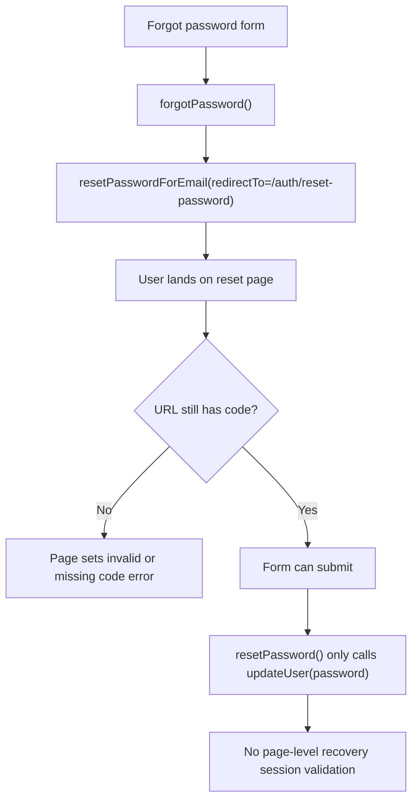
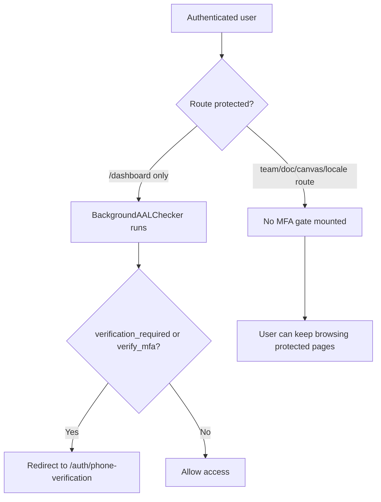

# P0 Auth Audit

> Phase window: 2026-03-27 to 2026-04-09
> Frozen on: 2026-03-13
> Scope: `ACC-01`, `ACC-03`
> Evidence basis: static code audit

---

## 1. Surface Summary

| Audit ID | Surface | Critical path | Primary risk | Verdict |
|---|---|---|---|---|
| `ACC-01` | Auth | sign in, sign up, forgot password, reset password | lockout, recovery failure, redirect drift | Fail |
| `ACC-03` | Phone verification | MFA enrollment, MFA verify, protected-route gate | policy bypass, inconsistent route enforcement | Fail |

## 2. Flow Decomposition

```text
Auth critical path
==================

Anonymous user
  -> /auth
  -> sign in or sign up
  -> authenticated session
  -> protected route

Password recovery
  -> forgot password form
  -> reset email
  -> recovery link
  -> /auth/reset-password
  -> submit new password
  -> sign in with new password

Phone verification
  -> authenticated user
  -> protected route
  -> background MFA check
  -> /auth/phone-verification when required
  -> return to requested page
```





## 3. Evidence Map

- `frontend/src/app/auth/actions.ts:127-176`
  - `forgotPassword()` sends the user to `/auth/reset-password`
  - `resetPassword()` only calls `supabase.auth.updateUser({ password })`
- `frontend/src/app/auth/reset-password/page.tsx:17-48`
  - page hard-requires `searchParams.get('code')`
  - missing `code` becomes a fatal UI error
- `frontend/src/components/AuthProvider.tsx:42-91`
  - project-wide auth provider mounts globally
  - no `PASSWORD_RECOVERY` branch exists
- `frontend/src/lib/supabase/client.ts:3-7`
  - browser client uses `createBrowserClient(...)`
- `frontend/node_modules/@supabase/ssr/dist/module/createBrowserClient.js:30-39`
  - browser auth uses `flowType: "pkce"` and `detectSessionInUrl: true`
- `frontend/node_modules/@supabase/auth-js/src/GoTrueClient.ts:2023-2035`
  - PKCE callback exchange removes `code` from the URL after session exchange
- `frontend/src/components/auth/background-aal-checker.tsx:42-85`
  - protected-route detection only covers `/dashboard`, `/agents`, `/projects`, `/settings`
- `frontend/src/app/(dashboard)/dashboard/page.tsx:7-31`
  - checker is mounted on dashboard page
- `frontend/src/app/(dashboard)/layout.tsx:11-15`
  - dashboard layout does not mount the checker globally
- `frontend/src/app/(home)/page.tsx:63-77`
  - home page mounts checker with `enabled={false}`
- route inventory confirms additional authenticated surfaces outside the checker's path list:
  - `frontend/src/app/(dashboard)/(teamAccount)/team/[accountSlug]/dashboard/page.tsx`
  - `frontend/src/app/(dashboard)/(teamAccount)/team/[accountSlug]/canvas/[canvasId]/page.tsx`
  - `frontend/src/app/(dashboard)/(teamAccount)/team/[accountSlug]/doc/[itemId]/page.tsx`
  - `frontend/src/app/[locale]/(dashboard)/subscription/page.tsx`
  - `frontend/src/app/[locale]/(dashboard)/(teamAccount)/team/[accountSlug]/dashboard/page.tsx`

## 4. Findings

## BUG-0001 - Reset password recovery depends on transient URL state and lacks explicit recovery-state validation

- Surface: Auth / reset password
- Audit ID: `ACC-01`
- Severity: `P0`
- Status: `Triaged`
- Owner: Auth surface owner
- Phase target: `Phase 2`
- Environment:
  - app version / commit: repository state on 2026-03-13
  - role: anonymous user requesting password recovery
  - device: desktop web
  - browser / platform: all browser clients using Supabase PKCE flow
  - locale: all

### Reproduction Steps
1. Submit the forgot-password form from `/auth`.
2. Follow the reset link sent by `forgotPassword()`.
3. Load `/auth/reset-password`.
4. Let the global auth client initialize and normalize the recovery callback URL.
5. Observe that the page validity check is tied only to `searchParams.get('code')`, not to actual recovery-session state.

### Expected Result

The reset page should validate recovery state from the authenticated recovery session and keep the form usable after the URL is normalized.

### Actual Result

The page treats missing `?code=` as a hard failure and never checks whether a valid recovery session already exists. Because the Supabase PKCE client is configured to auto-detect the session and remove `code` from the URL, the reset page is brittle and can reject a valid recovery path.

### User Harm

Locked-out users depend on password recovery. A brittle or version-dependent reset path is an auth backbone defect with no acceptable workaround.

### Workaround

No safe product-level workaround exists. A user may retry the flow, but the route logic itself is still coupled to transient callback URL state.

### Evidence

- `frontend/src/app/auth/actions.ts:127-176`
- `frontend/src/app/auth/reset-password/page.tsx:17-48`
- `frontend/src/components/AuthProvider.tsx:42-91`
- `frontend/node_modules/@supabase/ssr/dist/module/createBrowserClient.js:30-39`
- `frontend/node_modules/@supabase/auth-js/src/GoTrueClient.ts:2023-2035`

### Severity Justification

`P0` because auth recovery is a critical entry path and the implementation does not robustly preserve a valid recovery session through the reset page.

### Regression Target

- Must automate?: yes
- Candidate regression pack: `REG-01`

## BUG-0003 - MFA enforcement only protects a subset of authenticated routes

- Surface: Phone verification / route guard
- Audit ID: `ACC-03`
- Severity: `P1`
- Status: `Triaged`
- Owner: Frontend platform owner
- Phase target: `Phase 2`
- Environment:
  - app version / commit: repository state on 2026-03-13
  - role: authenticated user with `verification_required` or `verify_mfa`
  - device: desktop web
  - browser / platform: all
  - locale: all

### Reproduction Steps
1. Authenticate with an account that should be forced through phone verification.
2. Open a non-dashboard protected page directly, for example a team dashboard, team canvas, team doc, or locale-wrapped subscription route.
3. Observe route rendering path and the mounted providers.
4. Compare it with the pages where `BackgroundAALChecker` is actually mounted.

### Expected Result

All authenticated product routes that require MFA policy enforcement should pass through one shared guard before rendering protected content.

### Actual Result

The guard only recognizes four path prefixes and is only mounted on the dashboard page. Most authenticated routes, including locale and team wrappers, can render without the MFA redirect ever executing.

### User Harm

Accounts that should be blocked pending phone verification can continue using protected product surfaces. This weakens the intended security policy and creates inconsistent user behavior across routes.

### Workaround

Users can be told to open `/dashboard`, but that is not a real enforcement mechanism.

### Evidence

- `frontend/src/components/auth/background-aal-checker.tsx:42-85`
- `frontend/src/app/(dashboard)/dashboard/page.tsx:7-31`
- `frontend/src/app/(dashboard)/layout.tsx:11-15`
- `frontend/src/app/(home)/page.tsx:63-77`
- authenticated route inventory under `frontend/src/app/(dashboard)` and `frontend/src/app/[locale]/(dashboard)`

### Severity Justification

`P1` because mandatory MFA policy becomes inconsistent and bypassable on high-value authenticated surfaces, but the flaw does not by itself grant cross-account access.

### Regression Target

- Must automate?: yes
- Candidate regression pack: `REG-01`

## 5. Non-Bug Notes

- `signIn()` and `signUp()` sanitize `returnUrl` to internal paths only, which is a good redirect-safety baseline.
- No additional confirmed auth P0 was logged in this pass beyond the reset-password path.

## 6. Verdict

- Result: `Fail`
- Open bug IDs:
  - `BUG-0001`
  - `BUG-0003`
- Regression follow-up:
  - convert reset-password flow into a Playwright recovery test
  - move MFA enforcement to a shared authenticated layout guard
