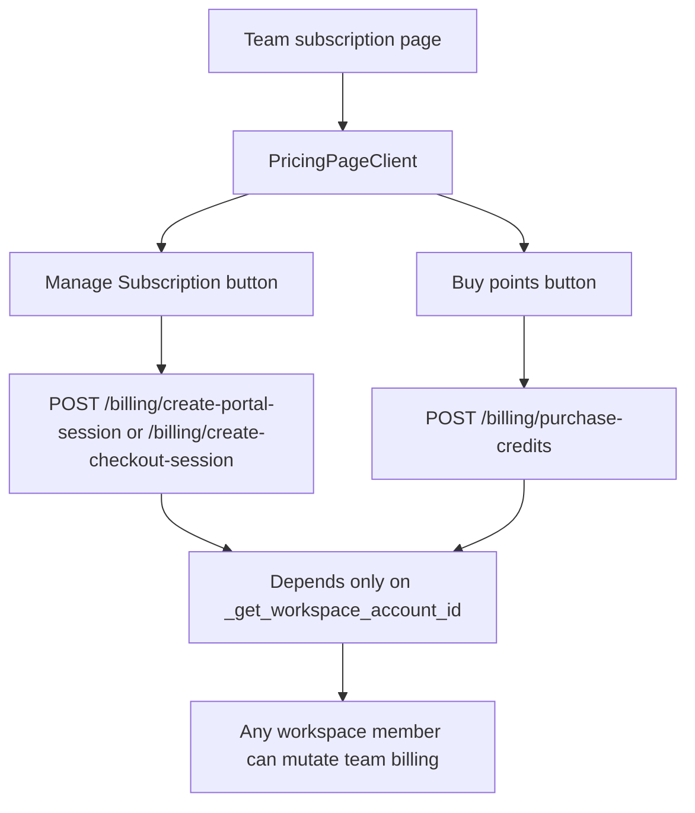

# P0 Billing and Credits Audit

> Phase window: 2026-03-27 to 2026-04-09
> Frozen on: 2026-03-13
> Scope: `CORE-16`
> Evidence basis: static code audit

---

## 1. Surface Summary

| Audit ID | Surface | Critical path | Primary risk | Verdict |
|---|---|---|---|---|
| `CORE-16` | Subscription | plan state, checkout, portal, cancel/reactivate | entitlement corruption, unauthorized billing mutations | Fail |
| `CORE-16` | Credits | balance visibility, credit purchase | wrong credit spend or unauthorized purchase | Fail |

## 2. Flow Decomposition

```text
Billing mutation path
=====================

Team member or owner
  -> /team/[accountSlug]/subscription
  -> PricingPageClient
  -> manage subscription / buy points
  -> frontend billing client
  -> backend billing endpoint
  -> provider checkout or account mutation

Required permission chain
  membership
    -> role validation
      -> owner-only billing mutation

Actual chain in current code
  membership
    -> billing mutation allowed
```



## 3. Evidence Map

- `frontend/src/app/(dashboard)/(teamAccount)/team/[accountSlug]/subscription/page.tsx:5-8`
  - team subscription route renders `PricingPageClient` directly
- `frontend/src/components/pricing/PricingPageClient.tsx:103-177`
  - renders the billing modal entry and "Manage Subscription" action
- `frontend/src/components/pricing/PricingPageClient.tsx:200-208`
  - renders the credit purchase entry
- `frontend/src/components/billing/credit-purchase.tsx:233`
  - credit purchase modal posts to `/billing/purchase-credits`
- `frontend/src/lib/api/billing-v2.ts:260-295`
  - exposes checkout, portal, cancel, reactivate, and purchase requests
- `backend/core/billing/api.py:449-474`
  - `POST /purchase-credits`
- `backend/core/billing/api.py:793-816`
  - `POST /create-checkout-session`
- `backend/core/billing/api.py:818-838`
  - `POST /create-portal-session`
- `backend/core/billing/api.py:858-897`
  - `POST /cancel-subscription` and `POST /reactivate-subscription`
- `backend/core/utils/auth_utils.py:205-223`
  - workspace resolution validates membership only
- `backend/core/canvas/api.py:1176-1206`
  - contrasting owner-only helper exists for collaboration invite management

## 4. Findings

## BUG-0002 - Team members can trigger owner-level billing mutations for the workspace

- Surface: Team billing / subscription / credit purchase
- Audit ID: `CORE-16`
- Severity: `P0`
- Status: `Triaged`
- Owner: Billing API owner
- Phase target: `Phase 2`
- Environment:
  - app version / commit: repository state on 2026-03-13
  - role: team member in a shared workspace
  - device: desktop web
  - browser / platform: all
  - locale: all

### Reproduction Steps
1. Log in as a non-owner member of a team workspace.
2. Open `/team/[accountSlug]/subscription`.
3. Trigger any billing mutation entry:
   - create checkout session
   - create portal session
   - cancel subscription
   - reactivate subscription
   - purchase credits
4. Inspect backend dependency chain for these endpoints.

### Expected Result

Only workspace owners should be able to mutate team billing state or launch provider billing flows for the workspace account.

### Actual Result

All billing mutations depend on `_get_workspace_account_id`, which only verifies workspace membership. No owner-role check exists on the billing endpoints even though owner-only helpers are already used elsewhere in the codebase.

### User Harm

Any team member can potentially purchase credits, open the billing portal, cancel, or reactivate the team's subscription. This is an entitlement and money boundary failure.

### Workaround

No safe workaround exists inside the product. The protection must be enforced server-side.

### Evidence

- `frontend/src/app/(dashboard)/(teamAccount)/team/[accountSlug]/subscription/page.tsx:5-8`
- `frontend/src/components/pricing/PricingPageClient.tsx:103-177`
- `frontend/src/components/pricing/PricingPageClient.tsx:200-208`
- `backend/core/billing/api.py:449-474`
- `backend/core/billing/api.py:793-897`
- `backend/core/utils/auth_utils.py:205-223`
- `backend/core/canvas/api.py:1176-1206`

### Severity Justification

`P0` because billing and entitlement mutations are exposed to the wrong role with no safe workaround.

### Regression Target

- Must automate?: yes
- Candidate regression pack: `REG-01`

## 5. Non-Bug Notes

- Read-only subscription summary and credit balance endpoints were not flagged in this pass.
- The critical gap is the missing owner-only authorization boundary on write endpoints.

## 6. Verdict

- Result: `Fail`
- Open bug IDs:
  - `BUG-0002`
- Regression follow-up:
  - add API-level member-vs-owner negative tests
  - add UI route smoke that verifies team members cannot see or trigger billing mutations
