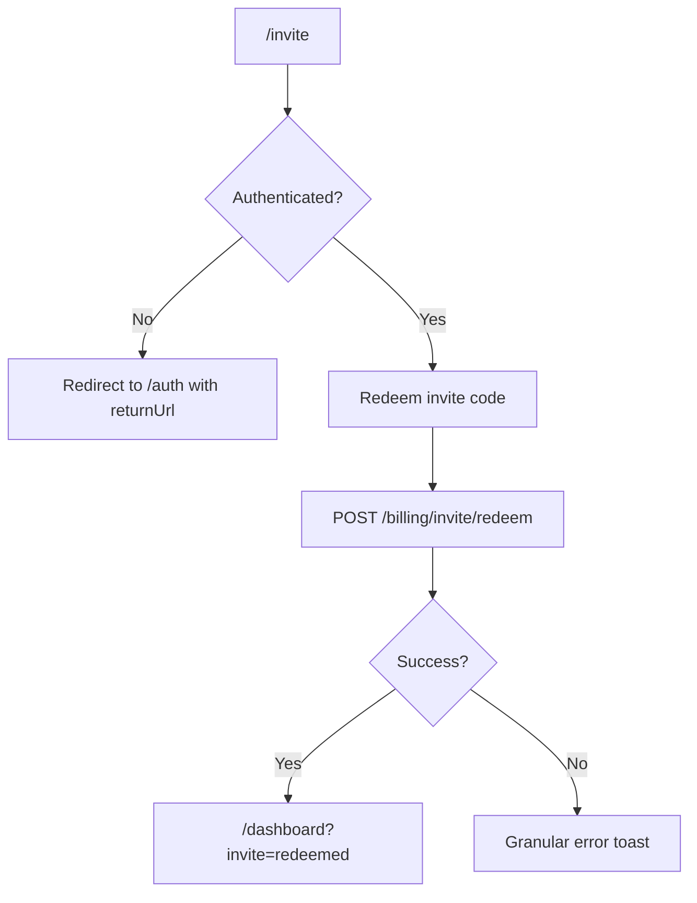
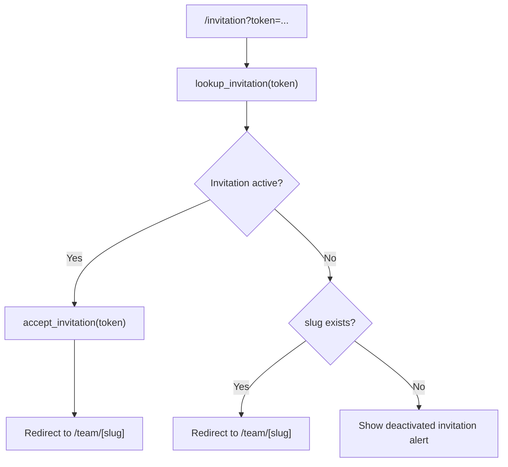

# P0 Invite and Activation Audit

> Phase window: 2026-03-27 to 2026-04-09
> Frozen on: 2026-03-13
> Scope: `ACC-04` plus critical invitation acceptance entry checks
> Evidence basis: static code audit

---

## 1. Surface Summary

| Audit ID | Surface | Critical path | Primary risk | Verdict |
|---|---|---|---|---|
| `ACC-04` | Invite / Activate trial | auth redirect, code redeem, maintenance gate, dashboard success redirect | lost conversion, wrong credit unlock, blocked onboarding | Pass with watchlist |
| `BND-04` | Team invitation accept | token lookup, accept invite, inactive fallback | unauthorized onboarding or wrong redirect | Pass with watchlist |

## 2. Flow Decomposition

```text
Invite activation path
======================

Anonymous user
  -> /invite?code=XXXXXX
  -> redirect to /auth?returnUrl=/invite?code=XXXXXX
  -> authenticated user
  -> redeem invite code
  -> /billing/invite/redeem
  -> dashboard with invite=redeemed

Team invitation path
  -> /invitation?token=...
  -> lookup_invitation()
  -> if active: accept_invitation()
  -> /team/[slug]
  -> if inactive: fallback message or redirect
```





## 3. Evidence Map

- `frontend/src/app/invite/page.tsx:43-130`
  - preserves invite code in `returnUrl`
  - redeems invite through the billing API
  - routes successful redemption to `/dashboard?invite=redeemed`
- `backend/core/billing/api.py:480-641`
  - invite redeem validates active state, expiry, per-code usage, per-account usage, and optional new-account-only rule
- `frontend/src/components/sidebar/invite-codes-card.tsx:24`
  - generated personal invite links use `/invite?code=...`
- `frontend/src/app/invitation/page.tsx:12-27`
  - invitation accept entry page requires `token`
- `frontend/src/components/basejump/accept-team-invitation.tsx:35-119`
  - active invite path calls `accept_invitation`
  - inactive path redirects to `/team/[slug]` when `slug` exists

## 4. Findings

### Confirmed defects

- No confirmed `P0` or `P1` defect was logged for the invite redeem path in this static audit pass.
- The redeem API contains the expected core defenses for active state, expiry, one-time use, and new-account eligibility.

### Watchlist item - inactive invitation redirect assumes downstream membership enforcement

- Surface: Team invitation accept
- Confidence: medium
- Why it matters:
  - `accept-team-invitation.tsx` redirects to `/team/[slug]` for inactive invitations when `slug` exists, without performing an explicit membership recheck in that component.
  - This may still be safe if the team route performs its own hard access validation, but that guarantee is not established inside this Phase 2 slice.
- Action:
  - Track as `RISK-0007`
  - re-open in Phase 5 boundary audit with end-to-end verification

## 5. Verdict

- Result: `Pass with watchlist`
- Confirmed bug IDs: none
- Risk follow-up:
  - validate inactive invitation fallback path in Phase 5
  - add invite redeem success and rejection cases to `REG-01`
