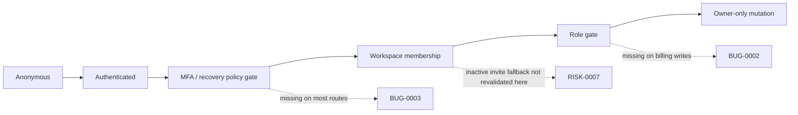

# P0 Permission Boundary Audit

> Phase window: 2026-03-27 to 2026-04-09
> Frozen on: 2026-03-13
> Scope: critical owner/member/auth boundary checks spanning `ACC-03`, `CORE-16`, `BND-03`, `BND-04`
> Evidence basis: static code audit

---

## 1. Boundary Model

```text
Expected permission chain
=========================

Anonymous
  -> auth required
Authenticated user
  -> policy gate (MFA / recovery / invite state)
Workspace member
  -> role gate
Workspace owner
  -> billing / collaboration management / destructive team actions

Current weak points
===================

Weak point A
  MFA gate is route-local instead of layout-global

Weak point B
  Team billing write endpoints stop at membership, not owner role

Weak point C
  Inactive team invitation fallback assumes downstream route guard
```



## 2. Boundary Matrix

| Boundary | Expected rule | Current implementation signal | Result |
|---|---|---|---|
| Auth recovery | valid recovery state should control reset access | reset page only checks `?code=` query presence | Fail |
| MFA gate | all protected routes should enforce phone verification when required | checker mounted only on dashboard page and hard-codes four prefixes | Fail |
| Team billing | owner-only mutations | endpoints validate membership only | Fail |
| Team invitation inactive fallback | explicit member check before redirect | component redirects by slug if present | Watch |

## 3. Evidence Links

- Auth recovery boundary:
  - `frontend/src/app/auth/reset-password/page.tsx:17-48`
  - `frontend/src/components/AuthProvider.tsx:42-91`
- MFA route boundary:
  - `frontend/src/components/auth/background-aal-checker.tsx:42-85`
  - `frontend/src/app/(dashboard)/dashboard/page.tsx:7-31`
  - `frontend/src/app/(dashboard)/layout.tsx:11-15`
- Billing role boundary:
  - `backend/core/utils/auth_utils.py:205-223`
  - `backend/core/billing/api.py:449-474`
  - `backend/core/billing/api.py:793-897`
  - `backend/core/canvas/api.py:1176-1206`
- Invitation fallback boundary:
  - `frontend/src/components/basejump/accept-team-invitation.tsx:101-104`

## 4. Linked Findings

### Confirmed defects

- `BUG-0002`
  - Team billing mutations skip owner-role authorization.
- `BUG-0003`
  - MFA enforcement is not layout-global and misses most authenticated routes.

### Watchlist

- `RISK-0007`
  - inactive invitation fallback redirect needs end-to-end boundary validation

## 5. Verdict

- Result: `Fail`
- Why:
  - critical policy checks are implemented inconsistently
  - role and route boundaries do not line up with the product's stated trust model
- Exit requirement for later phases:
  - consolidate guard logic into shared authenticated layouts
  - move owner-only checks to the billing backend, not the UI
