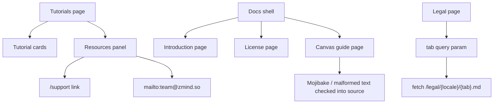

# Public Content Surface Audit

> Phase window: 2026-06-12 to 2026-07-02
> Frozen on: 2026-03-13
> Scope: `PUB-03`, `PUB-04`, `PUB-05`, `PUB-06`
> Evidence basis: static code audit

---

## 1. Surface Summary

| Audit ID | Surface slice | Critical path | Primary risk | Verdict |
|---|---|---|---|---|
| `PUB-03` | Changelog | page render -> changelog component | broken read-only content surface | Pass |
| `PUB-04` | Tutorials | chapter nav -> embedded demos -> resource links | dead resource exits or broken onboarding handoff | Fail |
| `PUB-05` | Legal | tab state -> markdown fetch -> locale-specific docs load | wrong legal content or broken query-state sync | Pass |
| `PUB-06` | Docs content | intro/license/canvas guide content render | corrupted content asset or broken documentation trust | Fail |

## 2. Flow Decomposition

```text
Public content flow
===================

Tutorials
  -> static tutorial inventory
  -> chapter hash navigation
  -> resource panel exposes support/contact exits

Docs
  -> docs shell renders content pages inside sidebar layout
  -> introduction and license pages are structured and readable
  -> canvas guide is checked in as page content, not fetched from CMS

Legal
  -> query param selects terms/privacy
  -> markdown file fetched from /legal/{locale}/{tab}.md

Result
  -> changelog and legal base shells are structurally coherent
  -> tutorials includes a dead support route
  -> docs content trust is broken by encoding-corrupted checked-in assets
```



## 3. Evidence Map

- `frontend/src/app/(home)/tutorials/page.tsx:288-310`
  - tutorials resource panel links to `/support`
- workspace route inventory on 2026-03-13
  - no `frontend/src/app/support` route exists in this repository
- `frontend/src/app/docs/canvas-guide/page.tsx:5-129`
  - canvas-guide page content is stored in source with mojibake and malformed tags
- `frontend/src/messages/zh-CN.json:338-412`
  - public-facing Chinese locale content contains widespread mojibake in shared UI strings
- `frontend/src/messages/en.json:375-405`
  - even the English locale file contains corrupted `languageToggle` copy
- `frontend/src/components/home/sections/navbar.tsx:256-263`
  - language menu renders mojibake instead of readable Chinese and checkmark glyphs
- `frontend/src/app/legal/page.tsx`
  - legal page derives active tab from query params and fetches markdown assets by locale/tab
- `frontend/src/app/(home)/changelog/page.tsx`
  - changelog route is a thin wrapper over the `Changelog` component with no conflicting static logic

## 4. Findings

## BUG-0016 - Public docs and locale copy assets are encoding-corrupted

- Surface: Docs content and public locale copy
- Audit ID: `PUB-06`
- Severity: `P1`
- Status: `Triaged`
- Owner: Frontend platform owner
- Phase target: `Phase 6`
- Environment:
  - app version / commit: repository state on 2026-03-13
  - role: anonymous, authenticated
  - device: web
  - browser / platform: all
  - locale: especially `zh`, but corruption also leaks into shared copy assets

### Reproduction Steps
1. Open the checked-in docs source for `canvas-guide`.
2. Inspect the rendered copy tokens used by the navbar language menu and locale JSON files.
3. Compare expected readable Chinese copy with the stored source text.

### Expected Result

Chinese public copy and docs assets should remain valid UTF-8 text, and every checked-in docs page should contain readable, syntactically valid content.

### Actual Result

The canvas-guide page is committed with mojibake and malformed tags, the Chinese locale file contains widespread garbled strings, and even `en.json` plus the navbar language menu still expose corrupted copy artifacts.

### User Harm

This is a public-trust defect. Documentation becomes unreadable, locale switching looks broken, and the product visibly ships encoding damage on first-impression surfaces.

### Workaround

Users can fall back to unaffected English pages where available, but the corrupted docs asset and locale strings themselves must be repaired in source.

### Evidence

- `frontend/src/app/docs/canvas-guide/page.tsx:5-129`
- `frontend/src/messages/zh-CN.json:338-412`
- `frontend/src/messages/en.json:375-405`
- `frontend/src/components/home/sections/navbar.tsx:256-263`

### Severity Justification

`P1` because the defect damages a supported public locale and the documentation surface itself. It does not expose data, but it materially breaks credibility and product comprehension for affected users.

### Regression Target

- Must automate?: yes
- Candidate regression pack: `REG-05`

## BUG-0018 - Tutorials resource panel links to a non-existent support page

- Surface: Tutorials / resource exits
- Audit ID: `PUB-04`
- Severity: `P3`
- Status: `Triaged`
- Owner: Public web owner
- Phase target: `Phase 6`
- Environment:
  - app version / commit: repository state on 2026-03-13
  - role: anonymous, authenticated
  - device: web desktop
  - browser / platform: all
  - locale: all

### Reproduction Steps
1. Open `/tutorials`.
2. Scroll to the right-side Resources panel on desktop.
3. Click the `Support` link.
4. Compare the link target with the route inventory in `frontend/src/app`.

### Expected Result

The tutorials resource panel should link to a real support destination, such as an existing page, mailto link, or external support property.

### Actual Result

The page links to `/support`, but this repository has no matching public route. The built-in resource exit is therefore dead.

### User Harm

The tutorials page promises onboarding help, then routes users into a missing page exactly when they ask for support. The damage is limited, but it is visible on a public onboarding surface.

### Workaround

Users can use the mailto contact link in the same panel instead of the broken support link.

### Evidence

- `frontend/src/app/(home)/tutorials/page.tsx:292-307`
- repository route inventory on 2026-03-13 confirms there is no `frontend/src/app/support`

### Severity Justification

`P3` because the core tutorial content still renders and a secondary contact path still exists, but one public support affordance is dead.

### Regression Target

- Must automate?: yes
- Candidate regression pack: `REG-05`

## 5. Non-Bug Notes

- Static review did not confirm a bug-register defect in the legal tab/query synchronization logic.
- Changelog remains a thin content wrapper with no independent route logic risk visible in static review.

## 6. Verdict

- Result: `Fail`
- Open bug IDs:
  - `BUG-0016`
  - `BUG-0018`
- Regression follow-up:
  - add docs content readability validation and tutorials resource-link checks to `REG-05`
