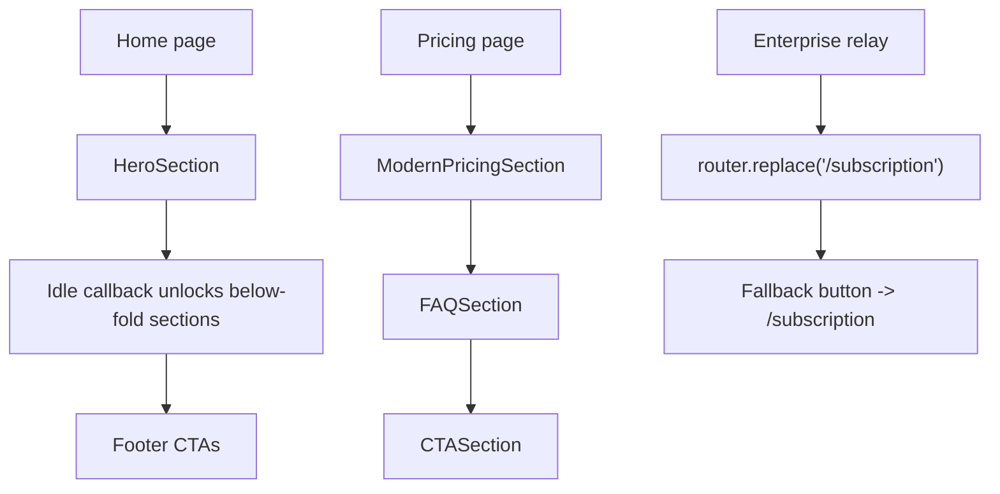

# Public Home and Pricing Audit

> Phase window: 2026-06-12 to 2026-07-02
> Frozen on: 2026-03-13
> Scope: `PUB-01`, `PUB-02`, `PUB-07`
> Evidence basis: static code audit

---

## 1. Surface Summary

| Audit ID | Surface slice | Critical path | Primary risk | Verdict |
|---|---|---|---|---|
| `PUB-01` | Home landing | hero -> below-fold sections -> footer CTAs | broken CTA or deferred-content shell | Pass |
| `PUB-02` | Pricing | plan compare -> FAQ -> CTA | wrong conversion shell or broken plan presentation | Pass |
| `PUB-07` | Enterprise relay | `/enterprise` -> subscription handoff | stale marketing relay or dead redirect | Pass |

## 2. Flow Decomposition

```text
Public landing and pricing flow
===============================

Home
  -> HeroSection renders immediately
  -> below-fold sections unlock after idle callback / timeout
  -> footer keeps public CTA and docs/legal exits available

Pricing
  -> ModernPricingSection renders public plan comparison
  -> FAQ and CTA reuse the same public shell

Enterprise relay
  -> /enterprise is a soft relay
  -> page redirects users into /subscription
  -> fallback button offers the same destination

Result
  -> base public home/pricing/enterprise routes are internally consistent
  -> no static-audit defect justified a bug-register entry on the non-locale base routes
```



## 3. Evidence Map

- `frontend/src/app/(home)/page.tsx`
  - home page defers below-fold sections through `requestIdleCallback` / timeout while keeping hero content live immediately
- `frontend/src/app/(home)/pricing/page.tsx`
  - pricing route is a direct public composition of pricing, FAQ, CTA, and footer sections
- `frontend/src/app/(home)/enterprise/page.tsx`
  - enterprise route is intentionally a relay into `/subscription`

## 4. Findings

No bug-register-level defect was confirmed on the base non-locale home, pricing, or enterprise routes during static review.

## 5. Non-Bug Notes

- Locale-specific drift on public routes is tracked separately in `docs/qa/audits/locale-consistency-audit.md`.
- This pass did not prove runtime quality for pricing checkout entry because the actual purchase path lives on authenticated subscription surfaces audited elsewhere.

## 6. Verdict

- Result: `Pass`
- Open bug IDs:
  - none confirmed in this slice
- Regression follow-up:
  - cover public home render, pricing shell render, and enterprise relay in `REG-05`
