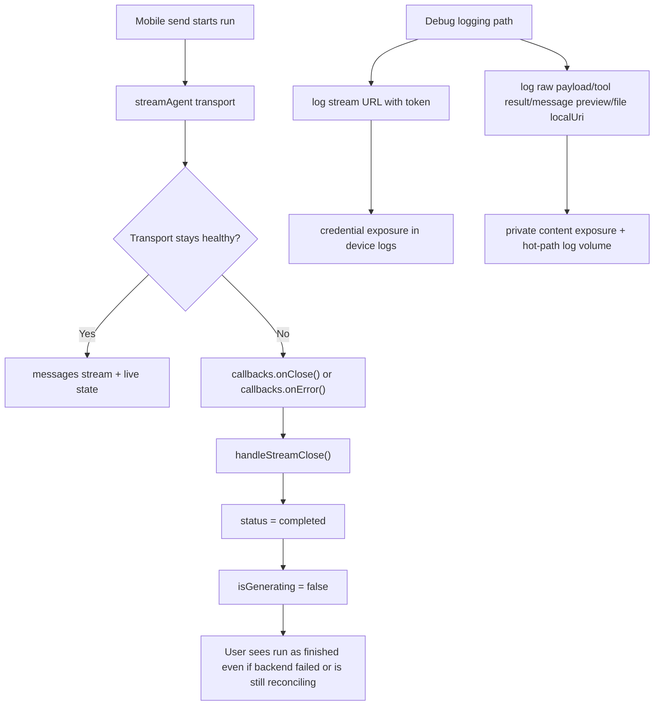

# Resilience and Recovery Audit

> Phase window: 2026-07-03 to 2026-07-09
> Frozen on: 2026-03-13
> Scope: `RES-01`, `RES-02`, `RES-03`
> Evidence basis: static code audit

---

## 1. Surface Summary

| Audit ID | Surface slice | Critical path | Primary risk | Verdict |
|---|---|---|---|---|
| `RES-01` | Mobile agent stream recovery | send -> stream -> disconnect/fail/stop -> reconcile | transport close is treated as success | Fail |
| `RES-02` | Long-session performance | long thread/tool history -> parse -> render -> sync | full-history work scales without guardrails | Fail |
| `RES-03` | Observability and incident recovery | capture incident -> identify run/thread -> recover safely | secrets and private payloads are written to logs | Fail |

## 2. Flow Decomposition

```text
Recovery truth
==============

Mobile stream today
  -> startStreaming(runId)
  -> transport closes or backend marks run non-running
  -> callbacks.onClose()
  -> handleStreamClose() maps "connecting/streaming" to "completed"
  -> generating indicator turns off
  -> user loses live/failure/stop truth

Security and observability today
  -> mobile stream URL is built with token query param
  -> debug logs print full URL
  -> debug logs also print raw stream payload, tool result preview,
     message preview, file localUri, and file metadata
  -> device logs now contain credentials and private conversation data

Expected robust baseline
  -> transport close is not treated as success until backend status is verified
  -> failed/stopped/completed states remain distinguishable
  -> production logs are redacted and structured
  -> incident responders capture run/thread IDs without leaking tokens or content
```



## 3. Evidence Map

- `apps/mobile/hooks/useChatHooks.tsx:348-353`
  - mobile stream close handler converts any close during `connecting` or `streaming` into `completed`
- `apps/mobile/hooks/useChatHooks.tsx:462-477`
  - mobile UI state turns off generating for `completed`, `stopped`, `error`, `failed`, and `agent_not_running`
- `apps/mobile/api/chat-api.ts:156-158`
  - React Native XHR fallback reports `DONE` as generic close without terminal-status classification
- `apps/mobile/api/chat-api.ts:916-924`
  - EventSource error path calls `onClose()` for every non-running backend status without preserving whether the run failed, stopped, or completed
- `frontend/src/hooks/useAgentStream.ts:1148-1206`
  - web hook does an explicit final-status check before finalization, which is the stronger reference behavior mobile currently lacks
- `apps/mobile/api/chat-api.ts:815-822`
  - mobile stream setup logs the full stream URL after appending the auth token query parameter
- `apps/mobile/api/chat-api.ts:859-880`
  - mobile stream logs raw EventSource payloads and parsed content previews
- `apps/mobile/api/chat-api.ts:1001-1012`
  - mobile initiate path logs message preview plus uploaded-file metadata and local URI
- `apps/mobile/components/RightPanel.tsx:352-356`
  - right panel render path logs raw tool result content
- `apps/mobile/components/MessageThread.tsx:86-88`
  - file-open interaction logs the full attachment payload
- `frontend/src/app/monitoring/route.ts:1-45`
  - repo exposes a Sentry tunnel endpoint
- `frontend/src/lib/telemetry.ts:1-19`
  - web telemetry wrapper is limited to PostHog product events
- `frontend/src/app/layout.tsx:10-12`
  - layout imports analytics helpers only
- `frontend/src/app/layout.tsx:209-210`
  - layout wires Google Analytics and PostHog identity, not release-grade recovery instrumentation

## 4. Findings

## BUG-0021 - Mobile stream recovery collapses disconnect, failure, and stop states into "completed"

- Surface: Mobile thread streaming and recovery
- Audit ID: `RES-01`
- Severity: `P1`
- Status: `Triaged`
- Owner: Mobile thread owner
- Phase target: `Phase 7`
- Environment:
  - app version / commit: repository state on 2026-03-13
  - role: authenticated mobile user
  - device: mobile
  - browser / platform: iOS, Android
  - locale: all

### Reproduction Steps
1. Start a mobile agent run from an authenticated chat.
2. Let the SSE/XHR transport close, or let the backend move the run into a non-running terminal state after a stream error.
3. Trace the callback chain from `streamAgent()` into `handleStreamClose()`.
4. Observe how mobile chooses the terminal UI state.

### Expected Result

Mobile should verify backend run status before declaring success, and it should preserve the difference between `completed`, `failed`, and `stopped` so the user can trust live state and recovery actions.

### Actual Result

Any close event that arrives while the hook still thinks it is `connecting` or `streaming` is finalized as `completed`. The transport layer also reports non-running statuses back through plain `onClose()` without preserving whether the backend actually completed, failed, or was stopped.

### User Harm

Mobile users can see a run as successfully finished when the stream merely disconnected or the backend actually ended in failure/stopped state. That makes live-state trust, cancel affordances, and follow-up recovery behavior unreliable on a core thread surface.

### Workaround

Users can manually reopen the thread and wait for periodic message refresh, but the live session state shown during the incident is not trustworthy and failure reasons can still be obscured.

### Evidence

- `apps/mobile/hooks/useChatHooks.tsx:348-353`
- `apps/mobile/hooks/useChatHooks.tsx:462-477`
- `apps/mobile/api/chat-api.ts:156-158`
- `apps/mobile/api/chat-api.ts:916-924`
- `frontend/src/hooks/useAgentStream.ts:1148-1206`

### Severity Justification

`P1` because the defect seriously degrades the main mobile thread workflow and makes recovery behavior misleading, even though messages may eventually be recoverable after later refresh.

### Regression Target

- Must automate?: yes
- Candidate regression pack: `REG-06`

## BUG-0022 - Mobile production logging leaks auth tokens and private conversation data

- Surface: Mobile stream, tool, and attachment observability
- Audit ID: `RES-03`
- Severity: `P0`
- Status: `Triaged`
- Owner: Mobile platform owner
- Phase target: `Phase 7`
- Environment:
  - app version / commit: repository state on 2026-03-13
  - role: authenticated mobile user
  - device: mobile
  - browser / platform: iOS, Android
  - locale: all

### Reproduction Steps
1. Start any authenticated mobile chat run.
2. Inspect the logging statements in stream setup, stream message handling, tool rendering, and file-open flows.
3. Compare the logged payloads with the sensitive data carried by those flows.

### Expected Result

Production mobile builds should never write access tokens, raw stream payloads, private tool output, message previews, or local file paths to logs. Debug instrumentation should be dev-gated and redacted.

### Actual Result

The mobile app logs the full stream URL after appending the auth token, logs raw stream payload and parsed content previews, logs message preview and uploaded-file metadata including `localUri`, and logs raw tool-result content and attachment payloads from UI surfaces.

### User Harm

Unauthorized data exposure is possible through device logs, remote debug sessions, CI captures, or support/crash pipelines. The same logging volume also adds avoidable overhead to the hottest mobile chat paths.

### Workaround

There is no safe end-user workaround. The app itself emits the sensitive logs.

### Evidence

- `apps/mobile/api/chat-api.ts:815-822`
- `apps/mobile/api/chat-api.ts:859-880`
- `apps/mobile/api/chat-api.ts:1001-1012`
- `apps/mobile/components/RightPanel.tsx:352-356`
- `apps/mobile/components/MessageThread.tsx:86-88`
- `apps/mobile/stores/ui-store.ts:263-351`

### Severity Justification

`P0` because access tokens and private conversation/tool/file data are written into production logging paths, which makes unauthorized data exposure possible with no safe workaround.

### Regression Target

- Must automate?: yes
- Candidate regression pack: `REG-06`

## 5. Non-Bug Notes

- The web thread stream hook is materially more resilient than the mobile hook because it verifies backend final status before finalization and performs explicit post-stream reconciliation.
- The repository already contains business analytics and a Sentry tunnel route, but that is not the same as release-grade incident breadcrumbs for stream recovery.

## 6. Verdict

- Result: `Fail`
- Open bug IDs:
  - `BUG-0021`
  - `BUG-0022`
- Regression follow-up:
  - add resilience and recovery coverage to a new `REG-06` pack before release closure
