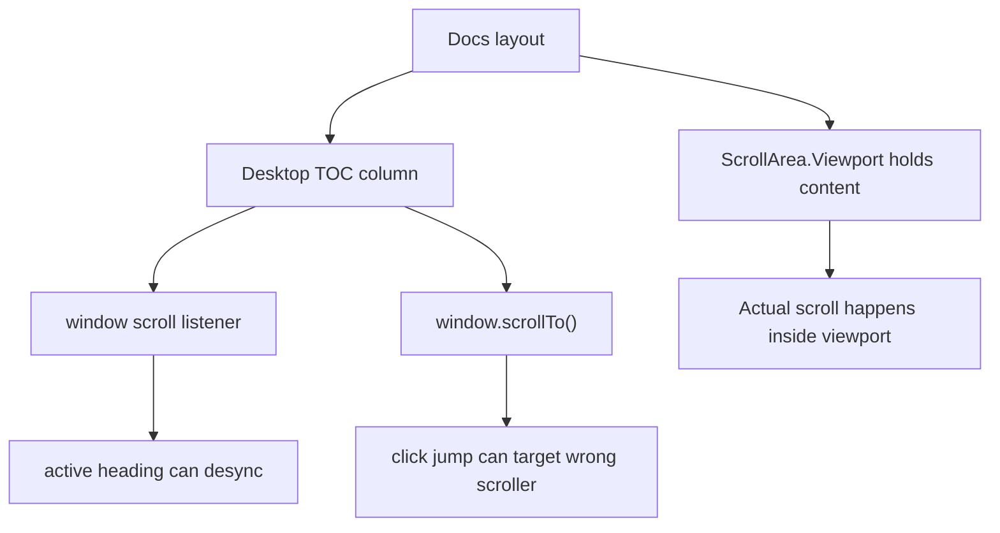

# Responsive Consistency Audit

> Phase window: 2026-06-12 to 2026-07-02
> Frozen on: 2026-03-13
> Scope: breakpoint consistency for public/docs surfaces
> Evidence basis: static code audit

---

## 1. Surface Summary

| Audit ID | Surface slice | Critical path | Primary risk | Verdict |
|---|---|---|---|---|
| `PUB-06` | Docs desktop navigation parity | content scroll -> TOC highlight -> section jump | desktop-only navigation shell uses wrong scroll source | Fail |
| `PUB-04` | Tutorials layout parity | content column -> desktop resources -> mobile simplified view | no confirmed breakpoint logic defect beyond missing support route | Pass |
| `PUB-01` | Home / pricing layout parity | hero, cards, CTA stacking | no confirmed static breakpoint defect | Pass |

## 2. Flow Decomposition

```text
Responsive consistency flow
===========================

Docs desktop shell
  -> content rendered inside Radix ScrollArea viewport
  -> TOC rendered in a separate fixed/sticky column
  -> TOC logic listens to window scroll and calls window.scrollTo

Docs mobile shell
  -> TOC column removed
  -> content still scrolls in ScrollArea viewport

Result
  -> desktop-specific docs navigation logic is wired to the wrong scroll container
  -> active heading tracking and click-to-jump behavior drift from the actual content viewport
```



## 3. Evidence Map

- `frontend/src/app/docs/layout.tsx:27-38`
  - docs content is placed inside a `ScrollArea`, while the TOC is rendered outside in a desktop-only column
- `frontend/src/components/ui/scroll-area.tsx:14-24`
  - `ScrollAreaPrimitive.Viewport` is the actual scroll container
- `frontend/src/components/ui/table-of-contents.tsx:57-113`
  - TOC active-state tracking and jump logic both depend on `window.scrollY`, `window.addEventListener('scroll', ...)`, and `window.scrollTo(...)`

## 4. Findings

## BUG-0017 - Docs table of contents listens to the wrong scroll container

- Surface: Docs desktop TOC
- Audit ID: `PUB-06`
- Severity: `P2`
- Status: `Triaged`
- Owner: Docs surface owner
- Phase target: `Phase 6`
- Environment:
  - app version / commit: repository state on 2026-03-13
  - role: anonymous, authenticated
  - device: web desktop
  - browser / platform: all
  - locale: all

### Reproduction Steps
1. Open any docs page with enough headings to use the TOC.
2. Inspect the docs layout and the TOC implementation.
3. Compare the actual content scroll container with the event source used by TOC highlighting and section jumping.

### Expected Result

The TOC should observe and control the same scroll container that actually moves the docs content viewport.

### Actual Result

Docs content scrolls inside `ScrollAreaPrimitive.Viewport`, but the TOC reads `window.scrollY`, subscribes to `window` scroll events, and calls `window.scrollTo()`. The desktop TOC is therefore wired to a different scroller than the page content.

### User Harm

Desktop docs navigation can drift from what the user is actually reading. Active heading highlighting and click-to-jump behavior become unreliable on a documentation surface whose job is fast structured navigation.

### Workaround

Users can scroll manually, but the right-side TOC cannot be trusted as the canonical navigator until it targets the viewport scroller.

### Evidence

- `frontend/src/app/docs/layout.tsx:27-38`
- `frontend/src/components/ui/scroll-area.tsx:14-24`
- `frontend/src/components/ui/table-of-contents.tsx:57-113`

### Severity Justification

`P2` because the docs content still renders, but a primary desktop navigation affordance is structurally miswired.

### Regression Target

- Must automate?: yes
- Candidate regression pack: `REG-05`

## 5. Non-Bug Notes

- Static review did not justify an additional breakpoint-layout bug on home, pricing, or tutorials beyond the separate content/link issues tracked elsewhere.
- This finding is desktop-specific. Smaller breakpoints avoid the bug mostly by removing the TOC surface entirely, which is why it is a consistency issue rather than a total docs outage.

## 6. Verdict

- Result: `Fail`
- Open bug IDs:
  - `BUG-0017`
- Regression follow-up:
  - add desktop docs heading-highlight and click-jump checks to `REG-05`
