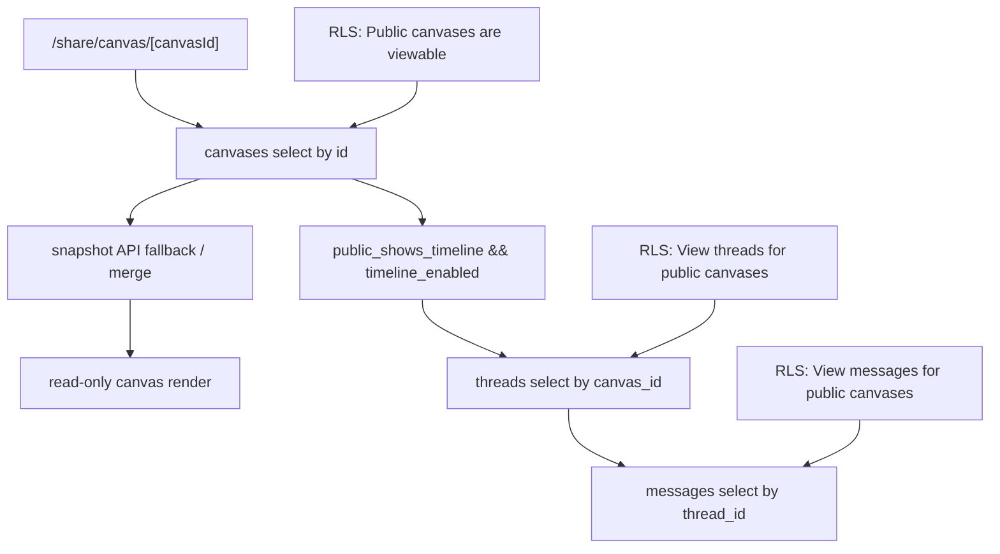

# Share Canvas Audit

> Phase window: 2026-05-22 to 2026-06-11
> Frozen on: 2026-03-13
> Scope: `BND-06`
> Evidence basis: static code audit

---

## 1. Surface Summary

| Audit ID | Surface slice | Critical path | Primary risk | Verdict |
|---|---|---|---|---|
| `BND-06` | Shared canvas load | public row read, snapshot fallback, read-only render | public-read boundary correctness | Pass |
| `BND-06` | Shared canvas timeline | thread lookup, message load, playback gating | timeline exposed beyond share flag | Pass |

## 2. Flow Decomposition

```text
Shared canvas flow
==================

/share/canvas/[canvasId]
  -> query canvases row
  -> reject missing / deleted rows
  -> fetch public snapshot
  -> choose best doc between snapshot and row
  -> render read-only InfiniteCanvas

Timeline branch
  -> only enabled when public_shows_timeline and timeline_enabled are both true
  -> thread lookup by canvas_id
  -> message load for playback frames

Boundary model
  -> canvases table has explicit public-select policy when is_public = true
  -> threads/messages also receive public-canvas read policies
```



## 3. Evidence Map

- `frontend/src/app/share/canvas/[canvasId]/page.tsx:260-289`
  - linked-canvas existence check requires `is_public` and falls back to the public snapshot endpoint
- `frontend/src/app/share/canvas/[canvasId]/page.tsx:543-566`
  - share page loads the canvas row, sets `isPublic`, and fetches the public snapshot
- `frontend/src/app/share/canvas/[canvasId]/page.tsx:552-555`
  - timeline is gated by both `public_shows_timeline` and `timeline_enabled`
- `frontend/src/app/share/canvas/[canvasId]/page.tsx:652-665`
  - message loading is only entered when a share-allowed timeline is active
- `backend/supabase/migrations/20251008090000_canvas_public_share.sql:16-45`
  - canvases, threads, and messages each receive explicit public-read policies tied to `is_public`

## 4. Findings

No bug-register-level defect was confirmed in static review for `BND-06`.

## 5. Non-Bug Notes

- The public canvas route is backed by explicit RLS instead of an ad hoc frontend-only allowlist. That is materially safer than several other share patterns reviewed in earlier phases.
- Static review did not prove an anonymous-share defect around timeline gating, deleted rows, or linked-canvas validation.
- This surface still needs runtime evidence for anonymous, logged-in cross-workspace, and post-unpublish states before it can be considered release-grade.

## 6. Verdict

- Result: `Pass (static only)`
- Open bug IDs:
  - none confirmed
- Regression follow-up:
  - cover anonymous load, private rejection, and timeline gating in `REG-04`
