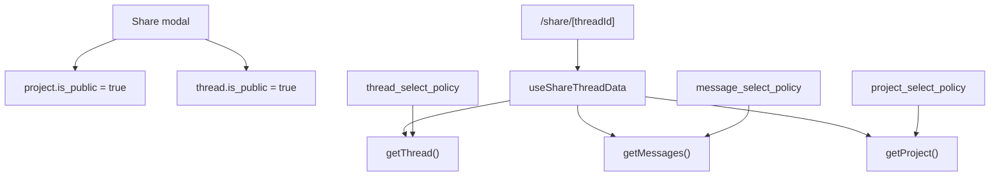

# Share Thread Audit

> Phase window: 2026-05-22 to 2026-06-11
> Frozen on: 2026-03-13
> Scope: `BND-07`
> Evidence basis: static code audit

---

## 1. Surface Summary

| Audit ID | Surface slice | Critical path | Primary risk | Verdict |
|---|---|---|---|---|
| `BND-07` | Shared thread load | thread read, message read, project metadata, read-only layout | public thread boundary correctness | Pass |
| `BND-07` | Shared thread attachments and metadata | file viewer handoff, OG metadata, share CTA coupling | anonymous/public runtime blind spot | Watch |

## 2. Flow Decomposition

```text
Shared thread flow
==================

Share modal
  -> updates both project.is_public and thread.is_public
  -> link format is /share/[threadId]

Shared thread page
  -> useShareThreadData()
  -> getThread(threadId)
  -> getMessages(threadId)
  -> getProject(thread.project_id)
  -> render read-only thread layout + file viewer handoff

Boundary model
  -> project_select_policy allows public projects
  -> thread_select_policy allows public threads
  -> message_select_policy allows reads when parent project is public
```



## 3. Evidence Map

- `frontend/src/components/sidebar/share-modal.tsx:81-135`
  - share link creation and removal keep project and thread public flags in sync
- `frontend/src/app/share/[threadId]/_hooks/useShareThreadData.ts:77-99`
  - share page loads thread and messages first, then project metadata
- `frontend/src/app/share/[threadId]/layout.tsx:19-24`
  - metadata generation tolerates missing project/thread data with a fallback share card
- `backend/supabase/migrations/20250416133920_agentpress_schema.sql:98-103`
  - projects are selectable when `is_public = true`
- `backend/supabase/migrations/20250504123828_fix_thread_select_policy.sql:3-16`
  - threads are selectable when `threads.is_public = true`
- `backend/supabase/migrations/20250416133920_agentpress_schema.sql:224-237`
  - messages are selectable when the parent project is public

## 4. Findings

No bug-register-level defect was confirmed in static review for `BND-07`.

## 5. Non-Bug Notes

- The share modal updates both project and thread public state together, which removes one common drift path that would otherwise break this surface.
- The share-thread hook is slimmer than the private thread hook and does not hydrate agent-run state, but static review alone was not enough to prove that as a user-visible product defect without runtime evidence.
- Anonymous share load, unpublish transitions, attachment preview, and live-run behavior remain verification gaps rather than confirmed bugs.

## 6. Verdict

- Result: `Pass (static only, watch runtime)`
- Open bug IDs:
  - none confirmed
- Regression follow-up:
  - run anonymous/public share thread cases plus attachment preview coverage in `REG-04`
