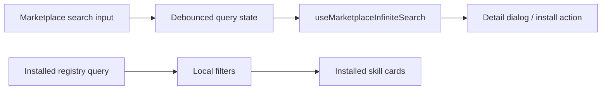

# Skills Audit

> Phase window: 2026-05-01 to 2026-05-21
> Frozen on: 2026-03-13
> Scope: `SET-04`
> Evidence basis: static code audit

---

## 1. Surface Summary

| Audit ID | Surface slice | Critical path | Primary risk | Verdict |
|---|---|---|---|---|
| `SET-04` | Skills marketplace | search, category filter, detail modal, install, import | skill acquisition path dead | Pass |
| `SET-04` | Installed skills view | search, enabled filter, detail modal, toggle/delete handoff | local skill state drift | Pass |

## 2. Flow Decomposition

```text
Skills support flow
===================

Marketplace view
  -> debounced search input
  -> infinite marketplace query
  -> category chips
  -> detail dialog
  -> install mutation

Installed view
  -> registry query
  -> local text filter
  -> enabled-only filter
  -> detail dialog
  -> downstream toggle/delete mutations from card components
```



## 3. Evidence Map

- `frontend/src/components/skills-marketplace/SkillsMarketplacePage.tsx:293-780`
  - marketplace and installed views share one route with local view switching, debounced search, detail state, and load-more behavior
- `frontend/src/hooks/react-query/skills-marketplace/use-skills-marketplace.ts:231-305`
  - marketplace search, install, import, toggle, and delete mutations all invalidate the shared skills query prefix
- `frontend/src/app/(dashboard)/(personalAccount)/skills/page.tsx:12-13`
  - canonical route mounts the marketplace page directly
- `frontend/src/app/[locale]/(dashboard)/(personalAccount)/skills/page.tsx:6-7`
  - locale wrapper mirrors the same page without introducing extra route logic

## 4. Findings

No confirmed code-level defect met bug-register threshold in this slice.

## 5. Non-Bug Notes

- The Chinese copy in `SkillsMarketplacePage.tsx` is valid UTF-8 and rendered correctly when read with explicit UTF-8 decoding; no localization corruption bug is registered here.
- Static review did not find route-scope drift because the surface is intentionally personal-only plus locale wrappers, not team-scoped.
- This audit did not execute marketplace/network integrations live, so runtime provider or upstream marketplace availability remains outside the confirmed-bug set.

## 6. Verdict

- Result: `Pass`
- Open bug IDs:
  - none confirmed in static review
- Regression follow-up:
  - keep install/import/toggle/delete smoke coverage in `REG-03` because this surface still drives external-network and local-registry state
