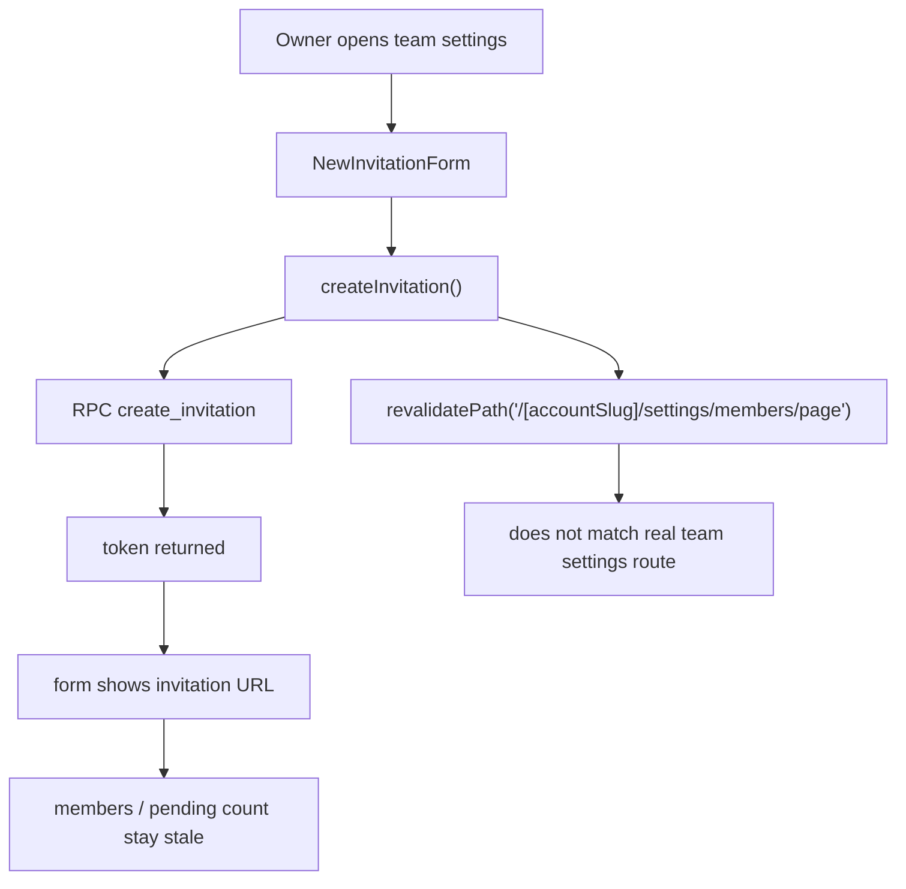

# Team Member And Invite Audit

> Phase window: 2026-05-22 to 2026-06-11
> Frozen on: 2026-03-13
> Scope: `BND-03`, `BND-04`
> Evidence basis: static code audit

---

## 1. Surface Summary

| Audit ID | Surface slice | Critical path | Primary risk | Verdict |
|---|---|---|---|---|
| `BND-03` | Team members | role edit, remove member, primary-owner handoff | owner-only mutation boundary | Pass |
| `BND-04` | Team invitations | create invite, reveal token, refresh directory, delete invite | stale post-create state | Fail |

## 2. Flow Decomposition

```text
Team invite flow
================

Owner settings
  -> TeamMembersAndInvitesClient
  -> NewInvitationForm
  -> createInvitation server action
  -> create_invitation RPC returns token

After success
  -> form switches from controls to token output
  -> no router refresh or redirect occurs
  -> action calls revalidatePath('/[accountSlug]/settings/members/page')
  -> actual live page is /team/[slug]/settings#members

Result
  -> pending count and invite list remain stale until full reload
```



## 3. Evidence Map

- `frontend/src/components/basejump/new-invitation-form.tsx:34-77`
  - success state swaps the form to a token display and does not trigger any route refresh
- `frontend/src/lib/actions/invitations.ts:7-33`
  - create action returns token and revalidates `/[accountSlug]/settings/members/page`
- `frontend/src/app/(dashboard)/(teamAccount)/team/[accountSlug]/settings/page.tsx:117-124`
  - real invite directory lives inside `/team/[slug]/settings#members`
- `backend/supabase/migrations/20240414162100_basejump-invitations.sql:88-101`
  - invitation creation policy remains owner-only at the table boundary
- `backend/supabase/migrations/20240414162100_basejump-invitations.sql:132-135`
  - invitation listing function remains owner-only
- `backend/supabase/migrations/20240414162100_basejump-invitations.sql:282-289`
  - invitation delete RPC remains owner-only

## 4. Findings

## BUG-0012 - Team invite creation does not refresh the directory after success

- Surface: Team invitations / create flow
- Audit ID: `BND-04`
- Severity: `P2`
- Status: `Triaged`
- Owner: Team invitations owner
- Phase target: `Phase 5`
- Environment:
  - app version / commit: repository state on 2026-03-13
  - role: team owner
  - device: web
  - browser / platform: all
  - locale: all

### Reproduction Steps
1. Open `/team/[slug]/settings#members` as a team owner.
2. Expand the new-invite form.
3. Create an invitation successfully.
4. Compare the pending-count badges and invite list before and after success.

### Expected Result

After the create action succeeds, the team directory should refresh so the pending count and invite row reflect the newly created invitation without requiring a manual reload.

### Actual Result

The form changes into a token display, but the surrounding directory remains stale. The server action revalidates `/[accountSlug]/settings/members/page`, which is not the live team settings route, and no client refresh or redirect is triggered.

### User Harm

Owners get a misleading success state on an onboarding surface. The token exists, but the surrounding directory still claims nothing changed, which makes invite administration look unreliable.

### Workaround

Reload the page manually after each invite creation.

### Evidence

- `frontend/src/components/basejump/new-invitation-form.tsx:34-77`
- `frontend/src/lib/actions/invitations.ts:7-33`
- `frontend/src/app/(dashboard)/(teamAccount)/team/[accountSlug]/settings/page.tsx:117-124`

### Severity Justification

`P2` because the invite is created correctly, but the success-state truth inside the team directory is wrong until a manual reload.

### Regression Target

- Must automate?: yes
- Candidate regression pack: `REG-04`

## 5. Non-Bug Notes

- Static review did not confirm a privilege-escalation path in role update, member removal, or invite deletion. The member / invite mutation layer stays owner-gated in the database functions and invitation table policies reviewed here.
- The confirmed issue is post-success freshness, not owner-boundary bypass.

## 6. Verdict

- Result: `Fail`
- Open bug IDs:
  - `BUG-0012`
- Regression follow-up:
  - add invite-create freshness and pending-count refresh assertions to `REG-04`
