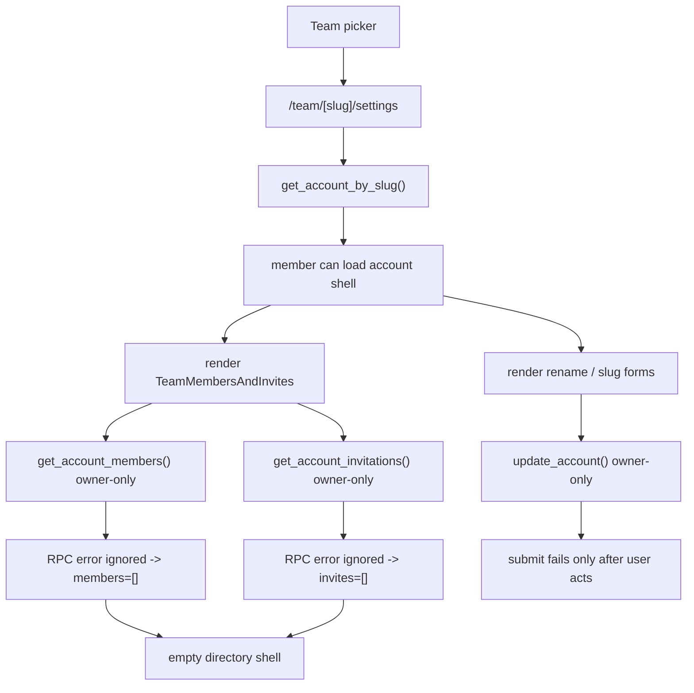

# Team Settings Audit

> Phase window: 2026-05-22 to 2026-06-11
> Frozen on: 2026-03-13
> Scope: `BND-01`, `BND-02`
> Evidence basis: static code audit

---

## 1. Surface Summary

| Audit ID | Surface slice | Critical path | Primary risk | Verdict |
|---|---|---|---|---|
| `BND-01` | Team switch and settings entry | team picker -> `/team/[slug]/settings` -> settings load | members routed into owner shell | Fail |
| `BND-02` | Team settings management | rename, slug edit, copy URL, workspace open | wrong role shell, invalid copied route | Fail |

## 2. Flow Decomposition

```text
Team settings boundary flow
===========================

Team picker
  -> any non-personal team selection opens /team/[slug]/settings

Team settings page
  -> get_account_by_slug() only checks "member of account"
  -> page renders owner mutation forms immediately
  -> page also mounts TeamMembersAndInvites

Team members / invites block
  -> get_account_members() and get_account_invitations()
  -> database functions are owner-only
  -> component ignores RPC errors and falls back to []

Result
  -> team members are routed into an owner-facing shell
  -> forms appear editable but fail only after submit
  -> directory area looks empty instead of permission-blocked
```



## 3. Evidence Map

- `frontend/src/components/sidebar/nav-user-with-teams.tsx:171-188`
  - team selection opens `/team/[slug]/settings` for every non-personal team
- `frontend/src/app/(dashboard)/(teamAccount)/team/[accountSlug]/settings/page.tsx:28-31`
  - settings page loads any accessible team through `get_account_by_slug`
- `backend/supabase/migrations/20240414161947_basejump-accounts.sql:503-510`
  - `get_account()` only requires the caller to be a member of the account
- `frontend/src/app/(dashboard)/(teamAccount)/team/[accountSlug]/settings/page.tsx:64-124`
  - page always renders rename / slug forms and members directory
- `backend/supabase/migrations/20240414161947_basejump-accounts.sql:623-626`
  - `update_account()` is owner-only at the database layer
- `frontend/src/components/basejump/team-members-and-invites.tsx:11-29`
  - members / invitations RPC errors are ignored and replaced with empty arrays
- `backend/supabase/migrations/20240414161947_basejump-accounts.sql:661-664`
  - `get_account_members()` is owner-only
- `backend/supabase/migrations/20240414162100_basejump-invitations.sql:132-135`
  - `get_account_invitations()` is owner-only
- `frontend/src/app/(dashboard)/(teamAccount)/team/[accountSlug]/settings/page.tsx:91-101`
  - team URL display and copy entry use a root-domain slug pattern
- `frontend/src/components/basejump/team-url-copy-button.tsx:13-20`
  - copy action writes `https://zmind.so/{slug}`
- `frontend/src/app/(dashboard)/(teamAccount)/team/[accountSlug]/settings/page.tsx:55-58`
  - canonical workspace route is `/team/[slug]/workspace`

## 4. Findings

## BUG-0010 - Team settings entry sends members into an owner-only shell

- Surface: Team settings entry and management shell
- Audit ID: `BND-02`
- Severity: `P1`
- Status: `Triaged`
- Owner: Frontend platform owner
- Phase target: `Phase 5`
- Environment:
  - app version / commit: repository state on 2026-03-13
  - role: team member
  - device: web
  - browser / platform: all
  - locale: all

### Reproduction Steps
1. Sign in as a non-owner member of a team.
2. Switch to that team from the team picker.
3. Observe the default route chosen for the team.
4. On `/team/[slug]/settings`, inspect the rendered controls and members section.
5. Attempt to use a rename or slug save action.

### Expected Result

Team members should land on a permission-safe team entry such as dashboard or workspace, or the settings page should explicitly degrade into a read-only / no-access state before owner-only controls render.

### Actual Result

The team picker routes all non-personal teams into `/team/[slug]/settings`. The settings page loads for any member, renders owner mutation controls, mounts owner-only directory RPCs, then silently falls back to empty members / invites data when those RPCs reject. Save actions only fail after the user tries to use them.

### User Harm

This is a permission-truth defect on a high-damage org surface. Normal team members are dropped into a misleading admin shell, see controls they cannot use, and receive no reliable explanation for why the directory is empty or saves fail.

### Workaround

Members can manually navigate to a safe team route such as `/team/[slug]/workspace`, but normal team switching still returns them to the broken settings entry.

### Evidence

- `frontend/src/components/sidebar/nav-user-with-teams.tsx:171-188`
- `frontend/src/app/(dashboard)/(teamAccount)/team/[accountSlug]/settings/page.tsx:28-31`
- `backend/supabase/migrations/20240414161947_basejump-accounts.sql:503-510`
- `frontend/src/app/(dashboard)/(teamAccount)/team/[accountSlug]/settings/page.tsx:64-124`
- `backend/supabase/migrations/20240414161947_basejump-accounts.sql:623-626`
- `frontend/src/components/basejump/team-members-and-invites.tsx:11-29`
- `backend/supabase/migrations/20240414161947_basejump-accounts.sql:661-664`
- `backend/supabase/migrations/20240414162100_basejump-invitations.sql:132-135`

### Severity Justification

`P1` because this is the default team entry path for members, it breaks permission truth on an org-management surface, and it produces a convincing false-admin shell even though the database still blocks the destructive writes.

### Regression Target

- Must automate?: yes
- Candidate regression pack: `REG-04`

## BUG-0011 - Team URL copy builds a non-existent root-slug link

- Surface: Team settings / copy URL action
- Audit ID: `BND-02`
- Severity: `P2`
- Status: `Triaged`
- Owner: Team settings owner
- Phase target: `Phase 5`
- Environment:
  - app version / commit: repository state on 2026-03-13
  - role: team owner, team member
  - device: web
  - browser / platform: all
  - locale: all

### Reproduction Steps
1. Open team settings.
2. Inspect the displayed team URL prefix and use the copy button next to the slug field.
3. Compare the copied URL with the actual team route structure used elsewhere in the app.

### Expected Result

The copied URL should resolve to a valid team route, such as `/team/[slug]` or another real public team destination.

### Actual Result

The settings page displays `https://zmind.so/` and the copy action writes `https://zmind.so/{slug}`. The actual team surfaces in this repo live under `/team/[slug]/...`, so the copied URL does not match the real route structure.

### User Harm

Owners can copy and distribute a broken team URL directly from the settings page. That damages trust on a configuration surface whose whole job is to make the team URL usable.

### Workaround

Users can manually rewrite the copied URL to `/team/{slug}`, but the built-in copy action remains wrong.

### Evidence

- `frontend/src/app/(dashboard)/(teamAccount)/team/[accountSlug]/settings/page.tsx:55-58`
- `frontend/src/app/(dashboard)/(teamAccount)/team/[accountSlug]/settings/page.tsx:91-101`
- `frontend/src/components/basejump/team-url-copy-button.tsx:13-20`

### Severity Justification

`P2` because the defect does not alter stored team state, but it does produce a broken collaboration link directly from a first-party team-management control.

### Regression Target

- Must automate?: yes
- Candidate regression pack: `REG-04`

## 5. Non-Bug Notes

- The actual mutation layer is materially stricter than the page shell. `update_account()` stays owner-only even though the page currently exposes the controls too broadly.
- Static review did not prove a backend privilege-escalation bug in role transfer or member removal; the confirmed defects in this audit are route / shell truth issues, not data-layer owner bypasses.

## 6. Verdict

- Result: `Fail`
- Open bug IDs:
  - `BUG-0010`
  - `BUG-0011`
- Regression follow-up:
  - add team-member route-entry coverage plus URL-copy validity checks to `REG-04`
