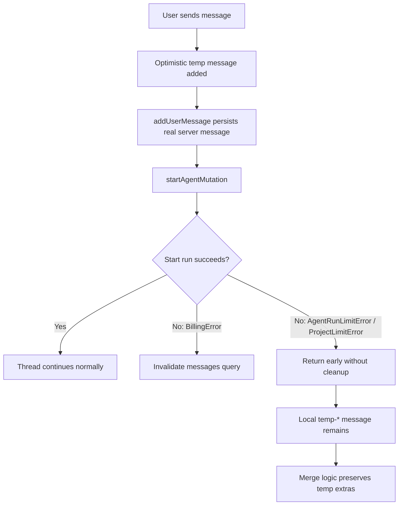

# Thread Deep Audit

> Phase window: 2026-04-10 to 2026-04-30
> Frozen on: 2026-03-13
> Scope: `CORE-11`
> Evidence basis: static code audit

---

## 1. Surface Summary

| Audit ID | Surface | Critical path | Primary risk | Verdict |
|---|---|---|---|---|
| `CORE-11` | Project thread | send, optimistic user message, run start, retry/cancel, file preview, CTA replay | stale or duplicated message state after run-start failure | Fail |

## 2. Flow Decomposition

```text
Thread send path
================

User submits message
  -> optimistic local temp message inserted
  -> addUserMessage mutation persists server user message
  -> startAgent mutation starts run

If billing error
  -> invalidate messages query
  -> UI can reconcile

If run-limit or project-limit error
  -> early return after dialog/alert
  -> optimistic temp message is not removed
  -> messages query is not invalidated
  -> later merge logic keeps temp-* messages not present in server IDs
```



## 3. Evidence Map

- `frontend/src/components/thread/ThreadComponent.tsx:432-505`
  - `addUserMessageMutation` completes before `startAgentMutation`
  - billing errors invalidate message query, but agent-run-limit and project-limit branches return early without removing the optimistic message or invalidating messages
- `frontend/src/hooks/react-query/threads/use-messages.ts:19-49`
  - add-user-message mutation is a thin wrapper with no automatic cache reconciliation or invalidation
- `frontend/src/app/(dashboard)/projects/[projectId]/thread/_hooks/useThreadData.ts:114-145`
  - server merge preserves local messages whose IDs are missing from server data, including `temp-*` messages
- `frontend/src/app/(dashboard)/projects/[projectId]/thread/_hooks/useThreadData.ts:239-289`
  - later message refresh still preserves local extras if server IDs do not explicitly replace them

## 4. Findings

## BUG-0006 - Thread optimistic user message can remain stale or duplicate when run start is rejected

- Surface: Project thread optimistic send path
- Audit ID: `CORE-11`
- Severity: `P1`
- Status: `Triaged`
- Owner: Thread surface owner
- Phase target: `Phase 3`
- Environment:
  - app version / commit: repository state on 2026-03-13
  - role: personal free, personal paid, team owner, team member
  - device: web
  - browser / platform: all
  - locale: all

### Reproduction Steps
1. Open a thread and send a user message.
2. Let `addUserMessageMutation` succeed so the real user message exists server-side.
3. Force `startAgentMutation` to fail with `AgentRunLimitError` or `ProjectLimitError`.
4. Observe that the UI returns early after showing the limit dialog or upgrade alert.
5. Let the thread refresh or merge with server messages.

### Expected Result

If the run cannot start, the UI should reconcile to the single real server user message and remove or replace the optimistic temp message.

### Actual Result

The optimistic temp message is left in local state and no message-query invalidation is triggered on the run-limit and project-limit branches. Merge logic explicitly preserves `temp-*` extras, so the user can see a stale temp message or duplicate user message representation.

### User Harm

The thread appears unreliable exactly when the product is already denying execution. Users can see duplicated or ghost user messages and lose confidence about what was actually sent.

### Workaround

A manual hard refresh can eventually clean state if the server message list fully replaces local state, but the current merge rules do not guarantee that.

### Evidence

- `frontend/src/components/thread/ThreadComponent.tsx:432-505`
- `frontend/src/hooks/react-query/threads/use-messages.ts:19-49`
- `frontend/src/app/(dashboard)/projects/[projectId]/thread/_hooks/useThreadData.ts:114-145`
- `frontend/src/app/(dashboard)/projects/[projectId]/thread/_hooks/useThreadData.ts:239-289`

### Severity Justification

`P1` because the defect corrupts perceived message truth on a core daily surface, but it does not directly drop cross-account data or fully block all message sending.

### Regression Target

- Must automate?: yes
- Candidate regression pack: `REG-02`

## 5. Non-Bug Notes

- The billing-error branch already invalidates message state, which narrows the defect to the run-limit and project-limit paths rather than the whole thread send flow.
- The optimistic model is structurally reasonable; the confirmed flaw is asymmetric cleanup between error branches.

## 6. Verdict

- Result: `Fail`
- Open bug IDs:
  - `BUG-0006`
- Regression follow-up:
  - add reconciliation cases for run-limit and project-limit failures into `REG-02`
