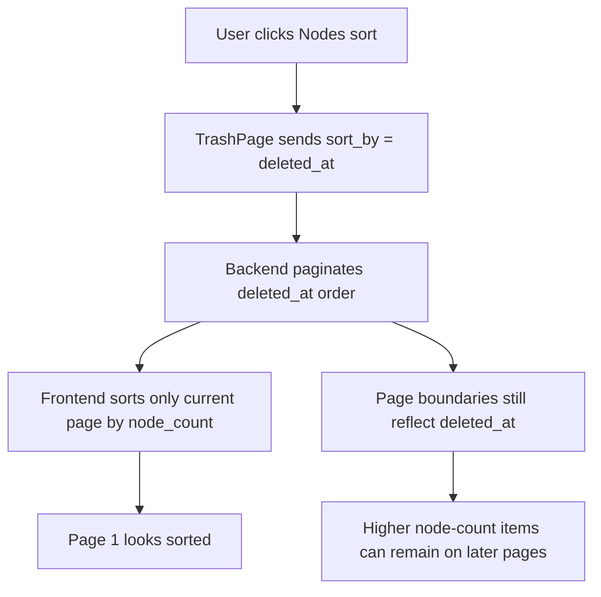

# Trash Audit

> Phase window: 2026-05-01 to 2026-05-21
> Frozen on: 2026-03-13
> Scope: `CORE-15`
> Evidence basis: static code audit

---

## 1. Surface Summary

| Audit ID | Surface slice | Critical path | Primary risk | Verdict |
|---|---|---|---|---|
| `CORE-15` | Trash list and actions | search, sort, restore, hard delete, batch action | misleading global sort order | Fail |

## 2. Flow Decomposition

```text
Trash list model
================

TrashPage
  -> listDeletedCanvases(q, limit, offset, sort_by, sort_dir)
  -> backend applies server-side filtering, sorting, and pagination
  -> page renders current page

When sortBy = nodes
  -> frontend intentionally sends sort_by = deleted_at
  -> backend paginates deleted_at order only
  -> frontend re-sorts the current page by node_count
  -> page 1 and page 2 are still slices of deleted_at order, not node_count order

Result
  -> "Nodes" sort is only correct within the already-fetched page
  -> global table order is wrong as soon as trash spans multiple pages
```



## 3. Evidence Map

- `frontend/src/app/(dashboard)/trash/page.tsx:44-54`
  - trash fetch falls back to `sort_by: 'deleted_at'` whenever UI sort is `nodes`
- `frontend/src/app/(dashboard)/trash/page.tsx:69-79`
  - node-count ordering is applied only to the current `trashItems` page in client memory
- `frontend/src/lib/api.ts:1201-1221`
  - trash list helper only forwards server sort fields supported by the backend
- `backend/core/interfaces/http/canvas/query_routes.py:60-80`
  - backend trash route only accepts `sort_by` values `deleted_at` and `title`
- `backend/core/application/services/canvas_query_service.py:170-205`
  - backend applies ordering before `range(offset, offset + limit - 1)`, so page boundaries are fixed by server sort choice

## 4. Findings

## BUG-0009 - Trash node sort is only correct within the current page

- Surface: Trash / list sorting
- Audit ID: `CORE-15`
- Severity: `P2`
- Status: `Triaged`
- Owner: Workspace / trash surface owner
- Phase target: `Phase 4`
- Environment:
  - app version / commit: repository state on 2026-03-13
  - role: personal free, personal paid, team owner, team member
  - device: web
  - browser / platform: all
  - locale: all

### Reproduction Steps
1. Put more than one page of canvases into trash with materially different `node_count` values.
2. Open the trash page and click the `Nodes` column header.
3. Compare the largest or smallest `node_count` values on the current page with the next page.

### Expected Result

Sorting by node count should produce a globally correct ordering across the entire trash collection, not just within the current page.

### Actual Result

The UI labels the table as node-sorted, but the fetch still requests deleted-at ordering from the server. Only the currently loaded page is reordered by `node_count`, so pagination boundaries remain wrong.

### User Harm

Users trying to triage the largest deleted canvases first cannot trust the table order. On a destructive surface, misleading ordering increases the chance of reviewing or permanently deleting the wrong items first.

### Workaround

No reliable UI workaround exists other than paging through the full trash list manually.

### Evidence

- `frontend/src/app/(dashboard)/trash/page.tsx:44-54`
- `frontend/src/app/(dashboard)/trash/page.tsx:69-79`
- `frontend/src/lib/api.ts:1201-1221`
- `backend/core/interfaces/http/canvas/query_routes.py:60-80`
- `backend/core/application/services/canvas_query_service.py:170-205`

### Severity Justification

`P2` because restore and delete actions still work, but the table advertises a sort mode that becomes false as soon as pagination is involved.

### Regression Target

- Must automate?: yes
- Candidate regression pack: `REG-03`

## 5. Non-Bug Notes

- Search, restore, batch restore, purge-expired, and empty-trash flows all use workspace-scoped API helpers and refresh state after mutation.
- The confirmed defect is about sort truthfulness, not about deletion authority or restore authority.

## 6. Verdict

- Result: `Fail`
- Open bug IDs:
  - `BUG-0009`
- Regression follow-up:
  - add a multi-page trash fixture that proves server ordering and page boundaries stay correct for every visible sort mode
