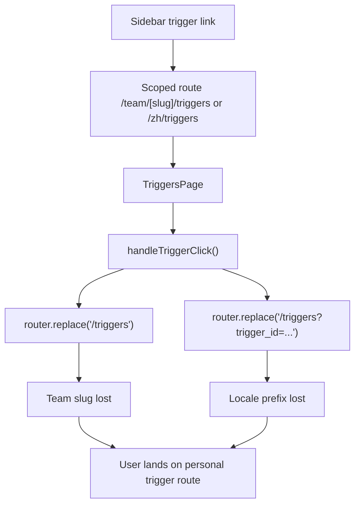

# Triggers Audit

> Phase window: 2026-05-01 to 2026-05-21
> Frozen on: 2026-03-13
> Scope: `CORE-14`
> Evidence basis: static code audit

---

## 1. Surface Summary

| Audit ID | Surface slice | Critical path | Primary risk | Verdict |
|---|---|---|---|---|
| `CORE-14` | Trigger list and detail deep link | load list, open detail panel, close panel, URL sync | team and locale scope drift | Fail |
| `CORE-14` | Trigger creation handoff | create scheduled/event trigger, pending selection | no confirmed static defect | Pass |

## 2. Flow Decomposition

```text
Triggers support flow
=====================

Sidebar
  -> buildTeamScopedPath('/triggers', teamSlug)
  -> personal, locale, and team wrapper routes all reuse TriggersPage

TriggersPage
  -> reads trigger_id from search params
  -> selects trigger detail panel
  -> clicking list item toggles panel and rewrites URL

Current mismatch
  -> route entry is scope-aware
  -> detail toggle writes hard-coded /triggers URLs
  -> team slug and locale prefix are discarded
```



## 3. Evidence Map

- `frontend/src/components/sidebar/sidebar-left.tsx:118-126`
  - canonical navigation computes trigger paths with `buildTeamScopedPath('/triggers', teamSlug)`
- `frontend/src/app/(dashboard)/(teamAccount)/team/[accountSlug]/triggers/page.tsx:1-6`
  - team route mirrors reuse the canonical triggers page
- `frontend/src/app/[locale]/(dashboard)/triggers/page.tsx:1-1`
  - locale wrapper also reuses the canonical triggers page
- `frontend/src/components/triggers/triggers-page.tsx:191-203`
  - page deep-links from `trigger_id` query state
- `frontend/src/components/triggers/triggers-page.tsx:226-238`
  - panel close/open logic mutates selected state and rewrites the URL with hard-coded personal paths

## 4. Findings

## BUG-0007 - Trigger detail panel rewrites team and locale routes to personal /triggers paths

- Surface: Triggers / detail deep-link path
- Audit ID: `CORE-14`
- Severity: `P1`
- Status: `Triaged`
- Owner: Frontend platform owner
- Phase target: `Phase 4`
- Environment:
  - app version / commit: repository state on 2026-03-13
  - role: personal free, personal paid, team owner, team member
  - device: web
  - browser / platform: all
  - locale: all locale-wrapped trigger routes plus team routes

### Reproduction Steps
1. Open a scoped trigger route such as `/team/[accountSlug]/triggers` or `/zh/triggers`.
2. Click a trigger in the list to open its detail panel.
3. Observe the route change performed by `handleTriggerClick()`.
4. Toggle the same trigger again to close the panel.

### Expected Result

Trigger detail open/close should preserve the current route scope and only add or remove the `trigger_id` query state.

### Actual Result

The list toggle logic rewrites the browser location to `/triggers` or `/triggers?trigger_id=...` regardless of whether the user started on a team-scoped or locale-scoped route. Scope-safe entry routing exists, but the detail panel breaks it.

### User Harm

This causes silent tenant/context drift. Team users can appear to "lose" their current trigger workspace, and locale users are kicked back to the default route namespace while performing a normal detail-panel action.

### Workaround

Users can manually navigate back to the original scoped route, but normal panel interaction immediately reintroduces the problem.

### Evidence

- `frontend/src/components/sidebar/sidebar-left.tsx:118-126`
- `frontend/src/app/(dashboard)/(teamAccount)/team/[accountSlug]/triggers/page.tsx:1-6`
- `frontend/src/app/[locale]/(dashboard)/triggers/page.tsx:1-1`
- `frontend/src/components/triggers/triggers-page.tsx:191-203`
- `frontend/src/components/triggers/triggers-page.tsx:226-238`

### Severity Justification

`P1` because the trigger surface is a primary automation-management path, and the defect breaks workspace and locale truth during normal interaction even though it does not directly corrupt stored trigger objects.

### Regression Target

- Must automate?: yes
- Candidate regression pack: `REG-03`

## 5. Non-Bug Notes

- The list query and optimistic pending-trigger selection logic are structurally straightforward; the confirmed problem is route mutation, not trigger data fetching itself.
- `handleClosePanel()` currently clears local state without clearing `trigger_id` from the URL. That inconsistency reinforces the need for a unified route-sync fix, but the registered defect remains the scope-dropping hard-coded route rewrite.

## 6. Verdict

- Result: `Fail`
- Open bug IDs:
  - `BUG-0007`
- Regression follow-up:
  - add scoped-route trigger deep-link smoke cases for personal, locale, and team routes
