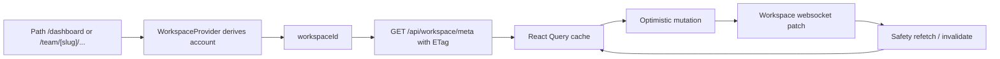

# Workspace Audit

> Phase window: 2026-04-10 to 2026-04-30
> Frozen on: 2026-03-13
> Scope: `CORE-02`
> Evidence basis: static code audit

---

## 1. Surface Summary

| Audit ID | Surface | Critical path | Primary risk | Verdict |
|---|---|---|---|---|
| `CORE-02` | Workspace | account-scope resolution, meta fetch, websocket patch sync, optimistic create/rename/move/delete flows | object loss, navigation dead-end, stale tree state | Pass |

## 2. Flow Decomposition

```text
Workspace control loop
======================

Pathname
  -> WorkspaceProvider derives account
  -> workspaceId stored as current workspace session
  -> useWorkspaceData fetches /api/workspace/meta with ETag
  -> websocket messages apply patch or invalidate query
  -> optimistic mutations update cache immediately
  -> safety refetch re-aligns with backend truth
```



## 3. Evidence Map

- `frontend/src/contexts/workspace-context.tsx:20-75`
  - route scope is derived centrally from personal routes, locale routes, and `/team/[slug]` routes
- `frontend/src/hooks/useWorkspaceData.ts:85-118`
  - workspace meta fetch uses `X-Workspace-Id`, `If-None-Match`, and a backend fallback if the Next proxy route is missing
- `frontend/src/hooks/useWorkspaceData.ts:137-176`
  - websocket patches are applied incrementally and fall back to query invalidation when patch replay is insufficient
- `frontend/src/hooks/useWorkspaceData.ts:202-222`
  - title changes are mirrored into cache immediately for low-latency workspace updates
- `frontend/src/hooks/react-query/workspace/use-workspace-mutations.ts:106-168`
  - canvas create uses temp IDs, request correlation, rollback, and safety refetch
- `frontend/src/hooks/react-query/workspace/use-workspace-mutations.ts:198-232`
  - rename keeps optimistic UI and then rehydrates from server payload
- `frontend/src/hooks/react-query/workspace/use-workspace-mutations.ts:339-387`
  - folder delete mutation rolls canvases to parent optimistically and schedules post-success refetch
- `backend/core/folders/api.py:303-343`
  - backend refuses deleting folders with child folders and either moves canvases to parent or rejects the delete

## 4. Findings

No confirmed workspace bug was promoted into the register in this phase.

## 5. Non-Bug Notes

- The workspace data layer is materially stronger than the dashboard shell because it has explicit ETag caching, websocket patch replay, and mutation rollback paths.
- The optimistic folder delete path matches backend contract: child folders block deletion server-side, so the frontend assumption that only direct canvas reassignment is needed is valid for this API.
- `WorkspaceProvider` hard-codes locale prefixes to `en` and `zh`. That is acceptable against the current route inventory and was not logged as a defect in this audit wave.

## 6. Verdict

- Result: `Pass`
- Open bug IDs:
  - none confirmed for `CORE-02`
- Regression follow-up:
  - cover create, rename, move, and delete flows inside `REG-02`
