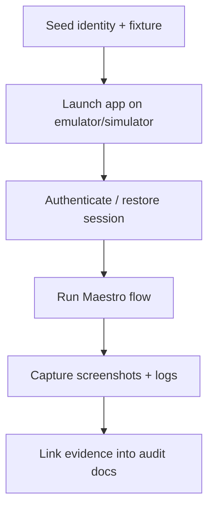

# Zmind Mobile E2E Adoption Plan

> Phase 1 owner document  
> Frozen on: 2026-03-13

---

## 1. Decision

Primary baseline framework: `Maestro`  
Deferred hardening framework: `Detox` after native build stability justifies the cost

Decision type: stable-baseline mobile adoption path

---

## 2. Why Maestro First

| Option | Decision | Reason |
|---|---|---|
| Maestro | Select first | Works well with Expo-driven apps, quick scenario authoring, strong screenshot flow, lower setup burden for baseline coverage |
| Detox | Defer | Higher setup and native build cost; useful later for deeper determinism but too heavy as first substrate |
| Pure manual only | Reject | Mobile blind spots would remain non-repeatable |

```text
Mobile choice logic
===================

Need first
  real-device-like navigation coverage
  low setup overhead
  readable scenarios
  screenshot evidence

Need later
  deeper native determinism
  more expensive harness
```

---

## 3. Device Matrix

| Lane | Device class | OS class | Purpose |
|---|---|---|---|
| `MOB-L1` | iPhone 15 class | iOS 17 | Primary visual baseline |
| `MOB-L2` | Pixel 8 class | Android 14 | Primary Android interaction baseline |
| `MOB-L3` | Narrow/smaller phone class | latest supported emulator | Responsive edge review after baseline |

Rule:

- baseline phase coverage requires at least one iOS-class run and one Android-class run
- no mobile bug is considered cross-platform without both classes reviewed or explicitly waived

---

## 4. Target Flow Waves

| Wave | Goal | Must-cover flows |
|---|---|---|
| `M-E2E-01` | Entry protection | auth overlay, initial load, project list, project switch |
| `M-E2E-02` | Core chat protection | send message, cancel run, tool timeline view, retry / error recovery |
| `M-E2E-03` | Action safety | share modal, delete project, settings drawer, sign out |

---

## 5. Auth and Fixture Strategy

Mobile must reuse the same semantic identities and fixture packs defined in `test-data-plan.md`.

Recommended baseline flow:

1. Provision seeded identities outside the mobile scenario.
2. Launch app against QA backend/Supabase project.
3. Use a stable sign-in path or test-only bootstrap path to enter as a known identity.
4. Execute scenario against frozen fixture objects.



Rule:

- mobile must not invent a private seed scheme that diverges from web identities

---

## 6. Artifact Standard

| Artifact | Requirement |
|---|---|
| Step log | Mandatory for every run |
| Screenshot set | Mandatory for key state transitions |
| Screen recording | Required for flaky navigation, modal, or animation issues |
| Device metadata | OS version, device class, app build, identity |
| Error logs | Include Expo / native logs for failures |

---

## 7. CI and Execution Strategy

```text
Execution lanes
===============

Lane A  Local emulator smoke
  run by engineer during active mobile audit

Lane B  CI smoke
  one iOS-class or Android-class runner
  smallest critical flow pack

Lane C  nightly dual-platform run
  iOS + Android
  broader mobile coverage
```

Why not start with full CI farm immediately:

- current repo has no mobile E2E substrate yet
- stable baseline needs a credible first lane before scaling cost

---

## 8. Maestro vs Detox Boundary

| Capability | Maestro owner | Detox owner later |
|---|---|---|
| Entry and navigation smoke | Yes | Optional |
| Modal and drawer safety checks | Yes | Optional |
| Cross-platform core chat smoke | Yes | Optional |
| Highly deterministic native synchronization | Limited | Yes |
| Deep native build lifecycle checks | No | Yes |

Decision:

- Maestro is sufficient to remove the current total blind spot.
- Detox is a future hardening layer, not a prerequisite for Phase 6 auditing.

---

## 9. Current Risks

| Dependency | Status | Effect |
|---|---|---|
| Mobile E2E framework | Missing in repo | Current mobile verification remains mostly manual |
| Seed/reset scripts | Missing | Repeatability limited |
| Stable auth bootstrap for tests | Missing | Noise risk in mobile scenarios |

---

## 10. Approval Gate

Phase 1 treats Mobile E2E adoption as approved when:

- Maestro is frozen as the first framework
- device matrix is fixed
- artifact policy is fixed
- shared fixture policy is fixed
- Detox is explicitly deferred rather than ambiguously "maybe later"
