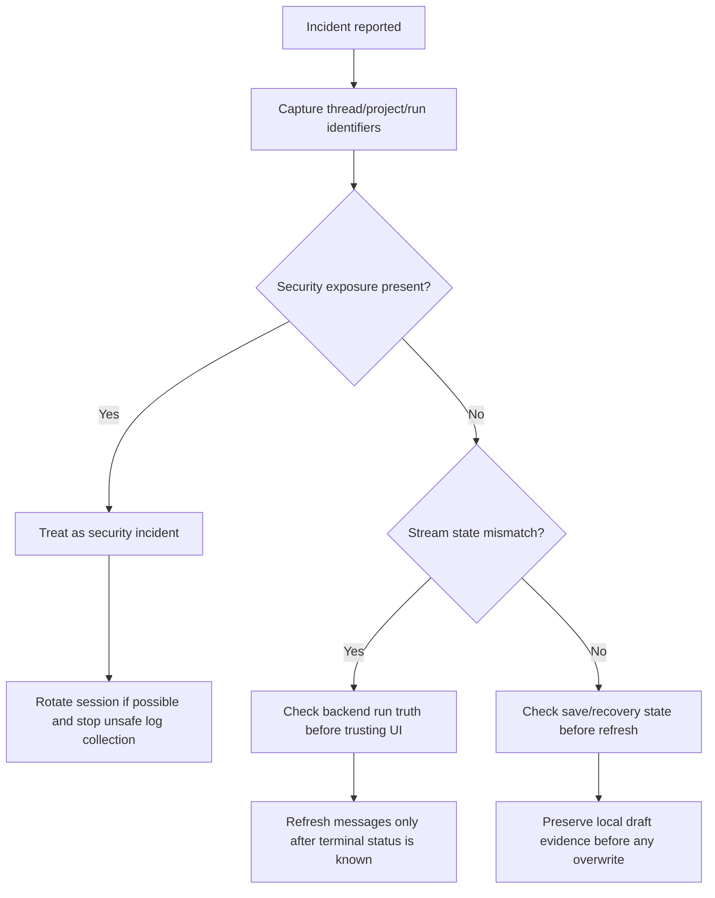

# Recovery Runbook

> Phase window: 2026-07-03 to 2026-07-09
> Frozen on: 2026-03-13
> Purpose: give operators and reviewers a safe baseline procedure for recovering from stream, save, and resilience incidents

---

## 1. Incident Intake Matrix

| Symptom | Primary surface | Immediate containment | Required identifiers | Escalate when |
|---|---|---|---|---|
| Mobile run suddenly looks completed but answer is incomplete | mobile thread | stop asking user to send another prompt until backend run truth is checked | `thread_id`, `agent_run_id`, last user message time, platform | backend still shows run active or failed |
| Mobile thread logs or support bundle contains tokens/content | mobile observability | treat as security incident, rotate exposed token/session if possible, stop collecting raw logs | user/account, device, run/thread, log excerpt location | any auth token or private content is present |
| Web stream closes unexpectedly | web thread | refresh thread after checking run status, preserve local timestamps | `thread_id`, `agent_run_id`, browser, route | repeated close or mismatch between run status and UI |
| User reports missing recent doc/canvas/thread data | canvas/doc/thread | preserve current tab, avoid overwrite, capture local draft state before refresh | project/thread/doc ID, timestamp, route, role | mismatch persists after controlled refresh |

## 2. Safe Triage Flow

```text
Safe recovery flow
==================

1. Classify incident
   -> stream state mismatch
   -> save/recovery suspicion
   -> credential or content leak

2. Capture identifiers first
   -> account / role
   -> project_id
   -> thread_id
   -> agent_run_id
   -> platform + app/web version
   -> exact timestamp

3. Capture only safe evidence
   -> status values
   -> redacted screenshots
   -> route name
   -> network condition

4. Do not capture
   -> access tokens
   -> raw stream URLs with token query params
   -> full message bodies unless explicitly redacted
   -> local file URIs or private tool output dumps

5. Choose recovery lane
   -> mobile stream mismatch
   -> web stream mismatch
   -> save/recovery mismatch
   -> security exposure
```



## 3. Playbook A - Mobile Stream Mismatch

Use when:

- the mobile UI flips from generating to completed too early
- the answer is incomplete
- the user cannot tell whether the run failed, stopped, or is still reconciling

Steps:

1. Record `thread_id`, `agent_run_id`, device OS, app build, and the last visible assistant text.
2. Do not trust the mobile terminal badge by itself. Phase 7 confirmed `BUG-0021`, so mobile can collapse disconnect/failure/stopped states into `completed`.
3. Check backend run truth using the canonical agent-run status endpoint or an equivalent verified operator tool.
4. If the run is still `running`, keep the conversation read-only from an operator standpoint:
   - do not tell the user to send a follow-up prompt into the same thread yet
   - wait for terminal state or reopen once backend truth changes
5. If the run is `completed`, refresh messages and verify the final assistant message exists server-side.
6. If the run is `failed` or `stopped`, capture the terminal status, user-facing symptom, and whether a retry path exists.
7. Link the incident to `BUG-0021` unless a new root cause is proven.

Evidence to capture:

- safe screenshot of the visible UI
- terminal run status
- last assistant timestamp
- whether stop/retry controls were visible

Do not capture:

- raw stream payloads
- stream URLs with `token`

## 4. Playbook B - Web Stream Mismatch

Use when:

- the web thread closes early
- final assistant text is missing
- the user reports a stale or duplicated terminal message

Steps:

1. Record `thread_id`, `agent_run_id`, current route, browser, and exact time.
2. Check whether the mismatch is already explained by known Phase 3 or Phase 7 defects:
   - `BUG-0006` for stale optimistic user state
   - Phase 7 performance/recovery watchlist for long-thread reconciliation
3. Let the web hook finish its normal reconciliation path before forcing a manual refresh. The web implementation already checks backend final status and performs full-thread sync after terminal states.
4. If the final assistant message is still missing after controlled refresh:
   - capture message count before/after
   - note whether local fallback assistant text was shown
   - escalate as a new thread-recovery candidate

## 5. Playbook C - Save and Recovery Suspicion

Use when:

- a user believes recent canvas/doc/thread work disappeared
- navigation or reload happened near the time of save

Steps:

1. Preserve the current browser/app state before any refresh if possible.
2. Record the object identifier:
   - canvas / project ID
   - doc ID
   - thread ID
3. Check against known saved-state defects first:
   - `BUG-0004` canvas undo/redo durability
   - `BUG-0005` doc autosave unmount loss
   - `BUG-0006` thread optimistic reconciliation
4. For doc/canvas:
   - inspect whether a draft or local recovery artifact exists
   - avoid opening the same object from multiple clients until evidence is captured
5. For thread:
   - compare server message list against the visible local list
6. Only after identifiers and timestamps are preserved should the operator recommend refresh/reopen.

## 6. Playbook D - Security Exposure in Logs

Use when:

- support artifacts, Metro output, device logs, or screen recordings show tokens or private content
- any runbook step uncovers raw stream URLs or payload dumps

Steps:

1. Classify as release-blocking while exposure is uncontained. Phase 7 confirmed `BUG-0022`.
2. Record where the exposure appeared:
   - local device log
   - CI capture
   - support bundle
   - remote debugging output
3. Determine whether the leaked material includes:
   - auth token
   - private message content
   - tool output
   - local file URI
4. If an auth token is exposed, rotate or invalidate the affected session if operationally possible.
5. Do not attach the raw token or unredacted content to tickets.
6. Attach only redacted excerpts and the exact code path/file evidence.

## 7. Minimum Observability Contract

The platform should capture these fields for every resilience incident:

- `account_id` or safe user surrogate
- `project_id`
- `thread_id`
- `agent_run_id`
- route or screen name
- platform and version
- network condition
- terminal status
- retry/stop action taken

The platform must not capture these fields in normal logs:

- bearer tokens or query-param tokens
- full prompt bodies by default
- raw tool result payloads
- local file paths / `localUri`

## 8. Release Blocking Rules

Treat release as blocked if any of the following is true:

- a mobile or web recovery incident cannot be reconciled to an exact backend run status
- tokens or private content still appear in production logging paths
- save/recovery incidents cannot be investigated without destructive refresh
- the resilience regression pack remains missing for release-candidate builds
