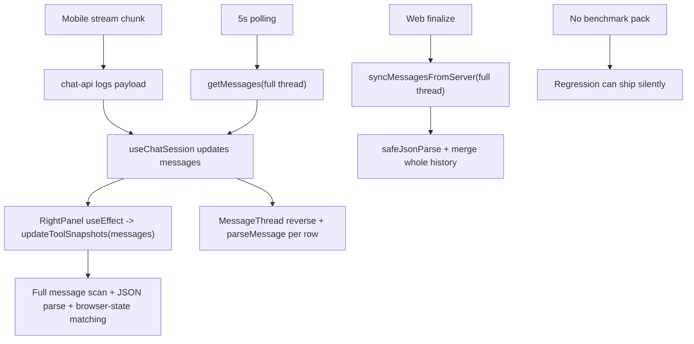

# Performance Risk List

> Phase window: 2026-07-03 to 2026-07-09
> Frozen on: 2026-03-13
> Scope: long thread, tool timeline, large-content, and resilience-adjacent performance

---

## 1. Risk Summary

| Risk ID | Surface | Current behavior | Risk level | Linked bug | Owner |
|---|---|---|---|---|---|
| `PERF-01` | Mobile chat hot paths | production console logging sits in render, stream, and file/tool paths | Critical | `BUG-0022` | Mobile platform owner |
| `PERF-02` | Mobile tool timeline | every message change reparses full tool history and browser-state matching | High | none | Mobile tool-surface owner |
| `PERF-03` | Mobile long thread | 5-second full-message polling combines with full-array reverse and per-item parse on render | High | none | Mobile thread owner |
| `PERF-04` | Web terminal reconciliation | final stream sync reparses and merges the full thread history at terminal states | Medium | none | Web thread owner |
| `PERF-05` | Program-level quality gate | no committed performance budget or benchmark pack exists for canvas/doc/thread/mobile | High | none | QA / platform owner |

## 2. Performance Topology

```text
Current non-functional load shape
=================================

Mobile stream session
  -> backend emits chunks
  -> stream code logs raw payloads and previews
  -> thread hook appends local state
  -> right panel effect reparses all messages into tool snapshots
  -> message thread reverses array and reparses each item for render
  -> 5-second poll fetches entire message list again

Web terminal path
  -> run ends
  -> hook refetches full thread
  -> message sync reparses metadata/content for every message
  -> local/server merge walks whole history before returning stable UI

What is missing
  -> no benchmark dataset for long thread
  -> no tool-timeline stress budget
  -> no mobile log-volume guardrail
  -> no release gate for latency/memory regressions
```



## 3. Detailed Risks

### PERF-01 - Mobile production logging is on the hottest interaction paths

- Evidence:
  - `apps/mobile/app/index.tsx:48-55`
  - `apps/mobile/api/chat-api.ts:818-822`
  - `apps/mobile/api/chat-api.ts:859-880`
  - `apps/mobile/components/RightPanel.tsx:352-356`
  - `apps/mobile/stores/ui-store.ts:263-351`
- Why it matters:
  - logging occurs during render, stream receive, and timeline rebuild paths
  - log I/O volume scales with conversation length and tool activity
  - this is already a confirmed release-blocking bug because the logs also expose secrets and private content
- Baseline action:
  - remove or dev-gate all chat/tool/file debug logs before any performance measurement

### PERF-02 - Tool snapshot building reparses full message history on every update

- Evidence:
  - `apps/mobile/components/RightPanel.tsx:48-53`
  - `apps/mobile/stores/ui-store.ts:263-365`
- Why it matters:
  - the right panel rebuild walks every message whenever `messages` changes
  - each pass performs JSON parsing, function-name normalization, and browser-state proximity scans
  - long tool-heavy sessions will pay cumulative parse cost instead of incremental updates
- Baseline action:
  - benchmark 25, 100, and 250 tool-result histories
  - move to incremental snapshot append/reconcile instead of full rebuild

### PERF-03 - Long-thread steady state scales linearly even when the user is idle

- Evidence:
  - `apps/mobile/hooks/useChatHooks.tsx:58-66`
  - `apps/mobile/hooks/useChatHooks.tsx:489-494`
  - `apps/mobile/components/MessageThread.tsx:345-348`
  - `apps/mobile/components/MessageThread.tsx:421-435`
- Why it matters:
  - the mobile thread refetches the full message list every 5 seconds
  - every update reverses the full array and re-parses every message for render/tool skipping
  - this can become visible on long-running conversations even without new user input
- Baseline action:
  - capture thread-size breakpoints at 100, 500, and 1000 messages
  - record fetch size, render cost, and JS thread frame drops

### PERF-04 - Web terminal sync does whole-history reconciliation at end-of-run

- Evidence:
  - `frontend/src/hooks/useAgentStream.ts:423-597`
  - `frontend/src/hooks/useAgentStream.ts:744-750`
- Why it matters:
  - each terminal stream path refetches full message history
  - the merge layer reparses metadata/content and deduplicates across the entire thread
  - this is acceptable for correctness today, but no budget proves it remains safe for long enterprise threads
- Baseline action:
  - benchmark terminal reconciliation time at representative thread sizes
  - capture worst-case end-of-run latency before the final assistant state appears

### PERF-05 - The audit program still lacks a non-functional benchmark gate

- Evidence:
  - `docs/qa/regression-status.md` currently tracks only functional packs through `REG-05`
  - Phase 7 adds resilience findings, but no executable performance pack exists yet
- Why it matters:
  - large canvas, long doc, and long thread can regress silently between releases
  - release closure would depend on static reasoning instead of measured budgets
- Baseline action:
  - define `REG-06` as the resilience/performance pack
  - require at minimum:
    - long mobile thread replay
    - mobile disconnect/reconnect stream recovery
    - long web thread terminal sync
    - representative large canvas and long doc smoke metrics

## 4. Recommended Baseline Measurements

| Benchmark ID | Scenario | Minimum metric set | Pass intent |
|---|---|---|---|
| `BASE-RES-01` | Mobile long thread | message count, poll payload size, render latency, dropped frames, log volume | no visible interaction stall at target thread size |
| `BASE-RES-02` | Mobile tool timeline | snapshot rebuild time, JSON parse cost, memory growth | right panel stays responsive across target tool counts |
| `BASE-RES-03` | Web terminal sync | terminal-status-to-final-render latency, merge duration, thread-size scaling | end-of-run reconciliation stays within agreed budget |
| `BASE-RES-04` | Large canvas/doc smoke | load time, save/recover latency, memory trend | large-content baseline becomes measurable instead of anecdotal |

## 5. Exit Rule

Phase 7 performance work is not release-grade until:

- `BUG-0022` is removed from production paths
- a measurable `REG-06` benchmark/recovery pack exists
- owners agree explicit budgets for long thread, tool timeline, and large-content scenarios
