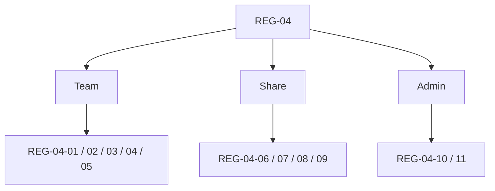

# REG-04 Boundary Surface Regression Pack

> Phase owner pack for Phase 5
> Status at definition time: manual specification only

---

## 1. Purpose

This pack covers the boundary-heavy surfaces audited in Phase 5:

- team settings
- team members and invitations
- share canvas
- share thread
- admin audit, billing, invites, and prompt studio

The goal is to convert boundary findings into repeatable checks, with special emphasis on:

- owner vs member shell truth
- anonymous / public read correctness
- admin vs authenticated-user privilege separation

## 2. Pack Map

```text
REG-04
======

Team
  REG-04-01 team member switch does not land in a false owner shell
  REG-04-02 team settings hides or blocks owner-only controls correctly
  REG-04-03 team URL copy produces a real team route
  REG-04-04 invite creation refreshes pending directory state
  REG-04-05 role edit / transfer / remove member smoke

Share
  REG-04-06 share canvas anonymous load + private rejection
  REG-04-07 share canvas timeline gate smoke
  REG-04-08 share thread anonymous load + private rejection
  REG-04-09 share thread attachment preview / file viewer smoke

Admin
  REG-04-10 prompt studio denies non-admin users at API and page level
  REG-04-11 admin invites delete-mode checkbox + batch delete smoke
```



## 3. Detailed Cases

| Case ID | Surface | Scenario | Bug Link | Priority | Automation Target |
|---|---|---|---|---|---|
| `REG-04-01` | Team | switch into a team as a non-owner member and confirm entry lands on a permission-safe surface instead of a false owner settings shell | `BUG-0010` | Must | Playwright |
| `REG-04-02` | Team | open team settings as owner vs member and confirm owner-only controls, member directory states, and no-access messaging are correct | `BUG-0010` | Must | Playwright |
| `REG-04-03` | Team | copy team URL from settings and confirm the link resolves to a real `/team/[slug]` route | `BUG-0011` | Must | Playwright |
| `REG-04-04` | Team | create an invite and confirm pending counts plus invite rows refresh without manual reload | `BUG-0012` | Must | Playwright |
| `REG-04-05` | Team | role change, primary-owner handoff, remove member, and delete invite smoke with owner-only accounts | none | High | Playwright |
| `REG-04-06` | Share canvas | load a public canvas anonymously, confirm read-only render, then verify a private canvas id is rejected | none | Must | Playwright |
| `REG-04-07` | Share canvas | compare canvases with and without `public_shows_timeline`, confirm playback controls only expose allowed history | none | High | Playwright |
| `REG-04-08` | Share thread | load a shared thread anonymously and verify private / unpublished threads are rejected | none | Must | Playwright |
| `REG-04-09` | Share thread | open attachment / file viewer from a shared thread and confirm allowed preview works without private runtime bleed | none | High | Playwright |
| `REG-04-10` | Prompt Studio | assert that non-admin authenticated users cannot read, preview, apply, history-read, or rollback prompt files | `BUG-0013` | Must | API + Playwright |
| `REG-04-11` | Admin invites | enter delete mode, toggle selection via checkbox and row, then batch delete selected invites | `BUG-0014` | Must | Playwright |

## 4. Required Fixtures

- `team_owner_boundary`
- `team_member_boundary`
- one workspace with at least one owner and one non-owner member
- one team with existing members and at least one invite-capable owner
- one public canvas with timeline on
- one public canvas with timeline off
- one private canvas id for rejection checks
- one public shared thread with at least one attachment
- one private thread id for rejection checks
- one admin user
- one non-admin authenticated user
- one admin invite catalog with at least three active codes

## 5. Exit Rule

`REG-04` is not green until:

- `BUG-0010` has owner/member route-entry and settings-shell evidence
- `BUG-0011` has working copied-route evidence
- `BUG-0012` has post-create freshness evidence
- `BUG-0013` has API-level and page-level non-admin denial evidence
- `BUG-0014` has direct checkbox interaction evidence
- anonymous share-canvas and share-thread smoke cases are runnable, not just reasoned from code
