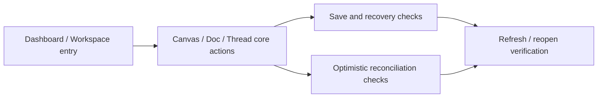

# REG-02 Core Workspace Regression Pack

> Phase owner pack for Phase 3
> Status at definition time: manual specification only

---

## 1. Purpose

This pack covers the daily-work surfaces that matter after login:

- dashboard
- workspace
- canvas
- doc
- thread

It exists to convert Phase 3 findings into repeatable verification, with special emphasis on save, recovery, and optimistic-state correctness.

## 2. Pack Map

```text
REG-02
======

Entry
  REG-02-01 dashboard prompt handoff
  REG-02-02 workspace create / rename / move / delete

Canvas durability
  REG-02-03 canvas undo background style survives refresh
  REG-02-04 canvas undo metadata-backed connection state survives refresh
  REG-02-05 canvas draft recovery restore / discard

Doc durability
  REG-02-06 doc blur flush
  REG-02-07 doc hotkey flush
  REG-02-08 doc navigate-away within debounce still persists

Thread correctness
  REG-02-09 thread send + billing error reconciliation
  REG-02-10 thread send + run-limit reconciliation
  REG-02-11 thread send + project-limit reconciliation
  REG-02-12 thread retry / cancel / refresh smoke
```



## 3. Detailed Cases

| Case ID | Surface | Scenario | Bug Link | Priority | Automation Target |
|---|---|---|---|---|---|
| `REG-02-01` | Dashboard | submit short prompt from dashboard and confirm canvas route receives prompt handoff | none | High | Playwright |
| `REG-02-02` | Workspace | create, rename, move, and delete canvases/folders with tree refresh validation | none | High | Playwright |
| `REG-02-03` | Canvas | change background/global style, undo, refresh, reopen, confirm reverted style persists | `BUG-0004` | Must | Playwright |
| `REG-02-04` | Canvas | change connection anchor/style or group attachment, undo/redo, refresh, reopen, confirm persisted state matches local history result | `BUG-0004` | Must | Playwright |
| `REG-02-05` | Canvas | edit canvas, interrupt normal save path, verify draft recovery restore and discard both behave correctly | `RISK-0004` | High | Playwright |
| `REG-02-06` | Doc | edit doc, blur editor, verify server version and content update | none | High | Playwright |
| `REG-02-07` | Doc | edit doc, trigger save hotkey, verify server version and content update | none | High | Playwright |
| `REG-02-08` | Doc | edit doc, navigate away within debounce window, reopen from server-side session, confirm content was not lost | `BUG-0005` | Must | Playwright |
| `REG-02-09` | Thread | send message, force billing error, confirm no stale temp message remains after reconciliation | none | Medium | Playwright |
| `REG-02-10` | Thread | send message, force agent-run-limit error, confirm only one real user message remains | `BUG-0006` | Must | Playwright |
| `REG-02-11` | Thread | send message, force project-limit error, confirm only one real user message remains | `BUG-0006` | Must | Playwright |
| `REG-02-12` | Thread | retry, cancel, refresh, and re-open latest thread to confirm message list and run state remain coherent | none | High | Playwright |

## 4. Required Fixtures

- `personal_free_core`
- `personal_paid_core`
- `team_owner_core`
- `team_member_core`
- seeded canvas with:
  - background styles
  - custom connection anchors
  - connection appearance overrides
  - grouped nodes with attached connections
- seeded doc with:
  - enough text to trigger debounce save
  - image-upload-capable permissions
- seeded thread with:
  - limit-triggering account state variants
  - billing-limit variant

## 5. Exit Rule

`REG-02` is not green until:

- `BUG-0004` has refresh-proof persistence evidence
- `BUG-0005` has teardown durability evidence
- `BUG-0006` has optimistic-message reconciliation evidence
- dashboard/workspace entry smoke cases are repeatably runnable
