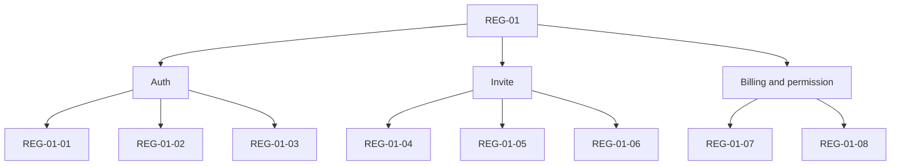

# P0 Critical Regression Pack

> Phase window: 2026-03-27 to 2026-04-09
> Frozen on: 2026-03-13
> Pack ID: `REG-01`

---

## 1. Pack Purpose

This pack covers the first release-blocking business backbone:

- auth recovery
- MFA policy enforcement
- invite redeem and activation
- team invitation accept
- billing and credit mutations
- owner/member boundary enforcement

Current state:

- manual specification exists
- automation mapping exists
- runnable product suite does not exist yet

## 2. Pack Map

```text
REG-01
======

Auth
  -> REG-01-01 password reset link opens usable recovery form
  -> REG-01-02 password reset commits new password
  -> REG-01-03 MFA-required user is redirected on every protected route

Invite
  -> REG-01-04 new eligible account redeems invite successfully
  -> REG-01-05 reused code / reused account is rejected
  -> REG-01-06 active team invitation joins correct team

Billing and permission
  -> REG-01-07 team owner can mutate billing
  -> REG-01-08 team member cannot mutate billing
```



## 3. Test Case Matrix

| Case ID | Flow | Intent | Current execution mode | Future automation | Linked bug |
|---|---|---|---|---|---|
| `REG-01-01` | Forgot password -> reset page | verify recovery link yields a usable reset screen | Manual only | Playwright + mailbox fixture | `BUG-0001` |
| `REG-01-02` | Reset password -> sign in with new password | verify password update actually completes recovery | Manual only | Playwright + seeded auth account | `BUG-0001` |
| `REG-01-03` | MFA-required account opens protected routes | verify dashboard, team, locale, doc, canvas all redirect to phone verification | Manual only | Playwright multi-route spec | `BUG-0003` |
| `REG-01-04` | Invite redeem success | verify eligible account receives credits and dashboard success handoff | Manual only | Playwright + seeded new account | none |
| `REG-01-05` | Invite redeem rejection | verify used code, inactive code, and already-redeemed account are blocked | Manual only | Playwright + API seed hooks | none |
| `REG-01-06` | Active team invitation accept | verify token lookup joins the target team and lands on correct slug | Manual only | Playwright + seeded invitation token | none |
| `REG-01-07` | Team owner billing mutation | verify owner can create checkout/portal session and purchase credits | Manual only | Playwright + API assertion hooks | none |
| `REG-01-08` | Team member billing mutation denial | verify member receives 403 on checkout/portal/cancel/reactivate/purchase | Manual only | Playwright + API assertion hooks | `BUG-0002` |

## 4. Manual Run Contract

### Required identities

- `personal free`
- `team owner`
- `team member`

### Required fixtures

- valid reset-email mailbox
- invite code that is active and unused
- invite code that is already used
- active team invitation token
- one team workspace with both owner and member

### Required artifacts

- screenshot for every failure
- network trace for billing and invite mutations
- video or trace for auth recovery and MFA redirects

## 5. Blocking Conditions

The pack is not release-grade until all of the following are true:

1. Playwright project exists in the repository.
2. Seed and reset fixtures are scriptable.
3. `REG-01-01` through `REG-01-08` are runnable in CI.
4. `BUG-0001` and `BUG-0002` are fixed and verified.

## 6. Verdict

- Exists: yes, as a frozen manual specification
- Runnable: no
- Gate impact:
  - Phase 2 audit evidence exists
  - Phase 2 release-grade exit gate is still blocked
