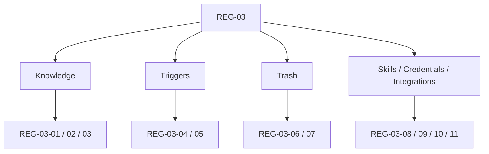

# REG-03 Support Surface Regression Pack

> Phase owner pack for Phase 4
> Status at definition time: manual specification only

---

## 1. Purpose

This pack covers the support surfaces that influence deeper product trust after the core editors:

- knowledge
- triggers
- trash
- skills
- credentials
- integrations

It exists to convert Phase 4 findings into repeatable smoke coverage, with special emphasis on workspace scope truth and support-surface correctness across pagination, wrappers, and external integrations.

## 2. Pack Map

```text
REG-03
======

Knowledge
  REG-03-01 dashboard knowledge panel respects active workspace scope
  REG-03-02 knowledge manager upload / preview / summary edit smoke
  REG-03-03 dashboard knowledge view-all preserves route scope

Triggers
  REG-03-04 trigger detail deep link preserves personal / locale / team scope
  REG-03-05 trigger create + close-panel URL synchronization smoke

Trash
  REG-03-06 trash restore / batch delete / search smoke
  REG-03-07 trash node-count sort remains globally correct across pages

Skills and integrations
  REG-03-08 skills marketplace search / install / import smoke
  REG-03-09 credentials refresh-state smoke
  REG-03-10 Obsidian import / export job smoke
  REG-03-11 OpenClaw owner/member gating and rollback smoke
```



## 3. Detailed Cases

| Case ID | Surface | Scenario | Bug Link | Priority | Automation Target |
|---|---|---|---|---|---|
| `REG-03-01` | Knowledge | open personal and team dashboards, confirm recent files and quick-upload folders only reflect the active workspace | `BUG-0008` | Must | Playwright |
| `REG-03-02` | Knowledge | upload file, open preview, edit summary, move entry, and confirm full knowledge page remains workspace-scoped | none | High | Playwright |
| `REG-03-03` | Knowledge | from team dashboard knowledge panel click view-all and confirm route stays `/team/[slug]/knowledge` | `BUG-0008` | Must | Playwright |
| `REG-03-04` | Triggers | open trigger detail from personal, locale, and team routes and confirm URL preserves current route scope while adding/removing `trigger_id` | `BUG-0007` | Must | Playwright |
| `REG-03-05` | Triggers | create schedule/event trigger, close detail panel, refresh, and confirm URL state and selected trigger remain coherent | none | High | Playwright |
| `REG-03-06` | Trash | search, restore, batch restore/delete, purge expired, and empty trash with state refresh validation | none | High | Playwright |
| `REG-03-07` | Trash | create more than one page of trashed canvases with varying node counts and verify `Nodes` sort is globally correct across pagination | `BUG-0009` | Must | Playwright |
| `REG-03-08` | Skills | search marketplace, filter by category, install marketplace skill, import custom skill, and verify installed view refreshes | none | High | Playwright |
| `REG-03-09` | Credentials | load credentials page with integrations enabled, refresh auth configs and connected toolkits, confirm error-free list transitions | none | Medium | Playwright |
| `REG-03-10` | Obsidian | create import job, upload payload, commit, create export job, poll status, and download zip through the proxy route | none | High | Playwright |
| `REG-03-11` | OpenClaw | compare owner vs member access to settings, capability toggles, and rollback controls | none | High | Playwright |

## 4. Required Fixtures

- `personal_support`
- `team_owner_support`
- `team_member_support`
- one user with access to both personal and team workspaces
- seeded knowledge entries in at least two workspaces
- seeded trash collection larger than one page with varied `node_count`
- one installable marketplace skill and one importable custom skill
- one credentials-enabled environment with integrations flag on
- one Obsidian fixture vault
- one OpenClaw workspace with activity history that includes rollback-capable rows

## 5. Exit Rule

`REG-03` is not green until:

- `BUG-0007` has scope-preserving trigger detail evidence on team and locale routes
- `BUG-0008` has workspace-safe knowledge dashboard evidence
- `BUG-0009` has multi-page sort-order evidence
- support-surface smoke cases are runnable from seeded fixtures instead of static reasoning only
