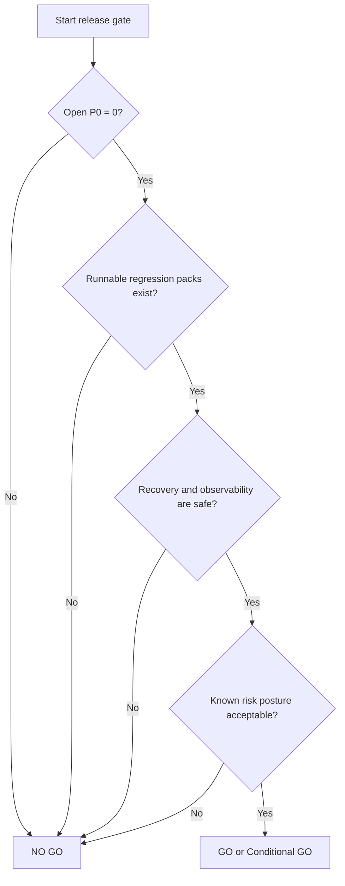

# Final Release Gate

> Phase window: 2026-07-10 to 2026-07-16
> Documentation executed on: 2026-03-13
> Program mode: Stable Baseline

---

## 1. Gate Decision

| Field | Value |
|---|---|
| Gate result | `NO GO` |
| Open `P0` count | `5` |
| Open `P1` count | `10` |
| Runnable product regression packs | `0` |
| Missing resilience pack | `REG-06` |
| Decision owner lane | QA + product + platform |

## 2. Decision Logic

```text
Release gate logic
==================

Rule 1
  No open P0
  -> FAILED

Rule 2
  No untriaged P1
  -> PASSED, but 10 triaged P1 still remain

Rule 3
  Core paths must have durable regression coverage
  -> FAILED
  REG-01 to REG-05 are manual only
  REG-06 is missing

Rule 4
  Recovery and observability must be safe
  -> FAILED
  Mobile recovery truth is broken
  Mobile logs leak token-bearing and private data

Rule 5
  Public/mobile/content integrity must be release-acceptable
  -> FAILED
  Locale, docs integrity, and mobile share gaps remain open
```



## 3. Rule Evaluation

| Gate rule | Target | Current state | Status | Primary evidence |
|---|---|---|---|---|
| `GR-01` No open `P0` | `0` open `P0` | `BUG-0001`, `BUG-0002`, `BUG-0004`, `BUG-0013`, `BUG-0022` remain open | Fail | `docs/qa/bug-register.md` |
| `GR-02` No untriaged `P1` | `0` untriaged `P1` | all `P1` findings are triaged, but 10 remain open | Pass with caution | `docs/qa/bug-register.md` |
| `GR-03` Durable regression coverage | critical packs runnable | `REG-01` to `REG-05` are manual-only and `REG-06` is missing | Fail | `docs/qa/regression-status.md` |
| `GR-04` Recovery truth and observability | safe runtime recovery and redacted telemetry | `BUG-0021`, `BUG-0022`, `RISK-0014`, `RISK-0015` | Fail | `docs/qa/audits/resilience-recovery-audit.md`, `docs/qa/open-risk-register.md` |
| `GR-05` Content and locale integrity guarded | no visible corruption + source guard | `BUG-0016` and `RISK-0013` remain open | Fail | `docs/qa/audits/public-content-surface-audit.md`, `docs/qa/open-risk-register.md` |
| `GR-06` Public/mobile parity acceptable | no material outward-facing divergence | `BUG-0015`, `BUG-0019`, `BUG-0021` remain open | Fail | `docs/qa/bug-register.md` |

## 4. Release Blockers

### Blocking defects

- `BUG-0001` reset-password recovery is brittle
- `BUG-0002` billing mutations allow member-level overreach
- `BUG-0004` canvas undo/redo is not durably truthful
- `BUG-0013` Prompt Studio backend lacks admin-role enforcement
- `BUG-0022` mobile production logging leaks tokens and private content

### Blocking system gaps

- `REG-01` to `REG-05` exist only as manual packs
- `REG-06` does not exist yet
- `RISK-0006` fixture reproducibility is unresolved
- `RISK-0014` and `RISK-0015` leave resilience incidents under-instrumented and under-tested

## 5. Forced-Release Consequences

| If shipped anyway | Likely consequence |
|---|---|
| open `P0` auth/billing/save/admin/security issues | release can fail on account access, billing integrity, editor durability, or unauthorized admin exposure |
| mobile log-leak defect remains | credentials and private content can enter production logs |
| manual-only regression packs remain | fixes cannot be trusted to stay fixed across subsequent merges |
| resilience pack remains missing | disconnect/recovery regressions can reappear without any executable gate |

## 6. Re-open Gate Requirements

The release gate can only be reopened after all of the following are true:

1. All open `P0` bugs are fixed and regressed.
2. `REG-06` exists and is executable.
3. At minimum, `REG-01`, `REG-02`, `REG-05`, and `REG-06` have runnable coverage on representative environments.
4. Mobile logging is redacted, dev-gated, and verified not to emit tokens or private payloads.
5. The team reruns the full gate using the final candidate build rather than static code review alone.
