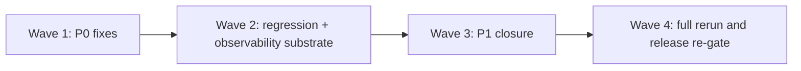

# Next-Cycle Quality Backlog

> Phase window: 2026-07-10 to 2026-07-16
> Documentation executed on: 2026-03-13
> Goal: define the robust path from current `NO GO` posture to a re-opened release gate

---

## 1. Recommended Workstream Order

```text
Robust path to GO
=================

Wave 1
  Release blockers
  -> close all open P0s
  -> remove token/content logging

Wave 2
  Runtime safety substrate
  -> observability
  -> fixture reset
  -> REG-06
  -> UTF-8/content guards

Wave 3
  High-risk P1 closure
  -> core recovery and public/mobile parity

Wave 4
  Closure rehearsal
  -> rerun packs
  -> verify waivers
  -> final gate re-open
```



## 2. Backlog Waves

| Wave | Target outcome | Primary contents | Exit criteria | Robust duration |
|---|---|---|---|---|
| `W1` | remove release blockers | `BUG-0001`, `BUG-0002`, `BUG-0004`, `BUG-0013`, `BUG-0022` | `P0` count reaches `0` | 2-3 weeks |
| `W2` | make recovery measurable and safe | `REG-06`, telemetry/breadcrumbs, fixture reset automation, UTF-8/content gate | resilience and integrity substrate is executable | 2-3 weeks |
| `W3` | close high-risk outward and mobile gaps | `BUG-0021`, `BUG-0015`, `BUG-0016`, `BUG-0019`, remaining core/public `P1` defects | no high-risk path lacks owner, fix, and regression | 2-3 weeks |
| `W4` | re-open release gate | full pack rerun, waiver review, final candidate validation | final release gate can be re-evaluated | 1-2 weeks |

## 3. Detailed Backlog

### Wave 1 - Release Blockers

| Priority | Item | Linked IDs | Required proof |
|---|---|---|---|
| `1` | Fix mobile logging leak and strip production debug payloads | `BUG-0022` | code diff + negative log proof on representative mobile build |
| `2` | Add admin-role enforcement to Prompt Studio backend | `BUG-0013` | authz tests + API-level regression |
| `3` | Fix billing owner/member mutation boundary | `BUG-0002` | role-matrix regression proof |
| `4` | Fix reset-password recovery-state truth | `BUG-0001` | recovery-flow regression proof |
| `5` | Fix canvas undo/redo durability gap | `BUG-0004` | refresh-persistence regression proof |

### Wave 2 - Runtime Safety Substrate

| Priority | Item | Linked IDs | Required proof |
|---|---|---|---|
| `1` | Create executable `REG-06` resilience pack | `RISK-0015`, `BUG-0021`, `BUG-0022` | runnable mobile/web recovery suite |
| `2` | Add structured redacted breadcrumbs for thread/run recovery | `RISK-0014` | captured incident payload example without secrets |
| `3` | Implement deterministic fixture seed/reset for QA | `RISK-0006` | documented reset command + repeatable dataset |
| `4` | Add UTF-8/content-integrity validation to CI | `RISK-0013`, `BUG-0016` | failing check on corrupted fixture |
| `5` | Freeze performance budgets for long thread/tool/content | `RISK-0016` | benchmark file and agreed thresholds |

### Wave 3 - High-Risk P1 Closure

| Priority | Item | Linked IDs | Required proof |
|---|---|---|---|
| `1` | Fix mobile stream terminal-state truth | `BUG-0021` | disconnect/failure/stop recovery suite |
| `2` | Fix locale public route truth | `BUG-0015` | locale navigation regression |
| `3` | Repair public docs/locale asset corruption | `BUG-0016` | readable asset proof + integrity gate |
| `4` | Align mobile share with web thread-share contract | `BUG-0019`, `BUG-0020` | mobile create/reopen/remove regression |
| `5` | Close remaining core/web `P1` defects by domain owner | `BUG-0003`, `BUG-0005`, `BUG-0006`, `BUG-0007`, `BUG-0008`, `BUG-0010` | updated bug status + regression mapping |

### Wave 4 - Closure Rehearsal

| Priority | Item | Required proof |
|---|---|---|
| `1` | rerun `REG-00` through `REG-06` | recorded execution and pass/fail evidence |
| `2` | review every remaining open risk for waiver or closure | signed-off known-risk register |
| `3` | reissue final release gate | `GO`, `Conditional GO`, or repeated `NO GO` with fresh evidence |

## 4. Practical Outcome

If a dedicated cross-functional team runs these waves in parallel where dependencies allow, the robust re-gate path is:

- best case: 7 weeks
- safer planning baseline: 9 weeks

That estimate assumes:

- no new feature scope is added
- blocker fixes are not repeatedly reopened
- automation and observability work are staffed in parallel with product fixes
