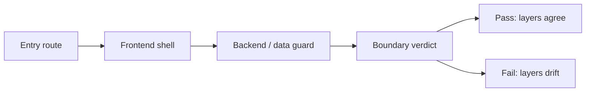

# Permission Boundary Matrix

> Phase 5 source-of-truth boundary map
> Frozen on: 2026-03-13
> Scope: team, share, admin

---

## 1. Boundary Model

```text
Boundary stack
==============

Entry route
  -> what path or control brings the user in

Frontend shell
  -> what UI is rendered before mutation

Backend / data guard
  -> what actually authorizes read or write

Decision
  -> pass when all three agree
  -> fail when route, shell, and backend truth diverge
```



## 2. Role Legend

| Role label | Meaning |
|---|---|
| `Anonymous` | no authenticated session |
| `Authenticated` | signed-in user without admin role |
| `Team member` | non-owner member inside a shared account |
| `Team owner` | owner inside a shared account |
| `Admin` | user with `admin` role |
| `Super admin` | user with `super_admin` role |

## 3. Matrix

| Surface | Audit ID | Entry path / control | Intended roles | Frontend boundary | Backend / data boundary | Verdict | Linked bug / note |
|---|---|---|---|---|---|---|---|
| Team switch | `BND-01` | team picker -> `/team/[slug]/settings` | `Team owner`, `Team member` | no role split before entering settings | settings writes remain owner-only deeper in stack | Fail | `BUG-0010` |
| Team settings rename / slug | `BND-02` | `/team/[slug]/settings` | `Team owner` | edit forms always render | `update_account()` is owner-only | Fail | `BUG-0010` |
| Team URL copy | `BND-02` | team settings copy button | `Team owner`, `Team member` | copies root-slug URL | route truth lives under `/team/[slug]/...` | Fail | `BUG-0011` |
| Team members directory | `BND-03` | team settings members card | `Team owner` | card mounts for any member, errors are hidden | `get_account_members()` is owner-only | Fail | `BUG-0010` |
| Team invitations directory | `BND-04` | team settings members card | `Team owner` | create flow returns token but does not refresh shell | create/list/delete remain owner-only | Fail | `BUG-0012` |
| Share canvas | `BND-06` | `/share/canvas/[canvasId]` | `Anonymous`, `Authenticated`, `Team owner`, `Team member` when canvas is public | read-only canvas route | explicit public RLS on canvases / threads / messages | Pass | runtime smoke still needed |
| Share thread | `BND-07` | `/share/[threadId]` | `Anonymous`, `Authenticated`, `Team owner`, `Team member` when thread/project are public | read-only thread route | project / thread / message public-read policies | Pass | runtime smoke still needed |
| Admin audit | `BND-08` | admin submenu -> `/admin/audit` | `Admin`, `Super admin` | submenu hidden unless `user.isAdmin` | endpoint requires `require_admin` | Pass | no confirmed bug |
| Admin billing | `BND-09` | admin submenu -> `/admin/billing` | `Admin`, `Super admin` | submenu hidden unless `user.isAdmin` | routes require `require_admin` or `require_super_admin` | Pass | no confirmed bug |
| Admin invites | `BND-10` | admin submenu -> `/admin/invites` | `Admin`, `Super admin` | submenu hidden unless `user.isAdmin` | routes require `require_admin` | Fail | `BUG-0014` is UI-only interaction break |
| Prompt Studio | `BND-11` | admin submenu -> `/admin/prompts` | `Admin`, `Super admin` | submenu hidden unless `user.isAdmin` | backend only checks JWT auth | Fail | `BUG-0013` |

## 4. Boundary Conclusions

- Team surfaces currently fail mostly because the entry route and UI shell are broader than the real owner-only mutation boundary.
- Share surfaces passed static review because the public-read rules are expressed in RLS, not just in frontend conditionals.
- Admin surfaces split cleanly:
  - audit and billing are backend-protected
  - prompt studio is not

## 5. Follow-Up Rule

- Any future team / share / admin change must update this matrix if it alters:
  - the entry route
  - the roles allowed to see a shell
  - the backend dependency used for authorization
