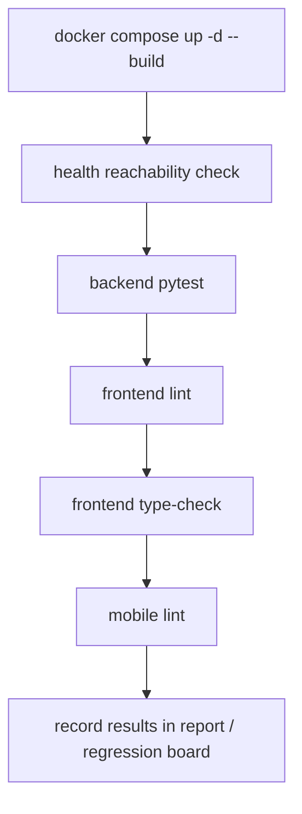

# Zmind Smoke Command Baseline

> Phase 1 owner document  
> Frozen on: 2026-03-13

---

## 1. Purpose

This document defines the minimum command baseline that must be runnable before a weekly audit wave is treated as active.

It is intentionally conservative:

- infrastructure boot
- backend integrity
- frontend static integrity
- mobile static integrity

It is not a substitute for feature regression.

---

## 2. Command Sequence

```text
Smoke sequence
==============

Step 1  Boot integrated stack
Step 2  Confirm service health / reachability
Step 3  Run backend baseline
Step 4  Run frontend baseline
Step 5  Run mobile baseline
Step 6  Store evidence and note failures
```



---

## 3. Frozen Commands

| Order | Command | Scope | Expected outcome | Failure meaning |
|---|---|---|---|---|
| 1 | `docker compose up -d --build` | Full-stack boot | All declared services start according to compose spec | Environment not audit-ready |
| 2 | `docker compose ps` | Service state snapshot | Containers visible and not crash-looping | Boot incomplete or dependency failure |
| 3 | `curl http://localhost:8013/api/health` or browser open | Backend reachability | Health endpoint responds | API unavailable |
| 4 | `curl http://localhost:6020/healthz` or browser open | Canvas realtime reachability | Health endpoint responds | Realtime path unavailable |
| 5 | `cd backend && uv run pytest -q` | Backend regression substrate | Pytest exits cleanly | Contracts/services not trustworthy |
| 6 | `cd frontend && npm run lint` | Frontend static integrity | ESLint exits cleanly | Obvious code quality regressions present |
| 7 | `cd frontend && npm run type-check` | Frontend type integrity | TypeScript exits cleanly | Route/component contract drift present |
| 8 | `cd apps/mobile && npm run lint` | Mobile static integrity | Expo lint exits cleanly | Mobile codebase not baseline-clean |

Stop rule:

- If boot fails, do not continue into feature audits pretending the product is healthy.
- If static integrity fails, feature findings must explicitly say they were collected on a dirty baseline.

---

## 4. Artifact Policy

| Artifact | Minimum requirement |
|---|---|
| Compose state | One `docker compose ps` snapshot or equivalent terminal record |
| Health checks | One success/failure note per endpoint |
| Static checks | Terminal output snippet or summarized status per command |
| Phase report | One summary entry linked into the weekly report |

Retention rule:

- Keep only audit-relevant artifacts.
- Delete temporary local caches or redundant scratch output after the phase concludes.

---

## 5. Execution Frequency

| Situation | Required? |
|---|---|
| Before starting a new phase | Yes |
| After major dependency or env changes | Yes |
| After only Markdown doc work | Optional |
| Before final closure | Mandatory |

---

## 6. Interpretation Rules

```text
Baseline interpretation
=======================

Green smoke
  Means the repo is fit for deeper auditing.

Red smoke
  Means findings may still be real,
  but the phase report must separate
  product bugs from environment instability.

Missing smoke
  Means the phase has weak verification credibility.
```

---

## 7. Current Baseline Assessment

Repository-backed baseline today:

- boot path exists in `docker-compose.yaml`
- backend verification command exists in `backend/pyproject.toml`
- frontend verification commands exist in `frontend/package.json`
- mobile verification command exists in `apps/mobile/package.json`

Missing today:

- project-level Web E2E smoke command
- project-level Mobile E2E smoke command

These two missing commands are Phase 1 design outputs and later implementation obligations.

---

## 8. Exit Decision

This baseline is frozen when every later phase refers back to this exact command list rather than inventing new ad hoc "quick checks."
