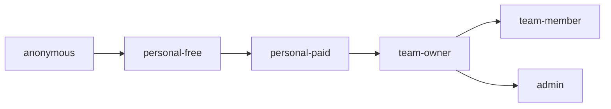

# Zmind Test Data Plan

> Phase 1 owner document  
> Frozen on: 2026-03-13

---

## 1. Purpose

This document freezes the identities and fixture sets used by the full-feature bug audit.

The goal is to prevent ad hoc testing with unknown accounts, unknown entitlements, and unknown data history.

---

## 2. Identity Model

```text
Identity hierarchy
==================

ID-A  anonymous
  no session
  public/share/auth gate coverage

ID-B  personal-free
  signed in
  no paid subscription
  standard personal workspace

ID-C  personal-paid
  signed in
  active paid subscription
  non-zero credits

ID-D  team-owner
  active team account
  owner role
  team billing + invite authority

ID-E  team-member
  active team account
  member role
  no owner-only actions

ID-F  admin
  platform operator role
  admin audit / billing / invites / prompt studio
```



---

## 3. Frozen Identity Contracts

| Identity ID | Role contract | Required entitlements | Primary audit waves | Must never be used for |
|---|---|---|---|---|
| `ID-A` | Anonymous visitor | No session, no account | Phase 2 auth entry, Phase 5 share exposure, Phase 6 public pages | Authenticated state assertions |
| `ID-B` | Personal free user | Personal workspace, no active paid plan, zero or low credit state allowed | Phase 2 billing edge, Phase 3 workspace, Phase 4 skills/knowledge | Team-owner permissions |
| `ID-C` | Personal paid user | Paid plan, positive credit balance, completed billing profile | Phase 2 subscription/credits, Phase 3 thread/canvas AI | Owner-only team actions |
| `ID-D` | Team owner | Team account, owner privileges, invitation creation, billing visibility | Phase 2 permission boundaries, Phase 5 team/share/admin-adjacent boundary checks | Admin-only routes |
| `ID-E` | Team member | Same team as `ID-D`, member privileges only | Phase 2 team invitation accept, Phase 5 owner/member boundary tests | Billing ownership or owner transfer |
| `ID-F` | Admin operator | Platform admin access, audit data visibility | Phase 5 admin audit, billing, invites, prompt studio | Customer-facing billing validation as a user |

Naming rule:

- Use semantic identity labels in evidence first.
- Real email addresses, phone numbers, or secret tokens should not be stored in QA docs.
- Secrets belong in environment stores, never in Markdown.

---

## 4. Fixture Sets

| Fixture ID | Fixture set | Required objects | Required states | Primary consumers |
|---|---|---|---|---|
| `FX-01` | Workspace baseline | 1 personal workspace, 1 team workspace, folder tree, mixed active/trashed items | empty, populated, recently modified, deleted/restorable | Phase 3 workspace, Phase 4 trash |
| `FX-02` | Canvas baseline | small canvas, dense canvas, shared canvas, draft-recovery candidate | clean save, unsaved draft, shared read-only, versioned | Phase 3 canvas, Phase 5 share canvas |
| `FX-03` | Doc baseline | short doc, long doc, doc with images, doc with ensured thread | autosave ready, upload-ready, AI-editable | Phase 3 doc |
| `FX-04` | Thread baseline | idle thread, active streaming thread, retryable failed thread, shared thread | empty, running, failed, completed, public-shareable | Phase 3 thread, Phase 5 share thread, Phase 6 mobile |
| `FX-05` | Knowledge baseline | nested folders, files of mixed types, searchable entries | previewable, movable, summarizable | Phase 4 knowledge, settings knowledge |
| `FX-06` | Trigger baseline | active trigger, paused trigger, failing trigger, deep-linkable trigger | create, edit, pause, resume, error | Phase 4 triggers |
| `FX-07` | Invite/share baseline | trial invite code, team invite, canvas invite, expired share, revoked share | valid, invalid, expired, redeemed | Phase 2 invite, Phase 5 share |
| `FX-08` | Billing baseline | free account, paid account, credit-depleted account, pending-payment account | upgrade path, purchase path, exhausted credits, grace/failure path | Phase 2 billing, Phase 3 AI gating |
| `FX-09` | Admin baseline | audit records, billing user records, invite QR asset, prompt versions | filterable, paginated, editable, rollbackable | Phase 5 admin |

---

## 5. Fixture Ownership Rules

| Rule | Decision |
|---|---|
| Identity reuse | Allowed only if the identity contract is unchanged and fixture reset is recorded |
| Share/invite tokens | Always treated as disposable artifacts tied to a fixture refresh cycle |
| Billing state | Must not be mutated casually during unrelated audits |
| Admin state | Must be isolated from personal/team routine audits |
| Mobile fixture data | Reuses web seed contracts; no separate mobile-only truth set unless mobile backend diverges |

---

## 6. Seed and Reset Strategy

Because the repository currently does not expose a committed, reproducible Supabase seed pack, Phase 1 freezes the strategy before implementation.

```text
Seed strategy
=============

Source of truth
  semantic fixture contracts in this file

Short-term execution
  controlled manual provisioning against a dedicated QA project

Medium-term required hardening
  scripted idempotent seed/reset commands
  deterministic fixture IDs
  one reset command per fixture family

Non-negotiable rule
  no deep audit may invent fixture state during testing
```

Recommended future seed units:

1. `seed-identities`
2. `seed-workspace-core`
3. `seed-canvas-doc-thread`
4. `seed-billing-states`
5. `seed-team-share-admin`
6. `reset-transient-artifacts`

---

## 7. Data Mutation Policy

| Mutation type | Allowed during audit? | Required action after audit |
|---|---|---|
| Read-only inspection | Yes | None |
| Soft-create disposable object | Yes | Delete or label disposable |
| Change persistent billing state | Only inside Phase 2 designated window | Reset before phase close |
| Change role / ownership | Only inside boundary audits | Reconcile before phase close |
| Admin prompt or invite asset changes | Only in isolated admin fixture space | Record exact rollback path |

---

## 8. Fixture-to-Phase Mapping

```text
Phase map
=========

Phase 2
  ID-A ID-B ID-C ID-D ID-E
  FX-07 FX-08

Phase 3
  ID-B ID-C ID-D ID-E
  FX-01 FX-02 FX-03 FX-04

Phase 4
  ID-B ID-C ID-D
  FX-05 FX-06 FX-01

Phase 5
  ID-A ID-D ID-E ID-F
  FX-07 FX-09 FX-02 FX-04

Phase 6
  ID-A ID-B ID-C
  FX-02 FX-04 FX-07
```

---

## 9. Evidence Requirements Per Identity

Every audit evidence block must declare:

- identity label
- fixture set labels
- whether state was pristine or mutated
- whether reset was completed

If any of these is missing, the finding is not audit-grade.

---

## 10. Exit Decision

Phase 1 data planning is considered frozen when:

- all six identities above are the only approved role baselines
- all fixture references use the frozen IDs
- no later phase invents a new billing/team/admin state without updating this file
