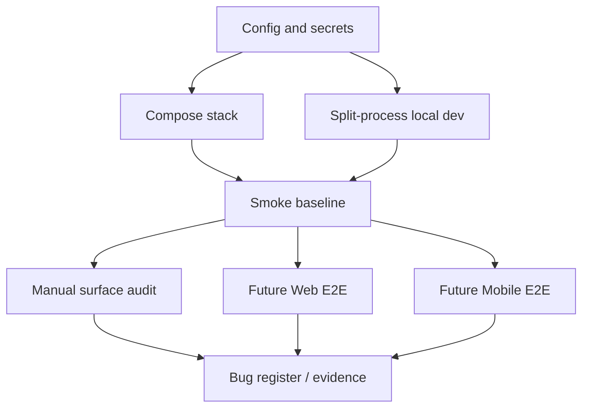

# Zmind Test Environment Matrix

> Phase 1 owner document  
> Frozen on: 2026-03-13  
> Program window reference: 2026-03-20 to 2026-03-26

---

## 1. Purpose

This document freezes the standard execution environments for the full-feature bug audit.

If a finding is reported without one of the environments below, the finding is not baseline-comparable.

---

## 2. Environment Topology

```text
Verification Substrate
======================

Layer 1  Bootstrap
  - backend/.env
  - frontend/.env.local
  - Redis
  - Supabase project access

Layer 2  Runtime
  - Docker Compose integrated stack
  - Local split-process stack
  - Expo mobile preview runtime

Layer 3  Verification
  - backend pytest
  - frontend lint
  - frontend type-check
  - mobile lint
  - future Web E2E
  - future Mobile E2E

Layer 4  Evidence
  - terminal output
  - screenshots / recordings
  - trace artifacts
  - bug register links
```



---

## 3. Standard Environments

| Env ID | Environment | Primary purpose | Required services | Entry command | Exit condition |
|---|---|---|---|---|---|
| `ENV-01` | Compose integrated stack | Cross-service smoke, route wiring, permission and billing review | `redis`, `backend`, `worker`, `outbox-relay`, `projection-worker`, `canvas-realtime`, `frontend` | `docker compose up -d --build` | All required containers healthy or started as designed |
| `ENV-02` | Split-process local web stack | Faster page and API debugging during deep audit | Redis, backend API, worker, canvas realtime, frontend | Run service-specific dev commands from repo root / service folders | Target route and its dependent services reachable |
| `ENV-03` | Backend verification shell | Contract, service, and persistence regression | Python 3.11+, `uv`, backend env | `cd backend && uv run pytest -q` | Test suite exits cleanly |
| `ENV-04` | Frontend verification shell | Static integrity for Next.js app | Node 18+/20+, frontend env | `cd frontend && npm run lint`, `cd frontend && npm run type-check` | Both commands exit cleanly |
| `ENV-05` | Mobile verification shell | Static integrity for Expo app | Node 18+/20+, Expo deps, mobile env | `cd apps/mobile && npm run lint` | Command exits cleanly |
| `ENV-06` | Future Web E2E runner | Browser regression of critical web flows | `ENV-01` or `ENV-02` + Playwright browsers + seeded data | Planned in `web-e2e-adoption-plan.md` | Scenario, artifact, and trace all produced |
| `ENV-07` | Future Mobile E2E runner | Device regression of mobile core flows | Mobile app + emulator/simulator + seeded data | Planned in `mobile-e2e-adoption-plan.md` | Scenario, screenshot set, and run log all produced |

---

## 4. Runtime Service Matrix

| Service | Source of truth | Port | Needed for | Notes |
|---|---|---:|---|---|
| `frontend` | `docker-compose.yaml`, `README.md` | `3000` | Web route audit, share/public checks, browser automation | Uses `BACKEND_INTERNAL_URL=http://backend:8013/api` inside container |
| `backend` | `docker-compose.yaml`, `README.md` | `8013` | API health, auth, billing, workspace, admin, integrations | Reads `backend/.env` |
| `canvas-realtime` | `docker-compose.yaml`, `README.md` | `6020` | Canvas collaborative state and websocket path checks | Depends on Redis and backend env |
| `redis` | `docker-compose.yaml` | `6379` | Worker queues, realtime, async coordination | Shared dependency for multiple services |
| `worker` | `docker-compose.yaml` | N/A | Agent/background job flows | Needed for async paths to behave realistically |
| `outbox-relay` | `docker-compose.yaml` | N/A | Event relay / delivery side effects | Included in integrated smoke because event lag can masquerade as UI bugs |
| `projection-worker` | `docker-compose.yaml` | N/A | Projection/read model freshness | Needed for state projection consistency |

---

## 5. Verification Modes

| Mode | Trigger | What is allowed | What is not enough |
|---|---|---|---|
| `Smoke` | Before any phase audit starts | Startup, health, static checks, fast route sanity | Deep functional confidence |
| `Deep manual` | Surface-by-surface audit | Multi-role, multi-state, refresh/recovery inspection | Repeatable regression confidence |
| `Automated regression` | After high-value findings stabilize | Playwright / Maestro / pytest regression packs | Exploratory bug discovery alone |

---

## 6. Browser and Device Baseline

| Dimension | Baseline | Secondary | Deferred |
|---|---|---|---|
| Desktop browser | Chromium stable | Edge stable | Firefox stable |
| Apple browser class | WebKit via Playwright nightly lane | Safari manual spot check when available | None |
| Desktop screen | `1440x900` | `1920x1080` | Ultra-wide |
| Tablet / narrow web | `1024x768` responsive review | `820x1180` | None |
| Mobile phone | iPhone 15 / iOS 17 class | Pixel 8 / Android 14 class | Small legacy device class after baseline |

Decision:

- Baseline web automation optimizes for Chromium first.
- Cross-browser parity is a nightly concern, not a PR-blocking concern in the stable baseline.

---

## 7. Environment Readiness Rules

```text
Environment gate
================

A surface audit may start only when:
  [1] target runtime is reachable
  [2] target role identity is assigned
  [3] target fixture set is assigned
  [4] evidence destination is known

A phase gate may pass only when:
  [1] smoke baseline is frozen
  [2] verification commands are reproducible
  [3] open environment risks are explicit
  [4] future automation path is frozen
```

---

## 8. Current Repository Reality

Observed from repository configuration on 2026-03-13:

- Integrated Docker stack is defined and sufficient for full-stack smoke.
- Backend already has a meaningful pytest substrate.
- Frontend currently has lint and type-check, but no project-level app E2E runner.
- Mobile currently has lint only, with no project-level device automation runner.
- Repository does not currently expose a committed Supabase migration/seed pack that can serve as the audit's reproducible fixture source.

These observations are design inputs for the Phase 1 adoption plans, not closure criteria by themselves.

---

## 9. Exit Decision

Phase 1 environment matrix is considered frozen when:

- the environments above are the only allowed reporting baselines
- every later audit doc references one of these environments
- any deviation is called out explicitly in evidence
