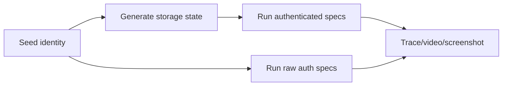

# Zmind Web E2E Adoption Plan

> Phase 1 owner document  
> Frozen on: 2026-03-13

---

## 1. Decision

Selected framework: `Playwright`

Decision type: stable-baseline primary framework for all future web product regression.

---

## 2. Why Playwright

| Option | Decision | Reason |
|---|---|---|
| Playwright | Select | Best fit for Next.js App Router, trace/video/screenshot artifacts, strong auth-state reuse, Chromium/WebKit coverage, fast CI ergonomics |
| Cypress | Reject for baseline | Better for component-heavy browser iteration, weaker fit for multi-tab/session/state capture strategy needed here |
| Pure manual only | Reject | Cannot convert high-value bugs into durable release confidence |

```text
Framework choice logic
======================

Need
  multi-role auth
  share/public pages
  trace artifacts
  browser matrix
  CI-ready execution

Playwright matches all five.
```

---

## 3. Scope Strategy

| Wave | Goal | Must-cover flows |
|---|---|---|
| `W-E2E-01` | Phase 2 protection | auth, reset password, invite redeem, team invitation accept, subscription gate, credit exhaustion dialog |
| `W-E2E-02` | Phase 3 protection | dashboard entry, workspace open/switch, canvas open, doc open, thread open, save/reload smoke |
| `W-E2E-03` | Phase 5-6 protection | share canvas, share thread, public pages, locale wrapper parity, responsive smoke |

PR baseline:

- Chromium only
- Small set of P0 routes

Nightly baseline:

- Chromium + WebKit
- broader boundary and public coverage

---

## 4. Proposed Directory Shape

```text
frontend/
  e2e/
    fixtures/
    helpers/
    specs/
      auth/
      billing/
      workspace/
      share/
    playwright.config.ts
```

File ownership rule:

- spec names must follow feature surfaces, not implementation details
- helpers must not hide role identity or fixture usage

---

## 5. Auth Strategy

Recommended baseline:

1. Seed a fixed QA user set outside the test itself.
2. Use Playwright storage state files per identity.
3. Refresh storage state via dedicated setup scripts, not inline per test.

Why:

- auth pages still need direct coverage for sign-in/reset flows
- most later tests should start already authenticated to reduce noise



Non-negotiable rules:

- never create production accounts during CI
- never bake secrets into test files
- role identity must be visible in test titles or metadata

---

## 6. Seeded Data Strategy

Because the repository does not currently include a committed seed pack, the adoption path must include one before Playwright becomes authoritative.

Required seed characteristics:

- idempotent
- deterministic object names and IDs where possible
- split by fixture family
- restorable between runs

Minimum seed packs before `W-E2E-01`:

| Seed pack | Needed for |
|---|---|
| `seed-identities` | role login state |
| `seed-invites-billing` | Phase 2 auth/invite/billing |
| `seed-workspace-core` | Phase 3 workspace/canvas/doc/thread |

---

## 7. Artifact Capture Standard

| Artifact | Requirement |
|---|---|
| Screenshot | On failure, automatic |
| Video | On first retry or failure |
| Trace | Mandatory for all critical-flow specs |
| Console log | Attach on failure |
| Network / API note | Attach for permission/billing/share failures |

Artifact retention priority:

1. trace
2. failure screenshot
3. failure video
4. terminal summary

---

## 8. CI Strategy

```text
CI lanes
========

Lane A  PR smoke
  Chromium
  W-E2E-01 subset
  block merge on red

Lane B  nightly full web
  Chromium + WebKit
  W-E2E-01 to W-E2E-03
  produce artifact bundle

Lane C  release candidate
  full critical pack
  manual review of waived items
```

Decision:

- stable baseline does not wait for a giant all-browser matrix before starting
- it freezes the smallest serious lane first

---

## 9. Risks and Dependencies

| Dependency | Status | Effect |
|---|---|---|
| Seed/reset scripts | Missing | Blocks authoritative E2E repeatability |
| Stable auth bootstrap | Missing | Blocks low-noise multi-role testing |
| Artifact storage convention | Defined in plan, not yet implemented | Needed before CI usefulness is real |

---

## 10. Approval Gate

Phase 1 treats Web E2E adoption as approved when:

- Playwright is the frozen framework choice
- auth strategy is fixed
- seed strategy is fixed
- artifact policy is fixed
- CI lane structure is fixed

Implementation begins in later phases, but the decision must not reopen casually.
